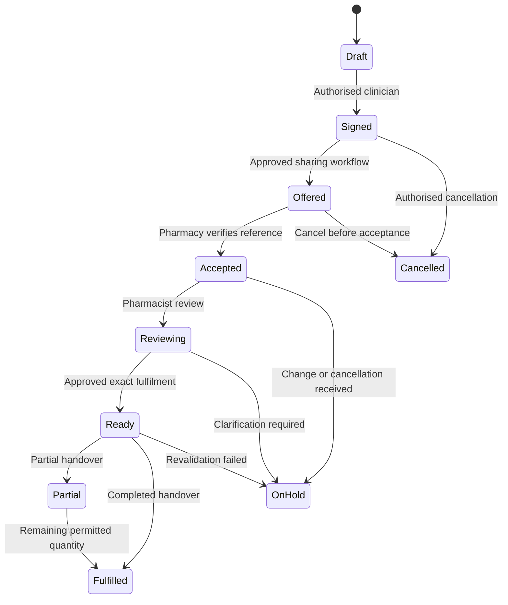
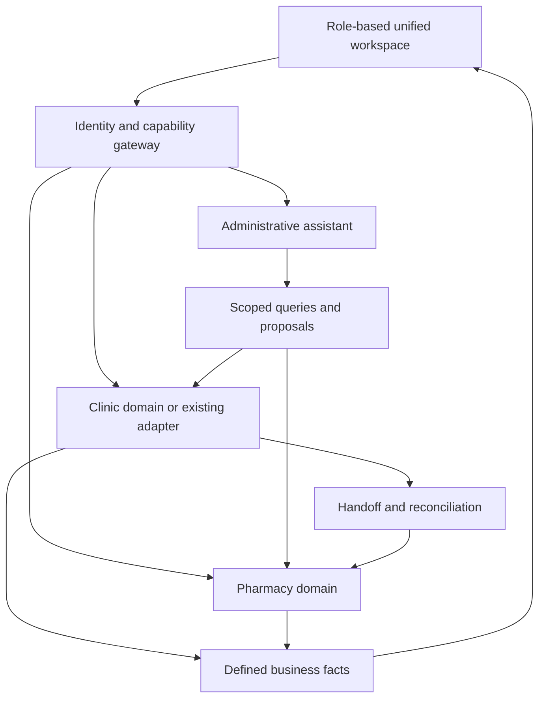
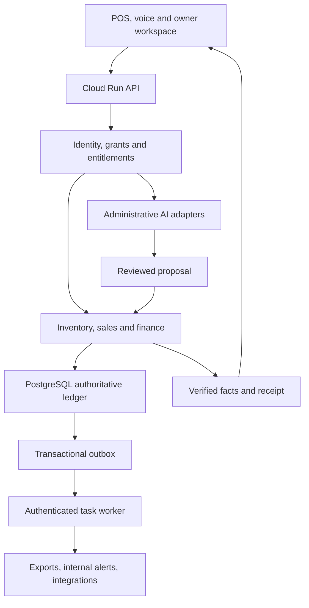

# RaOne Healthcare Management System — Product, Engineering & Delivery Master Plan

**Version:** 2026-11-19 v1.0  
**Repository:** https://github.com/ravanatech-official/RaOne-Healthcare-Management-System  
**Working product name:** SuwaSeva — Modular Clinic + Pharmacy ERP  
**Launch target:** 2026-12-01, supervised and acceptance-gated  
**Document type:** Requirements, proposed architecture, source-reported progress, implementation backlog, ten-level commercial roadmap and engineering execution instructions. **Not a certification or a completed-code audit.**

## Navigation

- [A. Current decisions and evidence](#a-current-decisions-and-evidence)
- [B. Next implementation slices](#b-next-implementation-slices)
- [C. Enhanced engineering and commercial contract](#c-enhanced-engineering-and-commercial-contract)
- [D. Git Bash publication runbook](#d-git-bash-publication-runbook)
- [E. Unified clinic and pharmacy blueprint](#e-unified-clinic-and-pharmacy-blueprint)
- [F. Remaining modules and expansion roadmap](#f-remaining-modules-and-expansion-roadmap)
- [G. Google AI Studio execution prompt](#g-google-ai-studio-execution-prompt)

## A. Current decisions and evidence

### A1. ප්‍රධාන අරමුණ

**“ඔබට හුරු භාෂාවෙන් කතා කරලා ඔබේ clinic සහ pharmacy ව්‍යාපාරයේ appointments, පැමිණීම්, තොග, විකුණුම්, ගෙවීම් සහ දෛනික reports කළමනාකරණය කරන්න. ඔබට අවශ්‍ය modules පමණක් තෝරාගන්න.”**

System එකේ වෙනස AI chat box එකක් තිබීම නොවේ. Staff member කෙනෙකුට තමන් කරන්න හදන වැඩේ කියලා, නිවැරදි record එක හඳුනාගෙන, පැහැදිලි preview එක බලලා, අවශ්‍ය අනුමැතිය දී, වැඩේ සැබෑ database එකේ සම්පූර්ණ වූ බව reference එකක් සමඟ දැනගන්න හැකි විය යුතුයි. Read-only business reports වලට timestamp, scope, calculation definition සහ source drill-down තිබිය යුතුයි.

මෙය ownerගේ ව්‍යාපාරික කළමනාකරණය සරල කරන product එකක්. Pharmacist/clinician professional qualification සහ අත්‍යවශ්‍ය training වෙනුවට AI යොදන්නේ නැහැ. Universal language, unlimited scale, zero training and fully autonomous healthcare remain aspirations, not advertised verified capabilities.

### A2. Authority and changes from earlier plans

1. Current owner instructions govern scope. This document Part A–D resolves inconsistencies in the inherited sections below.
2. Current product is modular **clinic + pharmacy coexistence**, not deletion/replacement of a functioning clinic. Four independently usable modes: clinic_only, pharmacy_inventory_only, pharmacy_retail_only, combo.
3. Preserve the reported **Express + Vite + React + PostgreSQL** implementation if confirmed in source. Do not migrate Express to Fastify merely because an older architecture table proposed Fastify.
4. Existing source schema, migration history and lockfile determine actual implementation. Proposed entity names are not permission to duplicate authoritative tables.
5. Latest source narrative reported only foundation and Pharmacy Phase 1 completion; clinic write/POS/recovery/browser gates remain pending. An earlier claim that the clinical system was complete is not proof that the external EHR is present in this repository.
6. The prior roadmap incorrectly inferred 38 tables. Recounting the supplied named list gives **17 core + 20 pharmacy = 37**. This corrects the documentation error, but does not independently verify a live database.
7. December 1 is a gated pilot target, not a promise to finish all future modules. On November 19 there are 12 calendar days until that date.
8. Current provider model IDs, SDK compatibility, prices, legal applicability and region availability require verification at implementation. Do not hard-code an unverified model name from a status narrative.
9. Inherited source-reference dates describe earlier research. This consolidation is not a fresh legal, service-pricing or provider-terms audit.

### A3. Evidence ledger as of this document

| Item | Evidence status | What can honestly be said |
|---|---|---|
| Windows project folder, source/docs/tests and configuration filenames | Screenshot observed | Project files appear locally; contents not available to this documentation pass |
| GitHub destination | Connector observed | Public repository, main default branch, readable README and push permission at inspection |
| Express, React, Firebase Auth, PostgreSQL, 37 tables | Source-reported | Obtain commit and schema evidence before declaring verified |
| Typecheck/build and 14 integration tests | Source-reported pass | Not rerun by this documentation task; associate logs with commit and test environment |
| Real Firebase login browser E2E | Source reports NOT TESTED | Mandatory before pilot |
| Existing clinical EHR integration | Source reports BLOCKED | Need actual source/API and authority contract |
| Pharmacy POS, clinic write workflows, background worker | Source reports remaining | Must not be advertised as complete |
| All future module cards below | Proposed | Not implementation claims |

Implementation status vocabulary: PLANNED, IN_PROGRESS, OBSERVED_IN_CODE, VERIFIED_LOCAL, VERIFIED_STAGING, PILOT_ACCEPTED, BLOCKED. Each status needs commit, evidence, environment, owner and last-checked timestamp. A passing build cannot promote a workflow to PILOT_ACCEPTED.

### A4. Reported data inventory

Core 17: users, tenants, branches, memberships, tenant_capabilities; services, resources, people, appointments; charges, payments, payment_allocations, receipts; action_proposals, commands, audit_events, outbox_events.

Pharmacy/shared 20: legal_entities, departments, counters, professional_grants; products, pack_variants, uom_conversions, barcode_aliases; suppliers, storage_locations; lots, cost_layers, inventory_balances, stock_movements, stock_reservations; goods_receipts, goods_receipt_lines, supplier_invoices, recalls, quality_holds.

Before migrations: extract actual table/constraint/index inventory from an authorised non-production database, identify migrations already applied, compare ownership and preserve data. Table existence alone proves neither API correctness nor tenant isolation.

## B. Next implementation slices

### B1. Order of work

| Slice | Build outcome | Minimum acceptance evidence |
|---|---|---|
| S00 Source import and reproducibility | Repository has real source, lockfile, safe configuration example, scripts and requirement map | Clean checkout setup; inspect scripts before executing; no secrets or patient data in git |
| S01 Capability-aware experience | Pharmacy-only home; tenant/branch switch; complete Sinhala copy; appropriate empty states | Four modes, role changes, cache isolation and direct route tests |
| S02 Identity/admin | Invites, memberships, branch access, professional grants, revocation and shared-terminal lock | Cross-tenant direct requests fail; revoked access cannot execute old proposals |
| S03 Clinic write slice | Person disambiguation; appointment booking/reschedule/cancel/attendance; proposal-command engine | Overlap race, failed reschedule preservation, no silent person merge |
| S04 Clinic money | Charges, allocations, receipts, authorised reversals/refunds | Exact fixture totals, no duplicate collection, reconciled shift and report |
| S05 Pharmacy usability | Multiline GRN, variants/barcodes, expiry/quality UI | Multiple lines and bonus units; idempotent retry; no invoice-created stock |
| S06 Pharmacy POS | Exact product/cart, eligible FEFO, professional clearance, tender, immutable receipt | Last-unit race; recall race; changed cart invalidates approval; no negative stock |
| S07 Returns/cash/counts | Quarantine returns; capped refund; till close; stocktake | Refund replay; cash change; count concurrent with sale; historical cost policy |
| S08 Business assistant | Scoped reports, safe stock queries, previewed administrative actions | Native Sinhala/Singlish tasks, numerical grounding, provider outage fallback |
| S09 Operations | Worker, exports, monitoring, backups/restore, CI and deployment | Duplicate delivery, quarantine restore, safe export, deployment rollback |
| S10 Pilot decision | Selected bundle rehearsed by actual users | Recorded acceptance, defects, support owner and go/no-go |

Do not start all slices concurrently if one person is implementing. Deliver a tested vertical workflow, then expand. If the pharmacy retail gates miss the date, sell only the accepted inventory or clinic administrative bundle and state the limitation explicitly.

### B2. Proposed November 19–December 1 working schedule

| Dates, Asia/Colombo | Focus | Decision |
|---|---|---|
| Nov 19–20 | Import, dependency/scripts audit, baseline tests, choose one pilot mode | Freeze scope and identify actual blockers |
| Nov 21–24 | Complete selected core writes, stock/money invariants, roles | Drop optional scope instead of bypassing safety |
| Nov 25–27 | Sinhala experience, reports, worker, real auth E2E and hardware | Confirm real user workflow |
| Nov 28–29 | Trial import, concurrency, recovery, native pilot rehearsal | Evidence-based release candidate |
| Nov 30 | Freeze, defect review, support/rollback rehearsal | Go/no-go |
| Dec 1 | Supervised release of accepted scope | Observe reconciliation and user problems |

This is a planning allocation, not an effort estimate validated against code. No complete EHR, laboratory, inpatient or multinational launch is implied.

## C. Enhanced engineering and commercial contract

### C1. System architecture and ownership

A modular monolith is the initial default: browser → authenticated Express API → domain command/query services → PostgreSQL. Worker processes transactional outbox after commit. Private object storage holds approved uploads/exports; model adapter receives only allowed minimum context. Shared infrastructure does not imply shared permissions between departments or tenants.

- Frontend: React/TypeScript/Vite, accessible components, i18next/Intl, TanStack Query. Use existing compatible dependencies, route guards for UX and server checks for security.
- Backend: preserve Express; schemas validate untrusted inputs; domain services own rules; adapters own external SDK calls. Separate readiness from liveness and boot migrations from request handling.
- Database: PostgreSQL is stock/finance/appointment authority. Every tenant-scoped query, mutation, unique constraint and relation must have a reviewed tenant boundary. RLS is optional defence in depth with transaction-scoped tenant settings and non-bypass application roles, never a substitute for API checks.
- API: versioned REST/OpenAPI, opaque IDs, cursor pagination, bounded export jobs, structured error codes, correlation IDs, explicit idempotency contracts. Never trust tenant ID headers without membership checks.
- Realtime: authenticated SSE/WebSocket or polling for invalidation; events are hints to re-read authoritative state. Reconnect, deduplication, authorization changes and stale badges are necessary.
- Offline: allow clearly marked non-authoritative drafts; never silently commit stock, money or clinical instructions offline. Recover unknown command status before retrying.
- Automation: SQL outbox plus authenticated jobs, retry backoff/jitter, dead-letter review, leases and dedupe. Exactly-once business effect is a designed transaction/dedupe property, not an assumption about delivery.
- Files: file-type and size validation, malware scanning where applicable, private access, short-lived scoped delivery, retention and export audit. Uploaded document text is untrusted input to the assistant.

### C2. AI and familiar-language experience

For each request capture current actor, tenant, branch, locale, business date and enabled capabilities. Resolve user intent into a schema-constrained allowlisted tool call. Enforce permission and data minimisation before retrieval. Ambiguous identity/product/time/amount requires one clear question. Monetary calculations happen in deterministic code; model wording is optional.

Examples:

| User says | System behaviour | Completion proof |
|---|---|---|
| “අද ලැබුණු සල්ලි කීයද?” | Resolve date/branch; query collections, refunds and net separately | Timestamp, currency, scope and receipt drill-down |
| “හෙට හතරට appointment එකක් දාන්න” | Clarify person/service/resource; local date/time preview | Confirmed appointment ID or conflict with alternatives |
| “මේ මාසේ expire වෙන stock පෙන්වන්න” | Exact expiry query with eligibility/hold status | Lot list with as-of time; no clinical advice |
| “මේ bill එක ආපහු කරන්න” | Identify original sale; eligible quantities/refund ceiling; approval | Reversal/refund ID and quarantine return record |

Voice pipeline: visible recording state → transcription → visible editable transcript → intent resolution → deterministic preview → explicit approval when needed → authoritative execution → result card → optional speech. Interrupt speech safely; speaking “cancel” cannot imply reversal of a transaction already committed. Display posted status and offer an authorised corrective workflow.

Language evaluation records supported locale, browser/device, microphone, noise condition, task success, critical entity accuracy, amount/date errors, completion time and user assistance needed. Do not average away failures on medicine strength or money. Drug names and identifiers remain exact; translate surrounding explanation. Speech service support and contractual suitability must be confirmed for selected production endpoints.

### C3. Autonomy levels

| Level | Allowed examples | Authority |
|---|---|---|
| A0 Read | Daily totals, stock, expiry dashboards | Current permission and scoped tool |
| A1 Draft | Appointment proposal, PO draft, report explanation | No domain write until approved |
| A2 Confirmed action | Book, collect payment, post receiving | Bound preview, current access, idempotent command |
| A3 Preapproved routine | Scheduled owner digest, low-stock draft generation | Explicit policy, scope, budget, expiry, pause and audit |
| A4 Professional/high impact | Dispensing approval, clinical changes, major financial correction | Human professional/authorised approver; no autonomous model authority |

A routine must have trigger, actor/service identity, scope, limits, action schema, approval policy, retry semantics, expiry, kill switch, owner and evidence. Consent to one action is not permission for all future actions.

### C4. Transaction correctness

Authenticate and check current access; locate a committed matching command result before rejecting a consumed/expired one-time proposal; return the original result for an authorised exact replay. For a new command validate proposal binding, entitlements, versions and professional grants, acquire deterministic locks, apply domain changes and audit/outbox/result atomically, then print/speak after commit. Same key with different payload is a conflict.

FEFO first excludes expired/unknown-expiry/quarantined/recalled/ineligible lots, then selects earliest eligible expiry under locks. Recall and checkout share an authority/guard so a concurrent recall cannot be bypassed. Bounded retries address deadlocks and serialization failures; deterministic ordering does not prove deadlocks impossible.

Finance uses currency-aware integer minor units or exact decimal where required, with explicit rounding/version rules. Quantities and unit costs may need exact decimal or rational allocation; allocate residual minor units deterministically. No JavaScript floating-point totals for posted money. A payment allocated to two departments remains one receipt of cash, not two collections.

### C5. Security and production operations

Default-deny tenant and role access; professional grants separately verified; step-up for sensitive corrections; least-privilege service identities; server-only secrets; no Admin SDK credentials in browser bundles. Treat Firebase client configuration as public identifiers, not a replacement for access rules. App Check complements authentication and authorization.

Test tenant isolation on reads, writes, joins, search, reports, exports, jobs, cache keys and realtime channels. Avoid logging raw voice, patient notes, tokens or payment data. Give support staff time-bounded, approved access with audit. Do not disable safeguards for an unpaid subscription.

Use dev/staging/production separation, synthetic test data, reviewed additive migrations, migration locks and rollback/forward-fix plans. Cloud Run concurrency/max instances and SQL pool size must fit a shared connection budget; Cloud Shell is a development console, not the production runtime. A successful HTTP health check does not mean the database or worker is ready.

Observe business invariants as well as availability: duplicate command rate, stuck outbox, negative-stock attempts, unmatched allocations, refund anomalies, queue lag, failed permissions and stale projections. Set actual SLO/RPO/RTO targets with the pilot contract after measurement. Backups need tested isolated restores, reconciliation of recalls/revocations/deletions and suppression of old side effects before reopening.

### C6. Firebase and Google Cloud selection

Use capabilities because a tested requirement needs them, not because a catalogue contains them. Initial candidates: Firebase Auth, Hosting when suitable, private object storage, Cloud Run, Cloud SQL, Secret Manager, IAM, Artifact Registry, Cloud Logging/Monitoring, Tasks/Scheduler. Select one coherent job pattern.

Conditional: Identity Platform features, App Check, FCM, Remote Config for presentation rollout, Functions for narrow adapters, Firestore/Realtime Database only non-authoritative projections, BigQuery for governed analytics, Pub/Sub for justified fan-out, Memorystore for measured cache needs, Document AI for human-reviewed extraction, Cloud Healthcare API for governed exchange. Do not duplicate the financial ledger across Firebase databases.

Python belongs in evaluation/import tooling or justified specialist services. Rust belongs in a measured performance/device need. Neither is a prerequisite for shipping a reliable TypeScript product. Pin compatible supported dependencies after inspecting actual package scripts and bun.lock; do not introduce competing npm/pnpm/yarn lockfiles casually.

### C7. Subscription and feature economy

A billable capability record includes stable key, version, dependencies, permitted product modes, roles, quotas, price component, activation prerequisites and offboarding behaviour. Resolve dependency closure before quoting. Shared platform fee is charged once in combo. Mandatory tenant isolation, audit, expiry/recall protection, professional checks and ledger integrity are inseparable from affected modules.

Suggested revenue structure: base subscription + selected modules + branch/counter tier + transparently metered AI/messaging + agreed onboarding/import/integration/support. Quotes show every included dependency and recurring/nonrecurring amount. Pricing numbers remain commercial decisions pending actual costs and customer interviews.

Entitlement state: trial → active → grace → restricted administrative state → export/offboarding. Do not delete business records on failed payment. Enforce feature access at API/command time, not only sidebar visibility. Validate webhook signatures and deduplicate billing events; keep an auditable usage ledger and provider-reconciliation process. Voice quota exhaustion must leave contracted manual core workflows available.

### C8. Ten sellable maturity levels

| Level | Target client | Sellable increment | Promotion method and proof |
|---|---|---|---|
| 1 | One small clinic or pharmacy pilot | Accepted clinic/inventory/retail bundle; combo only if accepted | Founder demo with synthetic data; supervised paid pilot; exact scope |
| 2 | Growing single-site pharmacies | Procurement, purchase orders, supplier AP | Demonstrate reconciled receiving/invoices and owner time saved |
| 3 | Small chains | Branch/HQ controls, transfers | Demonstrate custody, branch permissions, measured concurrent workload |
| 4 | Clinic plus pharmacy operators | Validated handoff and partial fulfilment | Joint clinician/pharmacist demo; source cancellation-race evidence |
| 5 | Businesses with accountants | Accounting exports, settlement and close | Accountant-reviewed reconciliation and scoped integration pilot |
| 6 | Storage-sensitive operations | Quality workflows and cold chain | Exception drill, device evidence and traceability demonstration |
| 7 | Warehouses/larger chains | Replenishment, central inventory and capacity | Contracted workload benchmark and operational support evidence |
| 8 | Approved digital-service operators | Portal, online ordering and delivery | Authorised channel demo, privacy and fulfilment evidence |
| 9 | Healthcare groups | Enterprise identity, integrations and dedicated operations | Technical evaluation, recovery/identity evidence and support contract |
| 10 | New countries/languages | Validated local packs | Native task tests, local professional review and regional operations |

These are dependency-led releases, not ten arbitrary dates or income guarantees. Avoid testimonials without permission, spam outreach or claims of clinical efficacy. Track activation, time to first completed task, retention, support load, cost per tenant and gross margin before widening acquisition.

### C9. Definition of done for every module

A feature is delivered only when its requirement maps to screens, API, schema/migration, policy, audit/event, tests, documentation and release evidence. Include empty/loading/stale/error/permission-denied states; localisation; accessibility; import/export; retention; observability; support playbook and subscription dependency behaviour.

Required issue template: problem and user; source requirement ID; acceptance examples; entities owned; API contract; security boundary; concurrency/idempotency; migration/rollback; metrics; tests; evidence link; remaining limitations. Avoid percentages without a measurable denominator.

## D. Git Bash publication runbook

This runbook imports a source snapshot into a fresh clone. It preserves the original Windows folder and GitHub history. It does not migrate any old local Git history; that remains in the original folder if present. Do not use force push, delete .git, or merge unrelated histories to make errors disappear.

1. Verify the original path in Git Bash: `cd "/d/RavanaTec Projects/Ravana Healthcare Management System"`, then `pwd`, `git --version`, `ls`.
2. Clone the existing repository to a new sibling folder, e.g. `/d/RavanaTec Projects/RaOne-Healthcare-Management-System-GitHub`. If that destination exists, inspect it or choose a different empty destination; do not delete it.
3. Copy project source while excluding `.git`, dependency caches/build output, real environment files, credentials and business data. Do not copy an old master plan over this current document.
4. Append protective rules to `.gitignore` without destroying existing rules. Ignore patterns do not protect already-tracked files or secrets hard-coded into ordinary source files.
5. Review a placeholder-only `.env.example` locally before adding it. Review configuration/docs/test fixtures for credentials and real patient/business records. Retain the existing lockfile.
6. Stage, inspect changed filenames and full diff locally; do not publish credentials in screenshots or chat. Unstage suspicious files with `git restore --staged -- path` and remove secrets from the source copy before continuing.
7. Check git author; use the email or GitHub noreply address shown in the account's own Settings → Emails. Do not invent a numeric noreply ID. Git author identity and GitHub push authentication are separate.
8. Commit reviewed source, fetch/pull with fast-forward-only, push main if permitted, then compare local HEAD against remote main. If branch protection requires PR, push a named import branch and open a PR; do not disable protection.
9. A source upload is not deployment, not a test pass and not a production readiness claim. Review package scripts and environment before installing/running. Run tests only against an isolated authorised test database.

Official Git guidance: https://docs.github.com/en/migrations/importing-source-code/using-the-command-line-to-import-source-code/adding-locally-hosted-code-to-github and https://docs.github.com/en/get-started/git-basics/set-up-git .

## E. Unified clinic and pharmacy blueprint

The following detailed blueprint is retained with the current decisions above taking precedence. Its original date and research notes remain historical context. References to companion documents are fulfilled by Part G in this consolidated file. All module and acceptance IDs are retained for traceability.

## Clinic + Pharmacy ERP — Unified Product & Engineering Blueprint v1.0

**Prepared:** 2026-11-18 · Asia/Colombo  
**Product:** Modular Clinic + Pharmacy Business Platform  
**Target:** 2026-12-01 gated supervised pilot; not a delivery guarantee  
**Companion:** Clinic_Pharmacy_ERP_Google_AI_Studio_Master_Build_Prompt_v1.md  
**Evidence status:** Documents reviewed. Existing clinical system completion is user-reported; no application repository, deployment, clinical workflow or integration has been independently verified in this task.

### 1. ප්‍රධාන තීරණය: එක platform එකක්, වෙන්ව පාලනය වන modules

සුද්දා, clinic සහ pharmacy එකතු කිරීම ප්‍රයෝජනවත් product direction එකක්. Clientට **Clinic Only**, **Pharmacy Only**, **Clinic + Pharmacy Combo** හෝ පසුව **Multi-branch / Enterprise** තෝරාගත හැකි පරිදි ගොඩනඟමු. Shared login, workspace, task assistant සහ owner reports තිබුණත් clinical records, dispensing authority, stock සහ finance වල ownership/permissions පැහැදිලිව වෙන්ව තිබිය යුතුයි.

“Clinical system එක හදලා ඉවරයි” යන්න ඔයා ලබාදුන් project status එක ලෙස භාරගන්නවා. එය නැවත ලියන්න තීරණය කරන්නේ නැහැ. නමුත් කලින් documents clinical diagnosis engine එකක් සනාථ කරන්නේ නැහැ; ඒවායේ baseline එක clinic administration. සැබෑ code/release එක පරීක්ෂා කර **පවතින verified capabilities රැකගෙන** adapter හරහා integration කිරීම මෙහි මුල් ක්‍රියාවයි.

Maximum value යනු maximum services install කිරීම නොව, එකම patient journey එකේ නැවත data entry අඩුවීම, stock/money වැරදි වැළැක්වීම සහ ownerට නිවැරදි business තොරතුරු ලැබීමයි.

### 2. අලුත් tagline සහ සැබෑ experience contract

> **“ඔබට හුරු භාෂාවෙන් කතා කරලා ඔබේ clinic එකේ appointments, පැමිණීම් සහ ගෙවීම්ත්, pharmacy එකේ විකුණුම්, තොග සහ මිලදී ගැනීම්ත්—එකම platform එකකින් කළමනාකරණය කරන්න. ඔබට අවශ්‍ය modules පමණක් තෝරාගන්න.”**

Client experience: “අද clinic එකයි pharmacy එකයි කොහොමද?” → authorised branch/date/currency context → separate clinic charges/collections and pharmacy sales/collections → correctly consolidated totals → visible breakdown and fresh timestamp → optional exact Sinhala/English speech. No patient note or diagnosis is included merely because the owner requested business performance.

First-time administrative staff get examples, one-question-at-a-time clarification, large controls, scan/type/voice choice and easy repair. Pharmacist/clinician professional work still needs qualifications/training. “All languages/no training/any scale” remains vision until separately validated.

### 3. Source review and migration of requirements

Current attachments: Pharmacy Engineering Report v1(1), 58711 bytes, and Pharmacy AI Studio Prompt v1(1), 26230 bytes; verified byte-identical to previously reviewed originals. Earlier four healthcare files—v2, v3, v4 and healthcare master prompt—were previously read/reviewed in this conversation and compared for the pharmacy redesign. They are background, not evidence of deployed code.

| Source family | Retain | Replace / extend |
|---|---|---|
| Healthcare v2 | Accessible UX, basic clinic modules, feature packaging | Earlier auth ambiguity/financial definitions yield to v3 corrections |
| Healthcare v3 | Current permissions, replay ordering, exact financial corrections, restore quarantine | Extend to stock/professional/patient-sharing boundaries |
| Healthcare v4 | Stack/service selection, voice pipeline, CI/evidence | Bring clinic and pharmacy together with common platform ownership |
| Old healthcare prompt | Complete slices, actual tests/status | Replace clinic-only scope and build order |
| Pharmacy report/prompt | Lot/UOM/FEFO/POS/refund/recall controls | Remove pharmacy-only replacement instruction; add clinic coexistence and integration |

**Authority:** current user instructions → this combined blueprint and its new build prompt → selected inherited controls in Appendix A → older documents where consistent. Do not run competing old prompts as equal instructions. Appendix A carries retained detailed pharmacy implementation rules, not the old pharmacy-only product decision. Where overlap occurs, main-body combo boundaries govern.

### 4. Products and launch boundaries

| Product | Modules | Independent usability |
|---|---|---|
| Clinic Core | Directory, scheduling, queue/attendance, charges, payments, receipts, business reports | No pharmacy dependency |
| Pharmacy Inventory | Catalogue/UOM, suppliers, receiving, lot stock, expiry/recall/quality, stocktake | No clinic or POS dependency |
| Pharmacy Retail | Inventory + POS/tills/returns + required professional release | No clinic dependency |
| Integrated Combo | Clinic Core + Pharmacy Retail + controlled handoff + combined business reports | Each product degrades gracefully if integration unavailable |
| Clinical Workspace | Existing clinician-authored clinical capability, if actually present and validated | No automatic grant of AI clinical processing |
| Chain/Enterprise | Branch governance, transfer/HQ, accounting integrations, contracted isolation/recovery | Capacity/compliance evidence required |

Launch target is one explicitly agreed workflow at one supervised pilot organisation, possibly with clinic and pharmacy under one legal entity. Do not force a full EHR rebuild, laboratory, inpatient, insurance, compounding or national e-prescribing infrastructure into December 1. Existing genuinely verified clinical features can remain available after regression testing; unknown functionality stays unverified rather than silently removed or advertised.

### 5. Departmentwise combined module catalogue

**K = shared foundation; L = launch/core; V = existing capability verification; G = growth; E = enterprise or separately gated.** This is a capability roadmap, not a claim every row is built.

| ID | Department / module | Submodules and key features | Stage |
|---|---|---|---|
| C01 | Organisation | Legal entity, tenant, branch, facility, counter, country packs | K |
| C02 | Identity/access | Staff, roles, branch access, professional grants, recovery, MFA/step-up | K |
| C03 | Shared directory | Scoped person identifiers, contact, verified links, merge review, preferences | K |
| C04 | Consent/access policy | Purpose, sharing scope, legal basis evidence, withdrawal, sensitive access audit | K |
| C05 | Reception | Appointments, service/provider calendars, cancellations, waitlist | L; waitlist G if unbuilt |
| C06 | Patient flow | Arrived/queue/in-service/completed/no-show; token display privacy | L |
| C07 | Clinic services | Duration, price snapshots, practitioner availability, resource blocks | L |
| C08 | Consultation workspace | Encounter, clinician notes, signatures, amendments, provenance | V; new build only if in agreed scope |
| C09 | Clinical records | Allergies, observations, diagnoses, problem/history data | V/E, professional workflow, outside administrative AI |
| C10 | Medication orders | Clinician-authored signed/versioned orders; amendments/cancellation | V/E with local permission review |
| C11 | Clinic finance | Charges, allocations, receipts, refunds, close/reconciliation | L |
| C12 | Referrals/follow-up | Human-directed referrals, follow-up scheduling, status | G |
| C13 | Lab/radiology interfaces | Orders, results, acknowledgement, imaging references | E; no AI interpretation |
| C14 | Pharmacy catalogue | Exact SKU/strength/form/pack/manufacturer/barcode/UOM | L |
| C15 | Pharmacy stock | Lot/expiry/location/balance/movement/reservations | L |
| C16 | Pharmacy safety | Recall, quarantine, damage, disposal, expiry and quality holds | K with inventory |
| C17 | Retail POS | Scan/search/cart, exact lots, price/discount/tax, tender/receipt | L |
| C18 | Pharmacist workflow | Review, exact release scope, partial fulfilment, handover | L baseline / E advanced |
| C19 | Cash office | Tills, float, paid-in/out, close, variance | L |
| C20 | Returns | Original sale linking, refund limits, quarantine disposition | L |
| C21 | Suppliers/receiving | Supplier, GRN, inspection, batch capture, document dedupe | L |
| C22 | Procurement/AP | Requisition, PO, partial receipt, invoice matching, credits, supplier aging | G |
| C23 | Inventory control | Opening balances, stocktake, approved adjustments | L |
| C24 | Transfers/warehouse | Dispatch/in-transit/receive, loss/damage, bins/picking | G/E |
| C25 | Pricing | Versioned policies, allowed discounts, ceiling evidence, branch pricing | L/G |
| C26 | Cold chain/quality | Manual logs, exceptions, hold/release, sensor interfaces | Required if relevant stock; advanced G |
| C27 | Customer accounts | Minimal identity, optional credit/AR/loyalty and opt-in communications | L minimal, G others |
| C28 | Handoff integration | Scoped order/reference transfer, acknowledgement, reconciliation, status | L only approved form; advanced E |
| C29 | Unified finance view | Domain breakdown, consolidated reports, allocations, accounting export | L reports, G deeper integration |
| C30 | Administrative assistant | Voice/text task interpretation, proposals, grounded reports, repair | L validated languages |
| C31 | Routine automation | Internal reminders/digests/reorder drafts, queues, budgets, pause | L bounded |
| C32 | Subscription platform | Module dependencies, feature flags, entitlements, quotas, billing lifecycle | K |
| C33 | Workforce | Staff scheduling/attendance/leave, payroll export | G; distinct from patient attendance |
| C34 | Asset/facility | Equipment inventory, maintenance, room/resource scheduling | G/E |
| C35 | Customer communication | Approved reminders, message consent, delivery audit | G / L if channel ready |
| C36 | Patient portal | Appointments/payments and appropriately scoped records | E; separate age/identity/privacy review |
| C37 | Commerce/delivery | Online pharmacy orders, reservation/fulfilment, proof of delivery | E after permissions/legal review |
| C38 | Enterprise integration | Partner API, webhooks, identity federation, standards mapping | G/E |
| C39 | Audit/security | Sensitive access, configuration history, incident controls, support sessions | K |
| C40 | Data lifecycle/operations | Backup/restore, deletion, export/import, observability, continuity | K |

Modules can be priced individually, but dependency closure and required security/professional controls are inseparable from the relevant workflow.

### 6. Existing clinical system: assess, preserve, integrate

Before changing code, record repo/commit, actual frameworks/runtime, environments, schema, identity, modules, integrations, licence/dependencies, tests and current production use. Build an evidence matrix: user-reported → observed code → run locally → verified staging → verified production. Do not upgrade the status based on a document or screenshot alone.

Inventory existing appointments, clinical records, payments, imports and APIs. Identify data owners and migration hazards. Write regression tests for the five clinic administrative journeys: today's appointments, create, reschedule, payment receipt and daily collections. If clinical signing exists, add signature/amendment/read-access tests under responsible professional review.

**Integration choice:** if the existing system is healthy, preserve it behind a versioned adapter. If same repository/database is suitable, add isolated domain modules and explicit service contracts. If database/stack differs, do not do a rushed wholesale rewrite. Fix actual defects that block safe integration, using incremental releases and rollback.

No schema merge is authorised merely by this report. Production data conversion needs mapped fields, rehearsed scripts, verified backups, sign-off and cutover plan.

### 7. Tenant, legal entity, branch and patient boundaries

Tenant is an isolation boundary; legal entity owns records/receivables; branch is an operational location; department scopes work; professional grant controls specialised actions. Common ownership or same email domain does not automatically authorise sharing all health records.

**Same legal entity:** shared minimal directory may link a person across departments, but clinical content remains purpose/role restricted. **Separate clinic/pharmacy businesses:** separate tenants by default; explicit scoped exchange agreement and person-linking process, no cross-tenant SQL join exposed through owner dashboard. A parent company's administrative account does not grant universal clinical access.

Support lawful anonymous OTC retail without forcing a clinic patient account. Names/phones are nonunique. Cross-system matching uses verified identifiers and human confirmation for ambiguity. Never auto-merge by phone/name. Merge record preserves source IDs, provenance and reversal path; downstream links are reconciled, not silently overwritten.

### 8. Roles and privacy contract

Receptionist manages appointments and authorised payments; clinician manages assigned encounters/orders; pharmacist reviews/release in granted scope; cashier runs authorised POS/till; stock keeper receives/counts; accountant sees financial data needed for role; owner manages business/subscription but does not automatically gain clinical or pharmacist privileges.

Clinical diagnoses/notes are not copied into business analytics. Pharmacy receives only the order/reference and patient identifiers required for authorised fulfilment, plus clinically necessary information provided through approved workflow—not entire encounter history. Administrative AI context excludes notes, diagnoses, prescriptions and patient-specific clinical instructions in this release.

Access decisions include subject, tenant/legal entity, branch, role/grant, resource, purpose, status and time. Consent is recorded where applicable; it is not assumed to be the only lawful basis everywhere. Withdrawal stops future optional sharing; it does not automatically erase required retained financial/clinical history. Country-specific policy owner decides obligations; do not fabricate retention periods.

Break-glass access, if later needed, is restricted, reason-bound, time-limited, audited and reviewed; it never exists as a general AI override. Shared-device lock clears sensitive views/audio/cache. Exports and support sessions have independent authorisation.

### 9. Clinic administrative operations

Appointments have service/provider/resource, UTC instants plus branch timezone, duration/price snapshots, status and version. Capacity-one bookings use exclusion constraints or equivalent proven reservation locks; overlapping bookings cannot succeed concurrently. `[start,end)` boundaries permit adjacent appointments. Reschedule is atomic; failure preserves old slot.

Patient flow distinguishes booked, arrived, in-service, completed, cancelled and no-show according to allowed transitions. Marking arrival does not create a payment; consultation completion does not automatically mark an order dispensed. Clinic resource calendars and staff HR attendance remain distinct.

Charges, payments and allocations are separate immutable records. No unallocated advances in the initial clinic model unless explicitly designed. Wrong patient/payment corrections use authorised reversal/new entry. Refund, charge credit and erroneous-entry void are different events. Old closed-day snapshots remain; restatements get new versions. Receipt printing and speech happen after commit.

### 10. Clinical workspace integration without clinical AI

If present and validated, preserve clinician-authored encounter notes, observations, medication orders and signing/amendment history. Human clinical authoring is a separate protected workflow. This blueprint does not invent diagnosis/dose logic or certify EHR completeness.

Signed records are versioned; edits create amendments, not silent overwrite. Clinician identity, role, signing time, source and supersession are recorded. Signature evidentiary requirements and order validity are local deployment decisions. A typed name is not automatically a legally sufficient electronic signature.

Administrative AI can schedule a clinician-requested follow-up without reading why it was ordered. It cannot translate/summarise a prescription into executable dispensing instructions or recommend substitutions. A “human will review” banner does not exempt clinical model use from provider terms. Google Cloud currently distinguishes clinical restrictions and administrative uses [S1].

### 11. Clinic-to-pharmacy handoff state machine



This is a proposed operational state model, not automatic authorisation to implement electronic prescribing. Initial fallback is approved manual/reference workflow, while professional validation remains required. Electronic order exchange and delivery stay disabled where permissions are unresolved.

A handoff includes source system, tenant/legal entities, patient link, source order ID/version/hash, author identity, intended recipient, scope/expiry, status and audit. Duplicate deliveries create one inbox record. Receiving an order does not create a sale, receive money or deduct stock. Dispense/sale events do not prove administration/consumption. HL7 similarly distinguishes order and dispense concepts [S2–S3]; no FHIR compliance claim is made from using these names.

### 12. Partial fulfilment, amendments and cancellation races

For each approved order line track authorised base quantity, fulfilled quantity, reserved pending fulfilment and remaining eligibility, with version and period rules. The approved source instructions remain unchanged; pharmacist records actual supplied SKU/lot/quantity and relevant human-approved discrepancy. No automatic brand/strength/form substitution.

A changed source order invalidates unfulfilled affected clearance. Cancellation cannot erase a past dispense; create exception/reconciliation record and professional follow-up. For disconnected systems, delayed cancellation messages create a freshness risk. A current source-status/version read is necessary but not sufficient: cancellation can occur immediately after that read. Automated fulfilment requires an atomic source-authority reservation/consume protocol or an equivalent scoped authorisation whose cancellation ordering is explicitly defined. Bind quantity/version/recipient, retain a durable fulfilment ID, and reconcile local sale outcome before releasing the source reservation. If authority is unavailable/stale, hold new fulfilment rather than assuming cached validity.

During legacy coexistence, single-writer authority per order and per inventory ledger is mandatory. Do not enable multiple autonomous dispensing systems against the same remaining quantity without a shared reservation/consumption authority. Source cancellation and fulfilment authorisation use a defined serialisation contract; event delivery alone cannot provide it. If the existing API cannot support this, use supervised manual reconciliation and disable automated clinical handoff for launch.

### 13. Pharmacy core integrity

Appendix A contains the detailed retained specifications for catalogue/UOM, ledger, FEFO/recall, GRN, checkout, refunds, stocktake, hardware, services and tests. Key invariants:

- Exact product/strength/form/pack; no fuzzy auto-selection for a medicine write.
- Versioned base-unit conversion; strength is not stock quantity.
- Lot-level stock and quality status, traceable source and expiry interpretation.
- Eligibility before FEFO; expired/recalled/quarantined stock cannot be sold.
- Shared policy/SKU guard coordinates recall with checkout.
- Last-unit concurrent checkout yields at most one consumption.
- Physical return enters quarantine; refund does not automatically restore sellable stock.
- Supplier invoice is not a second goods receipt.
- Receipt/reprint/TTS failure cannot repeat a committed sale.
- Owner cannot bypass professional release through subscription or admin role.

### 14. Shared finance versus combined screen

A unified owner dashboard does not imply one undifferentiated ledger. Clinic charges and pharmacy sale lines retain source domain, legal entity, tax category, currency, receipt series and correction history. Pharmacy COGS comes from stock cost layers; clinic charges do not acquire fictitious pharmacy COGS.

**MVP default:** separate domain receipts and tender records, consolidated read-only business view. Optional same-entity combined payment is introduced only after explicit allocation/refund tests: one receipt/payment event allocated across clinic charge and pharmacy sale balances, without duplicating collections. Source charge creation is idempotent and source referenced.

**Example, synthetic and tax-free solely for testing:** clinic charge LKR 2,000; pharmacy sale LKR 500; one authorised same-entity payment LKR 2,500 → total collections 2,500, allocations 2,000+500, not 5,000. A LKR 100 pharmacy sale credit/refund adjusts pharmacy net sales/collection and its inventory disposition only; clinic charge remains 2,000. If combined payments are disabled, two separate tenders 2,000 and 500 still total 2,500.

Separate legal entities do not share customer funds/receipt series by default. Cross-entity collections require reviewed settlement, tax and contractual design. Mixed currencies are reported separately; no summed “total” without an explicit FX policy/rate/time/source.

### 15. Data ownership and integration architecture



Recommended new components: modular monolith API plus worker and web. Preserve existing clinical runtime through adapter if necessary. Shared platform services own identity references, entitlements and configuration; domains own their records. Identity provider authenticates; current application membership authorises.

If all new operations genuinely share one database, a transaction can atomically coordinate compatible records. Across existing services/databases, use outbox/inbox, stable IDs, explicit states and reconciliation. Never claim a SQL transaction covers a remote API. No unsafe dual-write to old and new stock/money stores.

### 16. Integration contracts and event processing

Contract event fields: event_id, schema_version, source_system, tenant/legal entity scope, aggregate_id/version, event_type, occurred_at, recorded_at, correlation_id and minimal reference payload. Avoid embedding clinical documents into general queues/logs; authorised consumers retrieve protected content via scoped API when needed.

Event examples: appointment.created, clinic.charge_posted, order.reference_offered, handoff.accepted, dispense.completed, pharmacy.sale_posted, tender.recorded, recall.activated. Do not let a report consumer create a sale in response to a dispense event unless it is the explicit authorised idempotent business command path.

Outbox atomic with source write; consumer inbox uniqueness; aggregate-version ordering; stale/duplicate detection; bounded retries/dead-letter visibility; replay in non-sending mode by default. Out-of-order completion before acceptance is reconciled through current source state, not blindly applied. Failure is visible to staff with next action.

For API partner requests: authenticated service identity, tenant/resource scope, idempotency keys, rate limits, signed webhook verification, replay window and versioned schema. Human actor and delegated purpose survive service-to-service calls. Never expose patient records through a globally privileged integration token.

### 17. Unified database model

Shared: tenants, legal_entities, branches, memberships, professional_grants, directory_persons, external_identifiers, person_links, sharing_policies, audit, capabilities, usage and commands.

Clinic: services, resources, availability, appointments, attendance_events, encounters/clinical_versions if validated, charge_events, allocations and receipt snapshots.

Pharmacy: products, pack_versions, barcodes, lots, cost_layers, locations, balances, movements, reservations, GRNs, carts, professional_releases, sales/lines, sale_lot_allocations, tenders, returns, refunds, recalls/holds, tills and stocktakes.

Bridge: source_order_references, handoffs, line_authorisations, fulfilments, integration_inbox/outbox, mapping_versions and reconciliation_cases. Shared finance if approved: payment records and domain allocations with uniqueness on source reference.

Composite tenant/legal-scope keys prevent cross-links. Parameterised queries, runtime non-owner role, transaction-local trusted scope and RLS defence in depth. Clinical content receives additional object/field/purpose controls; a tenant match alone is insufficient. No broad browser SDK write access to money/stock/clinical signing.

### 18. API, commands and concurrency

Use versioned route families `/api/v1/platform`, `/clinic`, `/pharmacy`, `/handoffs`, `/reports`, `/assistant`, `/commands` with typed request/response contracts. Native domain routes and AI tools call the same services. Model cannot issue arbitrary SQL or cloud administration calls.

Correct command order: authenticate/current access → canonical fingerprint → authorised matching committed replay → conflicting key/in-progress handling → scoped transaction/uniqueness/locks → current policy/grants/version/confirmation checks → domain/audit/outbox/result atomic commit → rendering/speech outside transaction. A consumed confirmation does not block safe retrieval of an already committed result. Lost response retains original command ID.

Appointments lock resources/time; pharmacy locks policy/lot stock; combined allocation locks payer/payment and charge balances. Stable lock order, bounded full-transaction serialization retries and no provider/network/human wait while SQL locks are held. Partial integration failure creates a durable workflow state; it is not repaired with random new-key retries.

### 19. Frontend experience and screens

Workspace modes: Clinic, Pharmacy, Combined, Owner overview. Mode switch changes visible tasks, not underlying permissions. Persistent branch/legal entity and role context; explicit patient context when needed; clear indicator when two people with similar names exist. Do not drag a selected clinic patient into an unrelated pharmacy sale automatically.

Clinic views: appointment board/calendar, queue, directory, encounter handoff, charge/payment/receipt and reports. Existing clinical workspace stays within professional access. Pharmacy views: scan/POS, stock/lot, GRN/supplier, expiry/recall/quality, review queue, returns/till/stocktake. Shared views: assistant, tasks, modules/usage, staff/grants, audit/settings and integration exceptions.

States include loading/empty/stale/offline/permission denied, awaiting source check, awaiting pharmacist, expired/recall hold, insufficient stock, uncertain payment, committed/printer failed and integration degraded. No fake optimistic payment/dispensing success. Every state has accessible text and next action. Keyboard/scanner flow remains fast; voice is optional.

### 20. Voice, language and AI tool scope

Capture → STT → transcript review → allowlisted intent → authorised exact entity resolution → targeted clarification → canonical proposal → confirmation → deterministic command → verified facts → optional template speech. Partial transcripts cannot approve changes. Exact drug SKU/unit/amount/date readback; no automatically inferred clinical instruction.

Tool categories: clinic appointments/attendance/collections; pharmacy stock/expiry/sales/receiving/reorder drafts; authorised combined reports; command status. Tools cannot read clinical notes, generate prescriptions or decide medicine substitution. Staff can open protected clinical screens through normal authorised UI without passing their content to the model.

Launch language manifest independently records UI, understanding, STT, TTS and task validity for Sinhala/English/code-switching. Tamil later after native validation. Approved endpoint/model/region/terms are explicit; missing provider returns a clear unavailable state, never a fabricated voice result. No automatic fallback to an unapproved region/provider.

### 21. Algorithm register

| Problem | Method / invariant |
|---|---|
| Appointment scheduling | Working windows minus blocks/bookings; commit-time overlap protection |
| Person matching | Exact verified identifier then bounded candidate list; human ambiguity resolution |
| Medicine matching | Barcode/exact SKU + strength/form/UOM; fuzzy search only suggestions |
| Stock allocation | Eligibility filter then deterministic FEFO and locked reservations |
| Expiry interpretation | Source label precision + verified country/product policy + local date cutoff |
| Order fulfilment | Current source version/authority, bounded remaining quantity, dedupe and revalidation |
| Refund/credit | Linked immutable events, cumulative limits, separate stock disposition |
| Reports | Versioned parameterised metrics, explicit time/currency/legal entity and watermark |
| Reorder draft | Lead-time demand/safety stock minus inventory position; pack/MOQ/expiry/cash constraints |
| Dialogue repair | Ask highest-impact unresolved field, retain verified fields, invalidate changed proposal |
| Integration repair | Inbox/version checks, current source lookup, bounded retries, human exception queue |
| Quota | Atomic reservation/finalisation/release; idempotent metering |

AI confidence is not authority. No generated decimal arithmetic, hidden patient merge, approval inferred from background speech or autonomous professional act.

### 22. Stack and dependency bill of materials

| Layer | Baseline choice | Existing-system rule |
|---|---|---|
| Web | React/TypeScript/Vite, React Router, Tailwind/accessibility primitives | Preserve working existing frontend behind unified navigation if safer |
| Data/forms/i18n | TanStack Query, React Hook Form, i18next/Intl | One server-state owner; purge on scope/logout |
| API | Supported Node LTS/TypeScript/Express, JSON Schema/OpenAPI | Existing Express/Python API can stay behind adapter |
| Data | PostgreSQL/Cloud SQL, Kysely + pg, reviewed migrations | No forced migration of healthy clinical DB before audit |
| Identity | Firebase Auth/required Identity Platform features + current membership | Document subject mapping/account linking, no silent duplicate identities |
| Jobs | SQL outbox/inbox, Tasks/Scheduler, authenticated worker | Cross-service delivery explicitly eventual |
| AI | Server provider adapters, Genkit only if useful | No clinical-content model tools |
| Test | Vitest/Testing Library/Playwright, real PostgreSQL, property tests | Existing regression suite becomes preservation gate |
| Operations | Pino/OpenTelemetry, Cloud monitoring, GitHub Actions OIDC | Redact clinical/personal/payment content |
| Python | Evaluation/import diagnostics, isolated specialist service only if needed | Do not duplicate stock/finance logic |
| Rust | Optional measured device bridge/CPU bottleneck | Not a launch prerequisite |

Pin supported compatible versions after installation/tests; record lockfile/image/action digest, licence, purpose, SBOM/update owner. No invented latest versions or security certification. Appendix A provides detailed pharmacy dependency/service and hardware decisions.

### 23. Firebase/Google Cloud capability decisions

**Baseline:** Auth, Hosting, appropriate App Check, selected private Storage; Cloud Run API/worker, Cloud SQL, Tasks/Scheduler, Secret Manager, IAM, Artifact Registry and logs/metrics. App Check is supplementary, not authorisation. Browser API identity and private worker service IAM are separate contracts.

**Conditional:** Firestore/Realtime Database read projections/presence; no second financial/stock authority. App Hosting only if framework choice warrants it. SQL Connect must not bypass domain commands. Functions for narrow integrations, not duplicate domain logic. Remote Config only UX rollout, not entitlements or safety. FCM generic notifications, never guaranteed safety delivery. Analytics/performance instrumentation minimises data; no health content. Extensions require permission/cost review.

**Later:** native Crashlytics/App Distribution/Test Lab; Pub/Sub fan-out, BigQuery/CDC analytics, Memorystore, enterprise gateway, Document AI invoice assistance, sensor/device bridges. Cloud Healthcare API/FHIR interfaces are separate governed integrations. GKE/Spanner/GPU/AlloyDB only after workload evidence.

**Developer workspace:** Google AI Studio for synthetic prompt/schema iteration; GitHub for code/contracts/tests/releases; Cloud SDK/gcloud/Firebase CLI for reviewed operations; Cloud Shell/Workstations as developer environments, not an always-on production server. Do not inherit unrelated project's region or credentials.

### 24. Real-time, resilience and capacity

Commit response gives read-your-write consistency; bounded active polling initially updates other views, with timestamp/stale banners. Source-order status and stock eligibility are rechecked independently of dashboard freshness. Streams later require reconnect, cursors, authorisation and shared state; Cloud Run process memory is not durable authority [S4].

No offline medicine checkout/clinical handoff autopost in MVP. Unsent drafts are labelled; uncertain submitted commands reconcile before retry. Manual continuity procedures are agreed with professionals. True offline multi-counter stock and cancellation/recall freshness requires separate authority design.

Define measured envelope by active users/counters, checkout TPS, appointments, SKUs/lots, movement history and integration latency. Start one branch/1–2 counters; grow to multi-branch only after workload tests. Shared DB may remain appropriate; dedicated isolation/HA/DR are contracted options, not evidence of universal scale.

Proposed targets: warmed barcode query p95 ≤500 ms; local checkout acknowledgement p95 ≤1.5 s; core voice result p95 ≤6 s after speech end; appointment updates within configured refresh window. All are test targets, not measured results. Bound Cloud Run instances/concurrency/SQL pools including rollout overlap; shed heavy reports/AI before critical operations.

### 25. Security, lifecycle and disaster recovery

Least privilege, verified tokens/current grants, safe rendering/CSP, input limits, scoped APIs, parameterised SQL and audited privileged access. No raw Rx/audio/clinical note in logs, analytics, public storage, prompts or GitHub issues. No card PAN/CVV. Private exports expire and are reauthorised; CSV injection prevented.

Deletion graph covers directory links, files, caches, search, exports, provider traces and backups. Retained clinical/financial events follow reviewed jurisdictional policy; consent withdrawal and deletion are distinct. Do not promise absolute erasure on a generic timer.

Restore both old and new systems into quarantine. Verify coordinated snapshot/stream positions, replay only safe integration state, restore newest revocations/recalls/order cancellations from reconciled durable sources, suppress old external messages, reconcile stock/tenders/allocations and then reopen. A database restore must not resurrect cancelled orders or recalled saleable stock.

### 26. Migration, cutover and rollback plan

1. Read-only audit and mapping; record source-of-truth per entity.
2. Synthetic fixture integration; compatibility/contract tests.
3. Staging import with source IDs, units, timezone/currency and duplicate review.
4. Read-only comparison/shadow reporting; no shadow financial writes.
5. Rehearse cutover with defined freeze/CDC catch-up strategy; reconcile patients/appointments/open balances/stock by lot/active orders.
6. Activate one pilot branch and monitored feature flags; keep legacy read access as appropriate.
7. Stop new writes on failed gate; reconcile any committed events before rollback. Do not run two authoritative ledgers.

Rollback application code is not rollback of money/dispensing. After real new transactions, restore old writer only after reverse mapping/reconciliation, or use forward fix while maintaining history. Document schema compatibility and irreversible transformations. Preserve existing login/account IDs through explicit mapping.

### 27. Module subscriptions and money-making packages

| Bundle | Buyer | Includes |
|---|---|---|
| Clinic Core | Small consultation practice | Scheduling/attendance/collections/admin assistant |
| Pharmacy Inventory | Owner needing stock control | Catalogue/receiving/lots/safety/basic reports |
| Pharmacy Retail | Retail pharmacy | Inventory/POS/till/returns/professional gate |
| Integrated Combo | Same-entity clinic + pharmacy | Both bundles + controlled handoff + unified business reports |
| Growth | Multiple branches | Transfers/HQ/procurement/AP/accounting connectors |
| Enterprise | Groups/complex operations | Agreed identity/isolation/integration/recovery/support capacity |

Bill formula: shared platform base + selected dependency-complete modules + branch/counter limits + transparent AI/message usage + agreed setup/import/integration/support. Avoid charging twice for shared core in combo. Prices need cost/support/pilot validation; this report does not invent approved subscription amounts.

Feature registry maps capability/dependencies/roles/quota/price/version/migrations. Entitlements checked at proposal and execution. Never paywall required expiry/recall/professional/tenant/audit safeguards. Downgrade preserves records/export and needed correction continuity under contract. Exhausted voice quota must not disable paid manual core operations.

### 28. Revenue ladder and promotion

| Level | Sellable increment | Evidence before promotion |
|---|---|---|
| 1 | Verified clinic bundle, pharmacy bundle or limited combo pilot | Real core journey; no P0 defects; exact scope |
| 2 | Deeper purchasing/AP | GRN/invoice/credit reconciliation |
| 3 | Multi-branch/HQ/transfers | Custody and branch isolation/load tests |
| 4 | Improved handoff/partial fulfilment | Current-source and cancellation-race evidence |
| 5 | Finance/export integrations | Accountant-reviewed reconciliation |
| 6 | Quality/cold-chain automation | Exception drill/device evidence |
| 7 | Warehouse/large workload | Measured performance and support capacity |
| 8 | Authorised portal/commerce/delivery | Local/channel permission and privacy review |
| 9 | Enterprise integrations/dedicated operations | Contractual SLO/DR/identity proof |
| 10 | Multi-country/language packs | Native tasks, local rules, endpoint/region acceptance |

Founder-led demo to owners and professionals: appointment → visit → human-approved handoff → reviewed pharmacy sale → accurate separated/combined business report. Use synthetic data. Promote measured time saved, reduced duplicate entry and stock visibility; no diagnostic efficacy or “100% autonomous worldwide” claims. Obtain permission for case studies and outreach.

### 29. December 1 release decision

November 18 to December 1 gives 13 calendar days. Existing clinic readiness is unknown to this review. Protect verified existing product and run integration feasibility before promising a full combo.

Nov 18–19: repo/runtime/clinical scope audit; choose legal entity/pilot/provider/hardware; smoke/regression and speech feasibility. Nov 20–22: platform mapping, inventory/GRN and adapter contract. Nov 23–25: POS/stock/finance gates and clinic regression. Nov 26–27: controlled handoff, reports and voice. Nov 28–29: staging/import/restore/hardware/client rehearsal. Nov 30: freeze/go-no-go. Dec 1: supervised release only for accepted capability set.

If handoff is blocked but standalone bundles pass, sell the validated standalone scope transparently; do not label disconnected screens “fully integrated.” If pharmacy stock/money gates fail, do not expose medicine checkout. If clinical system isn't verified, the statement “already built” does not substitute for acceptance evidence.

### 30. Combined acceptance matrix

| ID | Required test/evidence |
|---|---|
| U01 | Clinic-only works without pharmacy entitlement |
| U02 | Pharmacy-only works without clinic entitlement |
| U03 | Combo shared UI does not broaden clinical access |
| U04 | Separate legal entities/tenants cannot query each other's patient/finance data |
| U05 | Ambiguous person matching does not auto-merge |
| U06 | Existing appointment/payment regressions pass on adapter-integrated build |
| U07 | Two users book same slot: one wins; failed reschedule preserves original |
| U08 | Duplicate handoff event creates one inbox/work item, not sale or tender |
| U09 | Source cancellation/amendment versus fulfilment respects current authority |
| U10 | Partial/retried fulfilment never exceeds authorised remaining quantity |
| U11 | Cashier/owner cannot impersonate clinician/pharmacist |
| U12 | Administrative model context never includes protected clinical fields |
| U13 | Last-unit checkout, recall race and FEFO/expiry tests pass |
| U14 | Same-key replay after consumed/expired confirmation returns one result |
| U15 | Lost response/print/TTS failure does not duplicate domain effects |
| U16 | Combined report counts shared payment once and separates currencies/entities |
| U17 | Pharmacy refund does not alter clinic debt or auto-restock returned medicine |
| U18 | Integration outage holds unsafe handoff while independent modules remain usable |
| U19 | Downgrade/quota preserves mandatory controls and permitted manual operations |
| U20 | Migration/reconciliation and cutover rollback/forward-fix rehearsed |
| U21 | Restore reapplies revocations, recalls and order cancellations without replayed sends |
| U22 | Native-language/device/accessibility/hardware tasks demonstrated |
| U23 | Actual load/connection/cold-start results recorded |
| U24 | Clinical signing/amendment regression verified if clinical workspace enabled |

Retain pharmacy P01–P26 in Appendix A. Automated fixtures, native user tests, professional acceptance and legal review are different evidence classes; one cannot substitute for another. Track PASS/FAIL/NOT RUN/BLOCKED by commit/environment/test command. No production test has been run by authoring this blueprint.

### 31. Repository and deliverables

Recommended new boundaries: apps/web, apps/api, apps/worker; packages/platform, contracts, locales, ai-adapters, clinic-domain, pharmacy-domain, integration-adapters and reporting; database/migrations; infra; tests/{clinic,pharmacy,integration,security}; evals; runbooks; docs/decisions.

If existing repo structure differs, preserve it where workable and add clear interfaces rather than forced folder churn. Deliver OpenAPI, entity ownership, role/professional grants, capability manifest, provider matrix, migrations/import mappings, synthetic fixtures, tests, SBOM/lockfiles, CI, deployment manifests, hardware matrix, incident/restore/cutover runbooks and release evidence.

CI pins actions/images, runs meaningful domain/concurrency/security/browser tests, builds one immutable artifact and promotes tested revisions. OIDC avoids committed deploy secrets. Untrusted PRs do not receive production credentials. Model/prompt/locale/schema versions are release artifacts too.

### 32. Cost and operations model

Measure per tenant/domain successful task costs: compute/SQL/storage, STT/LLM/TTS, notifications, telemetry, backup and support. Compare revenue to gross infrastructure cost plus onboarding/support labour. No free-tier or zero-cost guarantee. Budget alerts need application quotas, provider limits and max-instance controls.

Separate latency/error rates for appointment operations, checkout, reports and voice. Maintain identifiers across request/proposal/command/handoff/task without clinical payloads in logs. Alert on old integration backlog, unreconciled tender, stock mismatch, failed recall propagation, denied privilege attempts and stale provider configuration.

Designate owner, engineer/on-call and responsible professional before paid pilot. Document support hours, outage messaging, manual continuity and escalation. No automation can replace a missing accountable operator for critical exceptions.

### 33. Open decisions that block release, not document completion

Actual clinical repository/commit and deployed capabilities; tenant/legal entity structure; named pilot owner/pharmacist/clinician; existing API/signature/order authority; country-specific e-order/sharing/payment/retention permissions; hardware/network; exact supported language endpoints; region/data-processing choice; opening balances/stock; subscription price/support budget; capacity tests; restore and user acceptance.

Proceed with synthetic local engineering while resolving these. Do not fabricate their answers. A complete document is not a complete system, and the requested senior standard does not imply the author has a personal employment history.

### 34. Verified source notes

- **S1 Google Cloud service-specific terms:** administrative/clinical distinction for generative AI. https://cloud.google.com/terms/service-terms . Retrieved 2026-11-18; actual endpoint/account terms must be reviewed.
- **S2 HL7 FHIR MedicationRequest:** order/request semantics. https://hl7.org/fhir/medicationrequest.html
- **S3 HL7 FHIR MedicationDispense:** supplied/dispensed event semantics. https://www.hl7.org/fhir/medicationdispense.html
- **S4 Cloud Run WebSockets:** connection lifecycle/reconnect design. https://docs.cloud.google.com/run/docs/triggering/websockets

FHIR references explain semantic distinctions, not a commitment to a particular FHIR release/profile or interoperability certification. If implementing exchange later, select partner-supported version/profile/terminology and validate conformance. Appendix A source context retains pharmacy research limitations: NMRA linked guideline PDFs were not fully retrieved, and legal requirements were not certified.

## Appendix A — Retained detailed pharmacy engineering contracts

The following selected pharmacy report sections remain applicable to the pharmacy bounded domain. Original section numbers are prefixed A. Main-body combo boundaries override any inherited product packaging or isolated reporting assumptions. They are included here so developers do not need the old pharmacy-only prompt to implement inventory/POS correctly. These are proposed designs, not implemented capabilities.
### A8. Product identity and pack/unit model

Product identity is not just a brand name. Store SKU, display name, generic/brand metadata, strength with units, dosage form, route where relevant, manufacturer, pack variant, barcode aliases, category, local regulatory classification, storage requirements and source/version of master data. Avoid an AI-created medicine catalogue presented as verified.

Separate `product` from `pack_variant` and `lot`. One brand may have several strengths/forms/packs; they are not substitutable inventory. Barcode identifies a trade item/pack, not necessarily lot or expiry. GS1 structured codes may carry GTIN/lot/expiry/serial [R05]; parse documented delimiters/lengths and validate actual code format. Ordinary EAN/UPC scans do not magically reveal a batch.

Choose a base stock unit per SKU: tablet, capsule, sealed bottle or another verified indivisible unit. Example: 1 box = 10 strips = 100 tablets. Store exact rational/integer conversions with effective version; 2 boxes + 3 strips = 230 tablets. Prohibit fractional tablets where the approved sale unit does not allow them. Liquids default to sealed-bottle stock; do not invent dose-volume dispensing rules.

Snapshot conversion and unit price at receipt/sale. Changing tomorrow's pack definition must not rewrite yesterday's stock. Pack opening requires a traceable conversion record if physical packaging status matters. Strength unit (mg) is not stock quantity (tablets). Duplicate barcode mappings or conflicting lot expiry are review blockers.


### A9. Inventory ledger and lot-status state machine

Use append-only stock movement events plus transactionally maintained balances. Each movement records tenant, branch/location, SKU, lot, base quantity, from/to bucket, reason, source document, actor, command ID and timestamps. No direct “edit stock quantity” route.

Buckets: quarantine, sellable, reserved, in-transit, returned-quarantine, damaged, expired, recalled, disposed. Model reservations as allocations against sellable stock, not duplicate physical stock. Physical total and available quantity are separate measures. Pending purchase orders are neither physical nor sellable.

`available = sellable_on_hand − active_reservations`, evaluated under the same locked scope. Expiry/recall status is checked again even if a cached balance says stock exists. Opening balances are approved import movements with lot/expiry/cost provenance; unknown medicine lot/expiry remains quarantined.

Movement patterns: receive → inspect/release; reserve → release or consume; sell → outbound; return → returned-quarantine; approved restock → sellable; dispatch → in-transit; destination receive → destination stock; disposal → final outbound. Every status transition has role/reason/evidence and reversible correction semantics where physically possible.


### A10. FEFO, expiry and recall algorithm

FEFO = first expiry, first out for otherwise eligible identical stock. **Eligibility precedes sorting:** correct tenant/branch/SKU, released status, allowed storage, non-expired, not recalled/held, sufficient sale window, available quantity. Sort eligible lots by expiry, then receipt time and stable ID. A staff override among eligible lots needs reason and physical confirmation; blocked stock is never selectable.

Expiry is a labelled business date, not an arbitrary UTC timestamp. Store printed representation, parsed precision and approved interpretation. Month-only expiry requires a documented verified policy; do not silently invent a day. Unknown/invalid expiry blocks medicine release. Compute branch-local sale cutoff and any minimum remaining shelf-life policy; do not infer treatment duration from the cart.

Recall entity records affected SKU/manufacturer/lot scope, evidence/reference, effective time, state and approver. Apply a database-enforced release barrier and invalidate reservations/proposals. All checkout writers and recall writers lock a shared SKU/policy guard before lot locks so a newly activated recall cannot race past sale commit. A sale ordered before recall activation is retained and becomes part of recall tracing; no claim that past dispensing can be undone.

Trace lots from receipts through transfers and sales. Anonymous lawful sales may have no customer contact; report traceability limits honestly. Quarantine return by default; financial refund does not automatically make medicine saleable. Responsible authorised review governs any later release under applicable policy.


### A11. Purchasing and goods receipt

Supplier → optional requisition/PO → delivery/GRN → inspection → released stock → supplier invoice/matching → AP/payment. These are distinct documents and events.

MVP GRN: supplier, supplier delivery/invoice reference, branch, date, SKU/UOM, ordered if known, received quantity, bonus quantity, cost, lot, expiry, condition and accepted/quarantine split. Duplicate supplier-document checks are scoped and allow explicit legitimate exceptions. Partial deliveries do not close remaining PO automatically. Over-receipt threshold requires approval.

Posting receipt and stock movements is atomic. Supplier invoice posting must not create stock a second time. Free/bonus units influence actual landed unit cost; provisional costs are labelled. Later invoice/cost corrections use adjustment events and restated valuation policy; never silently rewrite historic margin. Return-to-supplier removes physical stock through custody events; supplier credit/AP settlement remains a distinct financial step.


### A12. POS, tender and dispensing flow

Cart states: draft → awaiting required review → ready → committing → completed; abandoned/voided are distinct. Show exact product, strength/form, UOM, quantity, eligible lot split, expiry, unit price, discount, tax basis and totals. Search confidence never finalises a medication identity.

MVP short-lived reservation begins at final reviewed checkout, not every search/scan. Proposed initial reservation TTL: two minutes, configurable after counter tests. On expiry, revalidate and re-present changed allocation; never silently charge for unavailable stock. Pharmacist clearance binds exact relevant cart/product/quantity/prescription/policy version; critical changes invalidate it.

For in-person cash or externally confirmed card entry, a single authoritative transaction posts sale lines, stock consumption, tender records, receipt snapshot, audit, outbox and command result. Payment method is not a payment-processor action. Cash tendered may exceed total; change is computed separately and net collected equals sale total. This differs from unsupported customer-credit overpayment.

For a future integrated gateway: reserve → external authorisation/capture workflow → reconciled finalisation. Remote processor and SQL are not one atomic transaction. Store gateway intent/reference, verify signatures, dedupe webhooks, reconcile uncertain settlement, release/compensate only after status is known. No blind second charge or immediate stock release when capture outcome is unknown.

Release/handover is recorded separately from receipt printing. If staged sale awaits physical handover and a new recall/expiry blocks it, hold handover and initiate authorised correction. Software cannot prove physical dispensing merely from a printed receipt.


### A13. Exact checkout transaction protocol

1. Verify bearer identity, current tenant/branch membership, capability and counter scope.
2. Canonicalise command fingerprint. Matching authorised committed replay returns prior result **before** consumed/expired approval checks. Same key/different payload conflicts.
3. Begin scoped DB transaction; acquire command uniqueness and proposal locks.
4. Lock policy/SKU guards, affected balance/lot rows and finance rows in stable order. Every competing writer follows the same order.
5. Recheck grants, professional release when required, feature, nonce/expiry, product/price/UOM versions, recall/expiry and reservations.
6. Check quantity and money invariants. Atomically append stock/sale/tender/audit/outbox/receipt/result records; consume approval/reservation.
7. Commit. Generate speech, print and notifications outside transaction.
8. Lost response → same command status/key reconciliation. Never new-key resubmit automatically.

Use bounded full-transaction retries for serialization/deadlock errors, not business-policy conflicts. No LLM, human wait, TTS or external payment request inside the SQL transaction. Unique keys and locks guarantee one domain effect for exact retries; do not advertise exactly-once external delivery.


### A14. Returns, cash and accounting boundaries

Return intake references original sale/line/lot and quantity already returned. Reject cumulative returns above sold eligible quantity and refunds above refundable value. No-receipt exceptions require authorised documented policy. Returned physical units enter quarantine; disposition and refund may complete at different times with reconciled references.

Sale void before fulfilment, erroneous tender-entry correction, customer refund, physical return, disposal and supplier credit are different events. Never “delete sale” to repair a receipt. Refund to customer does not restore sellable stock automatically. Prevent double restock and double refund under retries.

Till: opening float + net cash received + approved paid-in − approved paid-out − cash refunds = expected drawer cash. Card collections do not increase drawer cash. Counted cash and variance recorded with closer/reviewer. Preserve close snapshots and label later corrections.

Recommended MVP costing: receipt cost layers allocated to actual lot consumption, including reasonable exact fractional cost representation. FEFO physical allocation and valuation policy are explicitly documented, not assumed equivalent. Net sales exclude applicable tax according to configured accounting definition; gross margin estimate = net sales − recognised COGS. It is not net profit. Unknown opening cost yields “margin incomplete,” not fictitious zero COGS. Accountant validates rounding/tax/valuation rules before production.


### A15. Stocktakes, transfers and cold chain

**Stocktake:** snapshot cutoff, blind counts in base units, in-flight movement reconciliation, variance review and authorised adjustment events. MVP can temporarily freeze the counted location with visible checkout restriction; unrestricted concurrent counting needs a proven movement-aware algorithm. A stale count cannot overwrite later sales.

**Transfers (growth):** request/reserve at source → dispatch to in-transit → destination receipt; partial receipt and loss/damage remain unresolved custody balances. Do not immediately subtract source and add destination as if transit were instantaneous. Returns from transit have their own event. Same tenant/branch ownership rules; cross-company transfer is a separate sale/purchase integration.

**Cold chain:** approved per-product storage ranges from trusted source, manual readings initially, exception/hold and review evidence. Sensors later need calibration, identity, clock/freshness and offline alarm behaviour. Missing readings are unknown, not proof of safe storage. Do not promise continuous safety monitoring through a browser-only notification.


### A16. AI brain and multilingual experience

AI functions: understand administrative intent, identify missing fields, prepare reviewed drafts and explain verified business facts. Deterministic services calculate, authorise and execute. Scan/type remains faster for many counter tasks; voice is an additional path, not forced friction.

Utterance → STT → transcript preview → normalisation → allowlisted intent → exact authorised entities → clarification → proposal → confirmation → command → fact response → optional TTS. Drug-name/strength/quantity errors have high consequence: require exact SKU/pack readback and scan/manual verification; no fuzzy auto-substitution.

MVP tools: `find_stock`, `get_expiry_report`, `get_daily_sales`, `get_collections`, `draft_goods_receipt`, `draft_reorder`, `prepare_cart_for_known_skus`, `get_command_status`. No dose/interaction/substitute recommendation tools. Prompt injection in supplier files/product names cannot alter tool rights.

Sinhala/English/code-switching assessed separately across UI, STT, interpretation, speech and business task correctness. Tamil can be introduced after native validation. Use exact numbers/currency/units from fact objects in speech templates. “අද profit” asks for gross margin estimate or fuller accounting report; do not generate unsupported reasons for changes.

Audio has explicit start/stop, duration/size limit, microphone teardown on lock/navigation and no raw retention by default. Public-counter privacy mode suppresses patient names aloud. AI outage leaves scan/manual POS and inventory usable; TTS failure after sale is an audio failure, not a failed sale.


### A17. Autonomy policies

| Operation | Allowed automation | Approval |
|---|---|---|
| Read authorised stock/report | Immediate deterministic read | No extra confirmation |
| Near-expiry task/daily digest | Scheduled within configured scope | Owner enables rule |
| Reorder suggestion | Explainable draft with quantity/cost | Buyer approves before sending |
| GRN/cart | Draft and validate | Authorised staff confirms; professional gate where applicable |
| Stock adjustment/refund | Prepare evidence | Explicit privileged approval |
| Recall import | Candidate match/hold under configured trusted process | Confirm source/scope; no autonomous release |
| Dose/substitution/prescription interpretation | Not available | Not enabled by adding a confirmation button |

A reorder baseline uses lead-time demand + approved safety stock − inventory position, rounded to pack/MOQ and capped by cash/expiry constraints. Demand estimates account for stockout days and promotions; sparse data produces “insufficient evidence.” No autonomous supplier purchasing or medical need inference. Each routine has owner, version, permission, budget, pause and run history.


### A18. Frontend screens and device behaviour

Screens: sign-in/recovery; language/setup; owner home; POS; product search/detail; lot balance; goods receipt; supplier; expiry/recall/quarantine; professional review queue; returns; stocktake; till/day-close; reports; staff/grants; modules/billing; audit/settings/help.

POS prioritises scan field, exact product card, cart, lot/quantity/UOM, total and clear review/payment state. Owner home prioritises business summary and exceptions. Role-based navigation hides unavailable work but server always enforces policy. Low-literacy UX uses one question at a time, labels with icons, large targets and spoken guidance; it does not promise no professional training.

Required states: loading, empty, stale, offline, permission denied, stock changed, recalled, expired, awaiting pharmacist, tender uncertain, committed, printer failed, quota exceeded and session locked. Do not show fake optimistic sale completion. A locally saved cart is not posted stock/money.

Hardware matrix: keyboard-wedge barcode scanner first; camera scanning optional tested SDK; supported receipt printer via browser print initially; Sinhala fonts/paper sizes verified; label printing separately validated; cash drawer/scale/USB direct integration deferred unless an authenticated local bridge is implemented and tested. Browser print success is not proof paper emerged. Test Windows desktop and actual Android/iOS browser targets separately.


### A19. System architecture and ownership



Modular monolith initially: web, API, worker; one main transactional database. Domain ownership: catalogue owns identity/UOM; inventory owns quantities/status; retail owns carts/sales; professional workflow owns releases; finance owns tenders/refunds; reporting reads defined facts; SaaS billing owns feature access. No second Firestore source of stock truth.


### A20. Technology and dependency decisions

| Layer | Baseline | Rule |
|---|---|---|
| Web | React + TypeScript + Vite + React Router | Responsive web, no SSR complexity without need |
| UI | Tailwind + accessible primitives; React Hook Form | Keyboard/scan/mic usability and native-language fonts |
| Data UI | TanStack Query | Tenant/branch scoped keys; invalidate after commit; purge on logout |
| Localisation | i18next/react-i18next + Intl | Reviewed templates; domain parsing separate |
| Backend | Supported Node LTS + TypeScript + Fastify | One command implementation for manual and AI |
| Contracts | Trusted JSON Schema + OpenAPI | Generate client types; no untrusted schema compilation |
| DB | PostgreSQL on Cloud SQL; Kysely + pg | Explicit migrations, constraints, locks, exact decimals |
| Queue | Cloud Tasks + Scheduler + SQL outbox | Bounded retries, dedupe, visible failures |
| Identity | Firebase Auth/required Identity Platform features | Bearer validation + current DB grants |
| Hosting | Firebase Hosting; Cloud Run API/worker | Explicit browser API and worker IAM boundaries |
| AI | Server adapters; official SDKs for approved endpoint | Genkit optional; no clinical content/tool access |
| Tests | Vitest, Testing Library, Playwright, real-Postgres integration, fast-check | Behaviour/concurrency/property tests |
| Observability | Pino + OpenTelemetry/Cloud monitoring | Allowlisted attributes; no raw Rx/audio |
| Infrastructure | GitHub Actions OIDC, Artifact Registry, Terraform | Locked images/actions/config and reviewable promotion |
| Python | Offline evaluation/import diagnostics with pytest/pydantic | No duplicate production financial API |
| Rust | Deferred; candidate device bridge/audio bottleneck only after evidence | Adds no value merely by being installed |

Pin exact compatible releases in the build, not fabricated version numbers here. Commit package lockfiles, licence/purpose register, SBOM and owner. Barcode decoder and decimal arithmetic libraries require specific licence/security/format tests before selection. Avoid multiple ORM/router/state/agent frameworks. Google AI Studio uses synthetic records for prompt/schema exploration; accepted prompts/fixtures are versioned in GitHub.


### A21. Firebase service coverage and boundaries

| Family/services | Decision |
|---|---|
| Auth / Identity Platform / App Check | Baseline identity and abuse signal; App Check is not authorisation |
| Hosting | Static staff application; private API responses not cached publicly |
| App Hosting | Alternative for later supported full-stack framework; not duplicate SPA hosting |
| Firestore / Realtime Database | Optional non-authoritative projections/presence only; not stock/payment write path |
| SQL Connect | Alternative evaluation; no bypass around domain locks/approval |
| Cloud Storage | Private validated files/exports; not raw clinical upload to AI |
| Functions | Conditional narrowly scoped triggers; avoid duplicating Cloud Run domain logic |
| Firebase AI Logic / Genkit | Client AI not privileged execution; optional server orchestration/evaluation |
| Remote Config | Nonsecurity UX rollout only; backend owns entitlements and safety policy |
| Cloud Messaging / In-App Messaging | Optional generic notification; server inbox authoritative |
| Performance Monitoring / Analytics / A/B Testing | Conditional minimised telemetry; no experimentation with safety approval |
| Crashlytics / App Distribution / Test Lab | Later native app delivery/testing; web tests still needed |
| Extensions | Review permissions, data flow, cost and maintenance before installation |
| Emulator Suite / Rules tooling | Development tests for enabled products; does not prove cloud IAM/production parity |
| Phone verification | Conditional onboarding need; not compulsory identity for retail shoppers |

This maps relevant families [R06], not every Firebase SKU or a commitment to install them all. Disable unused APIs and rules. No project region is inherited from an unrelated earlier RavanaTec project; pharmacy processing locations require an explicit decision.


### A22. Google Cloud capability map

| Services | Baseline / trigger |
|---|---|
| Cloud Run services/jobs | API, worker, controlled migrations/imports; bounded requests/scaling |
| Cloud SQL/PostgreSQL | Ledger, locks, backup/PITR; isolated restore tests |
| Storage / Secret Manager / IAM | Private artifacts, runtime secrets, separate service identities |
| Tasks / Scheduler | Outbox dispatch and bounded scheduled tasks |
| Logging / Monitoring / Trace / Error Reporting | Redacted request/command/task evidence |
| Artifact Registry / GitHub Actions or Cloud Build | One primary reproducible build path; immutable promotion |
| VPC / SQL connectivity / DNS / TLS | Reviewed region/network/egress design |
| Load balancer / Cloud Armor | Conditional API edge requirements and threat/load evidence |
| KMS / organisation policy / security posture tooling | Key/permission governance; additional tiers by requirement |
| Speech-to-Text / Text-to-Speech / approved generative endpoint | Validated language/terms/region; server-side only |
| Translation | Reviewed interface/help content; no generated medicine instructions |
| Sensitive Data Protection | Conditional discovery; not proof data is anonymous |
| Pub/Sub / Eventarc / Workflows | Later multi-consumer orchestration; not initial domain truth |
| BigQuery / Datastream / Dataflow | Later warehouse/CDC with watermark and access controls |
| Memorystore | Later shared-cache/rate limit requirement; never sole stock truth |
| AlloyDB / Spanner / GKE / Compute / GPUs | Only measured workload/contract need; no speculative migration |
| Document AI / Vision | Later invoice extraction with human verification; prescription clinical extraction excluded |
| API Gateway / Apigee | Later partner APIs and enterprise governance |
| Cloud Healthcare API | Future separately scoped interoperability, not POS prerequisite |
| Cloud Shell / SDK gcloud / Cloud Workstations | Developer/admin environment; not always-on production server |
| Billing budgets / quotas | Alerts plus application caps; budget alerts alone do not cap spending |

Service/region/contract availability changes; provisioning evidence records actual chosen endpoint, location, data types, retention, IAM, estimated spend and rollback. No “free unlimited production” assumption.


### A23. Database schema and API contracts

Core entities: tenant, branch, counter, user_membership, professional_grant, product, pack_variant, barcode_alias, supplier, lot, storage_location, inventory_balance, stock_movement, reservation, goods_receipt/line, purchase_order/line (growth), supplier_invoice (growth), cart/line, professional_release, sale/line, sale_lot_allocation, tender, refund, return_intake/line, disposition, till_shift, cash_event, recall, quality_hold, stocktake, proposal, command_result, audit, outbox, entitlement and usage.

Every tenant-owned relation has scoped keys/FKs. Lot identity includes product/manufacturer/batch context, not batch string alone. Keep physical lot and receipt-cost layers separate where one lot arrives at different costs. Inventory balances are updated with append-only movements in the same transaction; periodic reconciliation raises discrepancies without silently rewriting history.

API families `/api/v1`: session/context, catalogue, stock/query, lots, goods-receipts, carts, professional-releases, proposals, commands, commands/{id}, sales, receipts, returns, refunds, tills, reports/{metric}, recalls, stocktakes, capabilities, usage, exports and audit. Writes require canonical validated schemas; model receives narrow domain tools rather than arbitrary REST/SQL access.

Errors include `STOCK_CHANGED`, `LOT_BLOCKED`, `EXPIRED`, `PROFESSIONAL_RELEASE_REQUIRED`, `PROPOSAL_STALE`, `IDEMPOTENCY_CONFLICT`, `TENDER_UNCERTAIN`, `FEATURE_DISABLED`, `PERMISSION_DENIED`. Human-readable Sinhala/English messages explain the next step. Query existence leaks must not expose another tenant's records.


### A24. Example sale proposal and precise numerics

Synthetic example; API quantity/money strings below avoid unsafe numeric coercion. Implement a validated bounded representation consistently across client/server.

```json
{
  "schema_version": "1",
  "intent": "checkout_sale",
  "proposal_id": "prop_demo",
  "version": 3,
  "branch_id": "branch_demo",
  "cart_id": "cart_demo",
  "lines": [{
    "sku_id": "sku_demo",
    "pack_version": 2,
    "base_unit": "tablet",
    "quantity_base": "12",
    "lot_allocations": [{"lot_id": "lot_demo", "quantity_base": "12"}],
    "line_total_minor": "12000"
  }],
  "currency": "LKR",
  "total_minor": "12000",
  "tender": {"method": "cash", "received_minor": "20000", "change_minor": "8000"},
  "professional_release_id": "release_demo",
  "expires_at": "2026-11-18T12:02:00Z"
}
```

This payload is not an authority assertion: server reloads trusted branch membership, current prices, grants, lot eligibility and release scope. `professional_release_id` is required only per configured product/workflow policy, never an arbitrary boolean supplied by the model. Hash/nonce and resource versions form the approval envelope stored server-side.


### A25. Reports and algorithms

| Metric / algorithm | Definition/control |
|---|---|
| Net sales | Posted sales less approved sale returns/credits under explicit tax/time policy |
| Recorded collections | Recorded tenders less applicable void corrections/refunds; settlement status separately visible |
| Expected till cash | Cash-only movement equation from Appendix A14 |
| Gross margin estimate | Defined net sales minus allocated recognised cost; incomplete costs flagged |
| Available stock | Eligible released stock minus active reservations, by SKU/lot/location |
| Near expiry | Lots with expiry in chosen local-date interval and status/quantity filters |
| Stock value | Approved cost basis × remaining quantity; quarantine/write-down treatment explicit |
| Reorder suggestion | Lead-time demand + safety stock − inventory position; pack/MOQ/expiry/cash constraints |
| Dead stock | No relevant demand for configured period; distinguish new SKU/stockout |
| Return rate | Matched sale/return basis and interval; zero denominator handled |
| FEFO | Eligible identical lots sorted by expiry with deterministic tie-break |
| Fuzzy search | Candidate ranking only; exact SKU/strength/form verification before action |

Report fact objects carry metric/version, branch, currency, period, timezone, recorded/effective basis, data watermark, generated time and permitted drill-down. AI explains these exact facts. Export, screen and speech must agree. No invented SQL or unsupported “sales fell because…” causal narratives.


### A26. Real-time, offline and performance

MVP: own writes refresh immediately after server commit; other sessions use bounded active polling initially (proposed 5–10 seconds depending screen/load). Show freshness. All sellability checks are transactional, independent of polling. Recall screen refresh is not the enforcement barrier.

Cloud Run streams require reconnect/lifecycle design [R07]. Later SSE/WebSocket uses external shared state, authorised event IDs/cursors and snapshot repair. No bearer tokens in URLs and no reliance on one process's memory.

**Offline MVP:** read previously allowed non-sensitive UI shell and unsent cart only; no automatic offline checkout/payment queue. Provide a pharmacist-approved business-continuity procedure outside the app and controlled later reconciliation. True offline multi-counter sales need local authority/device quotas/conflict/recall-age rules and are a separate product increment, not a service-worker toggle.

Proposed targets under measured pilot load: barcode lookup p95 ≤ 500 ms on warmed API/network profile; cash checkout commit p95 ≤ 1.5 s; voice read result ≤ 6 s after speech end; recovery objectives RPO ≤ 15 min/RTO ≤ 4 h only if configured and demonstrated. These are goals, not provider promises. Record actual end-to-end percentiles, error rates and test conditions.


### A27. Scale and tenancy strategy

| Profile | Initial design envelope to test, not claimed capacity | Additional engineering |
|---|---|---|
| Small | 1 branch, 1–2 counters, up to 20k SKU records | Shared tenant-isolated database, limited instance/pool budget |
| Medium | 2–10 branches, up to 30 active counters | Transfers, HQ controls, larger load tests, reporting projections |
| Large | 10+ branches or demanding throughput/integrations | Measured partition/index strategy, warehouse analytics, possible dedicated deployment/HA/DR contract |

Branch count alone does not define scale: measure checkout TPS, concurrent users, SKU/lot/movement volume, report fan-out, integration load and acceptable downtime. Do not shard early. Shared DB may suffice beyond these profiles; dedicated tenancy is a contractual/operational option, not a universal requirement.

Cloud Run max instances and per-instance pools must fit approved SQL connection capacity, including rollout overlap/worker/jobs/reserve. Shed heavy reports/AI before blocking essential POS. Read replicas/warehouse cannot decide whether the last item may be sold. All authoritative inventory decrements go to the transactional writer.


### A28. Security, privacy and incident recovery

Bearer token verification plus current membership; least-privilege runtime DB role; transaction-local tenant context/RLS; composite FKs; step-up privileged operations; professional grant checks; parameterised SQL; safe rendering/CSP; strict input/audio limits; redacted observability.

Separate runtime, worker, deployer, migration and support identities. Google Cloud worker IAM token and Firebase user token serve different purposes. Browser-facing API still enforces application identity; do not confuse public network reachability with anonymous data access. OIDC-based CI avoids long-lived deploy keys.

Anonymous retail where lawful should not require unnecessary patient profiling. Prescription references/files receive stricter access/retention than generic SKU stock data. No Rx scans, names or card data in prompts/analytics/GitHub. No PAN/CVV storage. Exports are scoped, audited, expiry-limited and CSV-injection-safe.

Restore quarantine: restore isolated; verify ledger balances; reapply revocations/deletions and newest recall/hold records from durable reconciled sources; prevent old outbox messages; verify tender reconciliation; then release. Backups containing old sellable states must not resurrect recalled stock. Runbooks cover provider outage, unknown sale, printer failure, SQL saturation, recall incident, suspicious access and reconciliation mismatch.


### A29. Modular pricing and billing logic

Client chooses a capability bundle, but dependency closure and mandatory safeguards remain enforced. Example tiers are packaging proposals, not market-validated prices.

| Bundle | Buyer | Included |
|---|---|---|
| Inventory Start | Small owner needing stock visibility | Catalogue, receiving, lots/expiry/recall, basic reports, audit, bounded assistant |
| Retail Core | Single-shop counter operations | Inventory + POS/till/receipts/returns + required professional workflow |
| Procurement Plus | Purchasing team | Requisitions/POs, supplier AP and purchasing reports |
| Branch Growth | Multi-shop owner | Transfers, HQ visibility, branch policy, consolidated reports |
| Enterprise Contract | Chain/warehouse | Agreed isolation, integrations, support/recovery/capacity evidence |

Monthly bill = base platform + chosen dependency-complete modules + branch/counter allowance extensions + disclosed AI/message usage + agreed integration/support. Implementation/import/training fees may be separate. No invented LKR price table presented as approved. Offer a fixed paid pilot scope after measuring hosting, support and migration effort.

Entitlement manifest includes key, dependencies, roles, quota, SKU and migration prerequisites. Check both proposal and commit. Downgrades preserve records/read/export and necessary corrections under contract; expiry/recall/security protections cannot be disabled. Shortfall in voice allowance leaves paid manual POS functioning. Meter usage idempotently with reservation/finalisation/release; price/version history preserved.


### A32. Test catalogue and release evidence

| ID | Behaviour required |
|---|---|
| P01 | Cross-tenant/branch reads, writes, exports and task execution denied |
| P02 | Same brand different strength/form/pack never auto-selected as equivalent |
| P03 | Pack conversion/versioning produces exact base units; historical snapshot stable |
| P04 | Two counters buy last unit: one successful, no negative stock |
| P05 | FEFO excludes expired/recalled/quarantined/reserved/unreleased stock |
| P06 | Recall activation racing with checkout honours shared locking order |
| P07 | Same command repeated concurrently creates one sale/stock/tender/receipt effect |
| P08 | Committed replay works after confirmation consumed/expired; changed payload rejected |
| P09 | Lost response and printer failure do not duplicate sale/charge |
| P10 | Owner without professional grant cannot release required dispensing |
| P11 | Critical cart change/revoked grant invalidates professional release |
| P12 | GRN posting retry and supplier invoice never duplicate inventory |
| P13 | Excess return/refund blocked; returned medicine quarantined, not automatically resold |
| P14 | Cash change/split tender if enabled/close/refund calculations reconcile exactly |
| P15 | Stocktake cannot overwrite intervening movements |
| P16 | Expiry month/day boundary and unknown expiry handled by verified policy |
| P17 | Reports/speech/export share exact totals and incomplete-cost labels |
| P18 | Voice ambiguity/noise/mic denial/model outage preserves manual operation |
| P19 | Malicious names/docs cannot execute instructions or expose records |
| P20 | Quota/downgrade never disables mandatory safety controls |
| P21 | Transfer partial receipt/loss preserves custody balance (growth gate) |
| P22 | Restore reapplies revocations, deletion and recalls; old events suppressed |
| P23 | Hardware/keyboard/screen reader/mobile and Sinhala print tests recorded |
| P24 | External payment uncertainty/webhook duplication reconciled (gateway gate) |
| P25 | Reconciled opening stock per SKU/lot/UOM/cost signed off |
| P26 | Load test includes real PostgreSQL locks and connection budget, not mock-only APIs |

Tests may be local automated, staging or manual professional validation. Maintain exact command/run/environment/commit/fixture and result. “Not run” stays not run. Zero observed errors in test fixtures is not proof of universal safety. No code, performance, user study or recovery test has been run by preparing this document.


### A33. Deterministic synthetic acceptance fixture

SKU DEMO-A, base unit tablet; 1 box=100 tablets. Lot EARLY released 20 tablets, later lot LATE released 30, lot HOLD quarantined 10. All sample dates are injected relative to a fixed test clock, not real medicine recommendations.

- Available = 50, physical held included = 60.
- Sale 25 tablets at LKR 10 each: consume EARLY 20 + LATE 5; remaining available 25. Price total 25000 minor units; customer hands 30000; change 5000; recorded net cash 25000. Assume no tax/discount solely for this fixture.
- Original unit cost LKR 6: COGS 15000 minor units, gross margin estimate 10000.
- Return 5 tablets/refund LKR 50: returned-quarantine +5, available remains 25, net cash falls to 20000. Restock only after separate authorised release; valuation of the returned asset follows explicit disposition policy.
- Activate recall for LATE: remaining 25 becomes unavailable; cached stock screen must not permit checkout. HOLD remains unavailable.
- Repeat original sale command: return original committed result with current access check; no additional stock/tender movement.

Tests should independently assert these facts, not calculate expected values using the same production function under test.


### A34. Repository, CI and handover

Repository: `apps/web`, `apps/api`, `apps/worker`; `packages/domain/{catalogue,inventory,retail,professional,finance,reporting,billing}`; `packages/contracts`, `packages/locales`, `packages/ai-adapters`; `database/migrations`, `infra`, `tests`, `evals`, `runbooks`, `docs/decisions`.

CI: types/lint → domain/property tests → real PostgreSQL constraints/concurrency/RLS → browser critical flows → dependency/secret checks → synthetic AI evaluation where affected → immutable image → staging smoke/restore evidence → production promotion. No production secrets for untrusted PRs. Record versions/models/prompts/schema, image digest and rollback limitations.

Deliver OpenAPI, migrations, seed fixtures, role matrix, capability manifest, provider/language matrix, service inventory, dependency lock/SBOM, hardware matrix, import/export schemas, runbooks, test evidence and implementation status. Existing clinic code, if any, must be inspected rather than assumed to match previous prose.


### A36. Sources and research limitations

Checked 2026-11-18. These references support selected facts; proposed implementation rules/algorithms are this report's design. Current prices, provider terms, local law and service availability must be checked at deployment.

- **R01 NMRA Pharmacy page:** current gateway to pharmacy licensing/guideline material. https://www.nmra.gov.lk/pages/pharmacy . Linked GPP/GSP PDFs could not be retrieved; no full clause audit claimed.
- **R02 WHO TRS 1025 Annex 7:** general good storage/distribution guidance and FEFO terminology. https://www.who.int/docs/default-source/medicines/norms-and-standards/guidelines/distribution/trs1025-annex7-(1).pdf
- **R03 Google Cloud service-specific terms:** generative AI healthcare restrictions; administrative distinction. https://cloud.google.com/terms/service-terms
- **R04 Sri Lanka Gazette 2145/1 (2019):** retrieved official regulatory text; current applicability/amendments require verification before affected feature launch. https://www.documents.gov.lk/view/egz/2019/10/2145-01_E.pdf
- **R05 GS1 Application Identifiers:** GTIN, lot and expiry encoding definitions. https://ref.gs1.org/ai/?lang=en
- **R06 Firebase Build catalogue:** relevant service families. https://firebase.google.com/products-build
- **R07 Cloud Run WebSockets:** bounded connection/reconnect architecture. https://docs.cloud.google.com/run/docs/triggering/websockets

**Founder decision:** sell a useful, tested pharmacy workflow early; preserve one consistent inventory/money truth as modules and customers grow.


## F. Remaining modules and expansion roadmap

## SuwaSeva — Remaining Modules & Product Expansion Roadmap v1.0

**Prepared:** 2026-11-18 · Asia/Colombo  
**Based on:** Uploaded `Pasted text(6).txt`, previous combined blueprint C01–C40, pharmacy P01–P26 and integration U01–U24.  
**Purpose:** Define what comes after the reported foundation, what must finish before launch, and how the broader modular healthcare business platform grows.  
**Evidence boundary:** Source narrative fully read; repository, live Cloud SQL, UI, provider endpoint and tests were not inspected/executed in this task. All implementation claims below remain source-reported unless explicitly described as document analysis.

### 1. දැන් තියෙන තැන ගැන නිවැරදි තීරණය

සුද්දා, uploaded text එකෙන් පේන්නේ **SuwaSeva foundation + Pharmacy Phase 1** එක ඉදිරියට ගොස් තිබෙන බවයි. නමුත් එම text එකේම clinic write workflows, POS/FEFO checkout, till management, full reports, worker සහ browser verification ඉතිරි බව සඳහන්. ඒ නිසා “Clinic + Pharmacy දෙකම complete, දැන් අලුත් modules පමණක්” කියන පදනමෙන් යන්න බැහැ.

අපේ වැඩ කොටස් තුනකට වෙන් කළ යුතුයි:

1. **R0 — මුල් product එක සම්පූර්ණ කිරීම:** clinic writes, pharmacy checkout/returns, cash close, safety, localisation සහ recovery.
2. **R1–R3 — revenue-producing expansion:** procurement/AP, reports, branches, automation, workforce, customer services.
3. **R4–R5 — enterprise/clinical expansion:** validated EHR/handoff, diagnostics, partner integrations, country packs සහ specialised products.

මෙහි F01–F33 යනු future work packages. ඒවා C01–C40 අලුත් නමකින් නැවත ගණන් කළ independent systems 33ක් නොවේ. සමහරක් පැරණි module එකක් ගැඹුරු කරන submodules; කිහිපයක් අලුතින් යෝජනා කරන optional extensions. එකම patient, stock, invoice හෝ identity authority දෙවරක් හදන්නේ නැහැ.

### 2. Uploaded status එකේ findings සහ corrections

| Source says | Analysis / required action |
|---|---|
| Cloud SQL, 37 tables, 14 tests pass | Reported evidence only. Obtain commit, migrations, exact table inventory, test logs/environment and isolation from real customer data |
| Core 17 + pharmacy 20 tables | Corrected on 2026-11-19: the supplied names total 17 core + 20 pharmacy = 37. Live schema remains source-reported and requires independent verification |
| Composite tenant FKs/checks stop errors | Useful controls, but not proof of complete tenant read isolation, RLS, aggregate stock correctness or complete API authorisation |
| 404 anti-probing prevents enumeration | Reduces existence disclosure; cannot by itself prove absence of timing/content leaks |
| Deterministic locks mean no deadlocks | Consistent order reduces risk; still need bounded transaction retry and contention tests |
| Month-only expiry → month end | Calendar-valid parsing is not policy validation. Confirm product/country/source interpretation before enabling sales |
| Release gate covers Rx/controlled stock | A pharmacist grant alone does not establish a complete controlled-drug regulatory workflow; unsupported classes stay blocked |
| Keywords such as “medicine/බෙහෙත්” blocked | May wrongly reject safe stock requests and may miss clinical paraphrases. Classify administrative intent + allowlist tools/data; test both overblocking and bypass |
| gemini-4-hydrogen named in report | Endpoint/model existence, account availability, terms and language behaviour unverified here. Record exact tested provider configuration before release |
| Web Speech API mic | No evidence yet of production Sinhala STT/TTS quality or target-browser support. Keep manual/text path and run native/device tests |
| EHR bridge blocked | Do not sell automated clinic-to-pharmacy clinical integration until actual source code/API and current-order authority exist |
| Sample appointments during bootstrap | Real onboarding should not silently mix synthetic appointments with real records; explicit separate demo mode/data |

**Keep the reported working Express + Vite architecture unless actual evidence justifies a change.** The earlier Fastify suggestion is not a reason to rewrite functioning code. Preserve real schema/migration history; do not assume a preferred folder layout proves implementation quality.

### 3. R0: finish before adding broad new modules

| Workstream | Required completion | Exit evidence |
|---|---|---|
| Capability-aware UX | Pharmacy-only home avoids clinic-only endpoints; workspace/branch switch clears stale state | Four product modes tested with current roles |
| Directory/clinic | People CRUD, ambiguity handling, calendar booking/reschedule/cancel/check-in | Real PostgreSQL overlap/tenant tests; failed reschedule preserves booking |
| Command engine | Proposal review, bound confirmation, exact replay order, status lookup | Consumed/expired confirmation replay and lost-response tests |
| Clinic finance | Charges, allocations, receipts and authorised correction/close | Exact financial fixtures and browser workflows |
| Pharmacy retail | Cart, eligible FEFO, reservations, professional release, sale/tender/receipt atomicity | Last-unit race, recall race and cart-tamper tests |
| Returns/tills | Quarantine return, capped refund, cash change/close/variance | No duplicate refund/restock and accurate drawer reconciliation |
| Stock control | Basic stocktake/adjustment; reconciled opening lots/UOM/cost | Counts cannot overwrite intervening movements |
| User/admin UX | Invitations, role/branch grants, revocation, complete si-LK copy | Browser sign-in and role-change tests |
| Worker/data exit | Authenticated outbox worker, retry/dedupe, scoped safe exports | No repeated side effects; export access/expiry tests |
| Hardening | Rate limits, CSP, privacy, hardware, restore, native usability and load | Recorded staging/recovery evidence, not build-only success |

Basic expiry/recall controls, audit, backups, professional gates, refund integrity and data exit are not optional premium add-ons. Advanced convenience/analytics can be paid; mandatory protections cannot be removed.

### 4. How to read every expansion module

Each F module below gives purpose/users, submodules, flow, screens/API/data, automation boundaries, dependencies, release evidence and commercial packaging. API paths are **proposed families**, not claims that endpoints exist. New entities are added only where current tables do not already own the concept.

Stages: **R1** immediate growth after R0; **R2** multi-branch/operations; **R3** advanced business services; **R4** gated clinical/partner workflows; **R5** enterprise/multi-country. Stage means dependency order, not promised date. Existing controls from the combined blueprint remain mandatory.

## Detailed expansion modules

### F01. Procurement Planning & Purchase Orders

**Origin:** C22; R1. **Users:** owner, buyer, stock manager. Ownerට “අඩුවෙන stock එක supplier අනුව order draft කරලා දෙන්න” කියා අවශ්‍යතාව පාලනය කළ හැකියි.

**Submodules:** purchase requisition, supplier quote comparison, approval threshold, PO versions, minimum order/pack rounding, partial delivery, backorder/cancellation and supplier performance. Reorder engine uses lead time, stockout-aware demand, approved buffer, expiry exposure and cash budget; limited data produces uncertainty rather than an invented forecast.

**Flow:** stock signal → suggested requisition → buyer review → approved PO → acknowledged supplier order → GRN matching. Creating a PO creates neither stock nor supplier payment.

**Layers:** buying dashboard/approval inbox/PO detail; `/procurement/requisitions`, `/purchase-orders`; entities requisition/PO/line/approval/version linked to existing suppliers/products/GRNs; events `purchase_order.approved`, `purchase_order.closed`.

**Controls/tests:** approved supplier, role threshold, stale-price reapproval, duplicate send protection, partial receipts do not close unreceived quantities. **Dependencies:** receiving, catalogue, stock, worker. **Revenue:** Procurement Plus add-on; measure buyer time and avoidable emergency purchases, not guaranteed savings.

### F02. Supplier Accounts Payable & Credit Control

**Origin:** C22; R1. **Users:** accountant, owner, buyer.

**Submodules:** supplier invoice approval, PO–GRN–invoice matching with tolerances, due dates, aging, dispute holds, credit notes, partial payment allocations and statements. Supplier returns maintain physical custody while AP handles the financial credit separately.

**Flow:** invoice → matched/exception → approved liability → recorded payment → allocation → reconciliation. Existing `supplier_invoices` is extended/reused, not duplicated. Payment recording is not autonomous bank transfer.

**Layers:** aging/statement/matching-exception screens; `/payables/invoices`, `/supplier-payments`, `/supplier-credits`; allocation/dispute events and immutable corrections. AI can explain due balances and draft a payment list, not authorise transfers.

**Tests:** duplicate invoice, over-allocation, multi-currency mismatch, partial credit, invoice posting creates zero physical stock. **Dependencies:** F01 optional, GRN/supplier/finance mandatory. **Revenue:** finance pack by branch or legal entity; demonstrate statement reconciliation.

### F03. Finance, General Ledger & Period Close

**Origin:** deeper C11/C29; R3 after reliable subledgers. **Users:** accountant/finance controller.

**Submodules:** chart of accounts, balanced journals, receivables/payables control, cash/bank, COGS and inventory valuation, accruals if scoped, period locks, trial balance and financial statements. Initial practical option is an approved accounting export/connector instead of building a complete GL immediately.

**Flow:** domain event → versioned posting rule → balanced journal → accountant review → period close. Each source event posts once; correction produces reversal/adjustment, not deletion.

**Layers:** posting rules/journal/close screens; `/accounting/journals`, `/periods`; chart, journal, posting mapping and reconciliation entities. Decimal precision/rounding and tax treatment require qualified review. AI explains approved numbers; it cannot invent journal entries that post without approval.

**Tests:** debit=credit, source idempotency, inventory/AR/AP subledger tie-out, closed-period corrections and migration opening balances. **Revenue:** Accounting Integration initially; Full Finance only after complete accounting acceptance.

### F04. Payment Gateway, Settlement & Bank Reconciliation

**Origin:** C11/C29/C38 extension; R2–R3. **Users:** cashier, accountant, owner.

**Submodules:** hosted checkout/provider tokens, payment intents, verified webhooks, settlement batches, fees, refunds, disputes/chargebacks, bank-feed import and matching. Do not store card PAN/CVV.

**Flow:** intent → authorisation/capture state → verified result → domain allocation → settlement reconciliation. Provider and SQL are not one atomic transaction. Unknown capture is reconciled before retry or stock release.

**Layers:** tender status/settlement exceptions screens; `/payment-intents`, `/payment-webhooks`, `/settlements`; provider reference, inbox and settlement-match records. AI can suggest match candidates using permitted financial facts; accountant confirms ambiguous matches.

**Tests:** duplicate/out-of-order webhook, payment succeeds but response lost, cancellation races, partial refund, fee/net settlement arithmetic. **Dependencies:** R0 immutable finance/commands and worker. **Revenue:** connector/setup fee plus transparent provider fees; don't promise integration with an unnamed provider.

### F05. Advanced Pricing, Promotions & Contract Rates

**Origin:** C07/C25; R1–R2. **Users:** owner/approved commercial manager.

**Submodules:** versioned branch price lists, effective dates, cost-margin visibility, approved price ceiling references, bounded discounts, coupon rules, package/service contracts and price-change review.

**Flow:** draft policy → approve → future effective activation → cart price snapshot → reapproval if changed. Medicine eligibility/regulated restrictions always override promotion logic. No automatic substitute or inappropriate health-targeted upsell.

**Layers:** pricing matrix/policy simulator/conflict screen; `/price-lists`, `/discount-policies`; policy versions and applied-price evidence. AI drafts a commercial change for review, never silently changes checkout price.

**Tests:** overlapping rules, rounding, expired discount, restricted category, stale cart, price change does not alter old receipt. **Dependencies:** catalogue/services/finance/entitlements. **Revenue:** pricing pack; measure authorised discount leakage and update effort.

### F06. Multi-Branch & Head Office Control

**Origin:** C01/C24/C29; R2. **Users:** chain owner, branch manager, regional accountant.

**Submodules:** branch/counter setup, scoped switcher, HQ price/policy publication, local override boundaries, consolidated dashboards, branch comparison and approval delegation. A shared group is not automatically one legal entity.

**Flow:** HQ policy → versioned branch rollout → acknowledgement → branch execution → aggregate reporting. Branch context must be visible during every sale/booking.

**Layers:** HQ console/branch switcher/rollout status; `/branches`, `/branch-policies`; no duplicated catalogue without a clear ownership model. Reports isolate entity/currency and do not sum transfer activity as sales.

**Tests:** branch switch purges cached personal data, denied cross-branch writes, partial policy rollout, connection/load budget under multiple counters. **Dependencies:** R0 scopes and reports; F07 for physical transfers. **Revenue:** extra branch tier plus HQ features; capacity is measured, not inferred from branch count.

### F07. Inter-Branch Transfers & Custody

**Origin:** C24; R2. **Users:** stock managers and receiving staff.

**Submodules:** transfer request, source reservation, pick/dispatch, in-transit balances, partial receipt, damaged/lost items, return-to-source and reconciliation.

**Flow:** request → approve/reserve → dispatch → transit → inspect/receive. Dispatch does not mean goods already exist at destination. Same company stock transfer differs from cross-company sale/purchase.

**Layers:** transfer board/pick list/receipt discrepancy screen; `/transfers/{id}/dispatch`, `/receive`; custody events linked to lot/UOM/cost layers. AI drafts available quantities, not an unauthorised cross-entity transfer.

**Tests:** duplicate dispatch/receipt, partial loss, recalled batch in transit, wrong destination, no double source/destination ownership. **Dependencies:** F06, exact inventory and permissions. **Revenue:** Branch Growth package; measure unresolved transit stock and transfer reconciliation time.

### F08. Central Warehouse & Replenishment

**Origin:** C24; R3–R5. **Users:** warehouse supervisor, picker, receiver.

**Submodules:** bins/zones, put-away, pick waves, replenishment, carton/pallet references, cycle counts, pack verification and dispatch scheduling. FEFO remains eligibility-first; do not copy a separate incompatible warehouse ledger.

**Flow:** warehouse GRN → inspection → bin allocation → branch demand → pick/verify → custody transfer. Physical scanning confirms exact lot/pack.

**Layers:** handheld-friendly pick screen/bin map/task queue; `/warehouse/tasks`, `/bins`; bin allocation and task entities over existing stock movements. Sensor/robot integration is optional future work.

**Tests:** wrong-bin scan, competing pickers, split lot allocation, expired/recalled stock during pick, offline device loss without unsafe autopost. **Dependencies:** F06–F07/stocktake. **Revenue:** warehouse licence and device integration setup; test throughput/pick error rates on actual hardware before enterprise promises.

### F09. Cold Chain, Storage Conditions & Sensor Operations

**Origin:** C26; R1 manual essentials, R3 sensor automation. **Users:** pharmacist/quality officer/facility team.

**Submodules:** approved product storage requirements, manual reading schedule, device registry/calibration, sensor ingestion, freshness/clock drift, excursion workflow, affected-lot hold and reviewed release.

**Flow:** reading/absence → exception → stock hold under approved policy → professional assessment → documented disposition. Missing sensor data is unknown, not safe. Generic push notifications cannot serve as the only critical alarm channel.

**Layers:** temperature trends/reading tasks/exception queue; `/storage-readings`, `/excursions`; source device/quality evidence/lot exposure links. AI summarises administrative status only, not medicine stability decisions.

**Tests:** disconnected sensor, stale/replayed sample, calibration expiry, clock shift, held stock blocked at checkout. **Dependencies:** quality holds/audit and operations. **Revenue:** sensor connector/hardware support; basic relevant storage controls are mandatory, not an optional safety upsell.

### F10. Quality, Recall & Compliance Evidence Management

**Origin:** C16/C26/C39; R1 essential and R3 advanced. **Users:** responsible pharmacist, quality officer, owner.

**Submodules:** SOP versioning, complaints, incident/CAPA workflow, recall source verification, lot traceability, disposal evidence, professional/license review tasks and audit evidence packs.

**Flow:** issue → containment/hold → investigation → approved action → effectiveness review → closure. Training acknowledgement is evidence of acknowledgement, not proof of competence.

**Layers:** quality inbox/SOP viewer/recall trace/audit pack; `/quality/cases`, `/sops`, `/recalls`; case/version/action/provenance entities. AI can route an administrative complaint or retrieve approved SOP text; no clinical investigation judgement.

**Tests:** recall blocks live checkout, anonymous-sale traceability limitation shown, superseded SOP cannot masquerade as current, controlled release permission enforced. **Dependencies:** R0 safety/audit. **Revenue:** advanced evidence/workflow package; expiry/recall blocks remain base protections.

### F11. Workforce Scheduling, Attendance & Leave

**Origin:** C33; R2. **Users:** manager/HR/staff.

**Submodules:** staff shift roster, availability, leave approval, timesheets, overtime review, professional coverage visibility and branch assignments. Staff attendance is distinct from patient arrival.

**Flow:** publish shift → staff acknowledgement → attendance/time entry → exception review → approved timesheet. Scheduling a pharmacist on a roster does not create a professional grant or prove physical presence.

**Layers:** roster/calendar/mobile attendance/approval screens; `/workforce/shifts`, `/timesheets`, `/leave`; versioned timesheet and approval records. AI drafts schedules from preferences and policy but manager approves.

**Tests:** overlapping assignments, revoked grant, leave conflict, manual correction trace, staff seeing only authorised colleagues. **Dependencies:** memberships/branches/current grants. **Revenue:** per-active-staff operations add-on; measure roster preparation and approved-time exceptions.

### F12. Payroll Export & Payroll Processing

**Origin:** C33; R3; initial scope export rather than full payroll engine. **Users:** HR/payroll accountant.

**Submodules:** approved time export, pay-component mapping, deductions/allowances, payroll-period lock, payslip access and reconciliation. Full statutory calculations require country-specific maintained rules and professional validation.

**Flow:** approved timesheets → payroll draft/export → payroll reviewer → finalisation → authorised payment process. No automatic transfer solely because a payslip was created.

**Layers:** pay-period review/private payslip; `/payroll/exports`, `/pay-runs`; access-isolated employee pay data and rule snapshots. Business assistant must not expose individual salaries to ordinary staff.

**Tests:** duplicate run, backdated correction, employee termination, country/rate version changes and total-to-bank reconciliation. **Dependencies:** F11/financial controls. **Revenue:** payroll connector initially; full payroll only when support/compliance capability exists, not for December pilot.

### F13. Equipment, Assets & Facility Maintenance

**Origin:** C34; R2–R3. **Users:** facility manager/technician/owner.

**Submodules:** asset register, purchase/warranty/service records, calibration reminders, preventive maintenance, breakdown tasks, spare-part consumption and room/equipment availability.

**Flow:** schedule/service fault → work order → technician work → evidence/review → returned-to-service status. A software task marked done is not proof a clinical device is calibrated or safe.

**Layers:** asset detail/work-order board/service calendar; `/assets`, `/maintenance-orders`; serial/location/service-history records. AI drafts maintenance tasks and vendor enquiries, not engineering safety certification.

**Tests:** blocked equipment unavailable for relevant bookings, duplicate spare consumption, overdue calibration visibility, scoped vendor access. **Dependencies:** shared resources/workforce/inventory where parts tracked. **Revenue:** asset operations add-on plus agreed integrations; measure overdue tasks/downtime rather than promise zero failure.

### F14. Customer Accounts, Receivables & Loyalty

**Origin:** C27; R2–R3. **Users:** authorised cashier/customer-service/accountant.

**Submodules:** minimal customer directory, explicit account linking, approved credit limits, AR aging, statements, loyalty earn/redeem/reversal and consent preferences. Support anonymous lawful retail; account creation is not compulsory for every shopper.

**Flow:** approve account → permitted sale on credit → liability/allocation → repayment → reconciliation. Loyalty points have their own ledger; they are not cash unless policy explicitly defines them.

**Layers:** account statement/credit approval/points history; `/customer-accounts`, `/receivables`, `/loyalty`; reuse directory and finance entities. AI explains authorised balances, never diagnoses from purchasing history or increases a limit autonomously.

**Tests:** refund reverses points correctly, simultaneous redemption bounded, negative/over-limit credit rejected, wrong person link blocked. **Dependencies:** correct POS/clinic finance and identity. **Revenue:** accounts/loyalty pack subject to commercial and product-category policy review.

### F15. Communication Hub & Reminders

**Origin:** C31/C35; R1. **Users:** reception/customer service/owner.

**Submodules:** approved SMS/email/other channel adapters, consent/recipient preferences, versioned templates, reminder schedules, opt-out, quiet hours, delivery receipts and failure queue.

**Flow:** approved event → current recipient/permission check → queued message → provider result → reconciliation. Cancelled/rescheduled appointments invalidate stale reminders. Do not include diagnosis, prescription details or sensitive balances in generic notifications.

**Layers:** template editor/delivery inbox/usage view; `/communications/templates`, `/deliveries`; event-recipient-template dedupe and provider IDs. AI may draft nonclinical text; approved template/recipient scope govern sending.

**Tests:** duplicate task, ambiguous number, opt-out during queue delay, wrong branch timezone, provider timeout with uncertain delivery. **Dependencies:** working outbox and contact/consent controls. **Revenue:** channel add-on plus disclosed usage; no unauthorised bulk outreach.

### F16. Patient / Customer Self-Service Portal

**Origin:** C36; R4. **Users:** patient/customer and appropriately authorised representatives.

**Submodules:** verified identity/linking, booking requests, reschedule/cancel policy, own receipts/balances, secure notifications and selected approved record access. Proxy/guardian access is explicit, revocable and jurisdiction-aware; never infer guardianship from shared phone.

**Flow:** verify → link account → scoped request → authoritative domain command → receipt/status. Public appointment availability reveals no other patients' identities.

**Layers:** separate portal surface/session policy; `/portal/appointments`, `/portal/receipts`; proxy grants and link-verification records. No public clinical AI assistant is included by default; separate age/provider/privacy review applies.

**Tests:** account takeover/link mismatch, proxy revocation, child/representative restrictions, leaked download link, booking race. **Dependencies:** stable R0 clinic/security/F15. **Revenue:** portal package; measure completed self-service tasks and reduced support burden.

### F17. Pharmacy Online Ordering & Commerce

**Origin:** C37; R4. **Users:** authorised customers, fulfilment team, pharmacist.

**Submodules:** permitted product catalogue, stock availability bands, cart/reservation, customer identity, order review, professional workflow when required, payment/cancellation/refund and pickup scheduling. Not every in-store SKU may be offered online.

**Flow:** request → eligibility/professional review → reserved fulfilment → payment reconciliation → pickup/delivery. Local permission and channel rules must be verified before enablement. An image upload is not automatically a valid prescription.

**Layers:** storefront separate from staff ERP; `/commerce/orders`, `/fulfilments`; order/reservation/source references reuse authoritative stock. AI may answer administrative availability/status only; no therapeutic recommendations.

**Tests:** simultaneous store/web sale, expired reservation, restricted category, changed order approval, failed capture/cancellation race. **Dependencies:** POS/stock/current grants/F04/F16; legal/channel readiness. **Revenue:** commerce pack only after validation, not a quick December feature.

### F18. Delivery, Dispatch & Proof of Handover

**Origin:** C37; R4. **Users:** dispatcher, approved courier, receiving customer.

**Submodules:** permitted delivery zones, approved dispatch, custody, route scheduling, limited courier identity/access, recipient verification, failed delivery, return quarantine and delivery evidence. Cold-chain fulfilment needs approved packaging/transport workflow.

**Flow:** approved order → pack verification → dispatch → delivery attempt → accepted handover or controlled return. GPS pin/OTP alone does not prove medicine suitability or professional requirements met.

**Layers:** dispatch board/courier task view; `/deliveries`, `/handover-events`; custody and minimal recipient data. AI can draft routing/ETA assistance, never authorise restricted delivery.

**Tests:** wrong recipient, duplicate proof, offline courier sync, failed-delivery medicine never automatically resold, expired grant/channel approval. **Dependencies:** F17/F09 as relevant/quality/legal review. **Revenue:** delivery connector and service usage, with transparent third-party costs.

### F19. Referrals, Follow-Up & Care Coordination Administration

**Origin:** C12; R2–R4 depending data exchanged. **Users:** clinicians/reception/referral coordinator.

**Submodules:** human-directed referral, recipient directory, scoped attachments, acknowledgement, appointment follow-up, tasks and closure status. Administrative scheduling may proceed without exposing clinical reasoning to the assistant.

**Flow:** authorised clinician request → verified recipient/scope → referral accepted → scheduled → outcome acknowledged by professional. Do not infer treatment completion from appointment attendance.

**Layers:** referral inbox/follow-up board; `/referrals`, `/follow-up-tasks`; source/request/version and purpose-bound sharing. AI creates scheduling drafts from permitted fields; no referral diagnosis or clinical summary generation.

**Tests:** wrong recipient/tenant, revoked sharing, duplicate send, declined/refused referral, overdue acknowledgement escalation. **Dependencies:** directory/current roles/F15; clinical source if content exchanged. **Revenue:** clinic coordination pack; measure unresolved referrals, not claimed health outcomes.

### F20. Clinical EHR / Consultation Workspace

**Origin:** C08/C09; R4; currently BLOCKED/UNVERIFIED per uploaded source, not complete by assumption.

**Submodules:** clinician-authored encounter notes, structured observations/allergies/problem lists, source provenance, signature/amendment history, assigned-team access and professional workflow. Existing external EHR should be inspected and preserved if available; build new only after explicit scope/product validation.

**Flow:** encounter → professional authoring → review/sign → versioned amendment. Signed content is not overwritten; owner dashboard cannot read notes by default. Wrong-patient corrections require governed record procedures.

**Layers:** protected clinical screens; `/clinical/encounters`, `/clinical/versions`; clinical-access audit distinct from generic business telemetry. No clinical data enters the administrative model.

**Tests:** role/purpose limits, patient context, signature/amendment provenance, concurrent edits, export/retention and clinical acceptance. **Dependencies:** identity/sharing/actual EHR evidence. **Revenue:** separately scoped clinical product; no clinical correctness or regulatory certification inferred from CRUD.

### F21. Medication Orders & Clinic–Pharmacy Bridge

**Origin:** C10/C18/C28; R4, actual source authority required.

**Submodules:** clinician-authored signed/versioned order references, recipient scope, pharmacy inbox, professional review, quantity authorisations, partial fulfilment, cancellation/amendment and reconciliation.

**Flow:** source order → authorised handoff → current authority reservation → pharmacist release → actual dispense/handover → source reconciliation. No automatic sale/payment from receiving a message. No generated dose or substitute recommendation.

**Layers:** bridge inbox/current-status/exception screens; `/handoffs`, `/fulfilment-authorisations`; outbox/inbox and stable external IDs. Live source lookup alone has a check-to-use race; use a source-authority serialisation/reservation protocol. If unavailable, hold automated fulfilment.

**Tests:** duplicate/out-of-order handoff, cancelled/amended order, partial/repeated dispense limit, independent-system outage, professional revocation. **Dependencies:** F20 or validated external EHR, pharmacy POS/permissions, F30. **Revenue:** integration/setup + support; no promise before local exchange permissions and contract tests.

### F22. Laboratory Order & Result Integration

**Origin:** C13; R4. **Users:** clinician, lab staff, authorised reception.

**Submodules:** human-created test order, specimen identity/barcode, collection/transport/receipt, external accession mapping, result version, reviewed release, acknowledgement and exception escalation. Initial scope is integration, not a complete instrument-control LIS.

**Flow:** professional order → specimen custody → partner lab → result received → authorised clinical review/release. Billing completion does not mean result reviewed. Critical-result handling requires lab/clinical-approved procedures and resilient acknowledgement, not ordinary marketing push.

**Layers:** lab worklist/specimen tracking/result status; `/diagnostics/lab-orders`, `/lab-results`; accession/version/source records. AI can report administrative status only; no interpretation or clinical summary.

**Tests:** wrong patient/specimen, duplicate/corrected result, unmatched accession, delayed acknowledgement and access denial. **Dependencies:** F20/current source/F30/country and lab agreements. **Revenue:** per-site connector/service package after partner validation.

### F23. Radiology, Imaging & Procedure Coordination

**Origin:** C13; R4–R5. **Users:** referring clinician, imaging team, reception.

**Submodules:** orders, resource scheduling, preparation checklist from approved content, accession, PACS/RIS reference, professional report/signature, corrected version and follow-up acknowledgement.

**Flow:** human order → schedule → procedure status → protected imaging/report reference → clinician acknowledgement. Image availability and final signed interpretation are different states.

**Layers:** imaging schedule/worklist/secure viewer-link surface; `/diagnostics/imaging-orders`, `/imaging-references`; external accessions and report versions. Use an established partner viewer where possible rather than inventing a diagnostic-quality viewer. No generative image diagnosis.

**Tests:** cross-patient link, expired viewer access, large-object handling, cancelled procedure, amended report and partner outage. **Dependencies:** F20/F30/resource controls and clinical acceptance. **Revenue:** imaging integration pack; diagnostic display/device claims require separate validation.

### F24. Teleconsultation Operations — proposed optional extension

**Origin:** new optional expansion, not a confirmed prior C-module deliverable; R4.

**Submodules:** verified booking, participant waiting room, staff identity, session access, consent/policy, technical support, payment/cancellation and clinician-authored follow-up. Recording is off by default; recording/retention needs explicit approved policy.

**Flow:** book → verify participants → clinician admits → consultation → human-authored documentation → administrative close. Video connection is not proof of clinically adequate care.

**Layers:** virtual waiting room/provider adapter/session status; `/teleconsult/sessions`; short-lived access tokens and attendance audit. No automated clinical transcript/summary added by default.

**Tests:** wrong participant, reused link, session leakage, poor connection, missed appointment/refund and recording-off behaviour. **Dependencies:** R0 clinic/F16/F20, provider and jurisdiction review. **Revenue:** optional clinic service connector; validate customer demand before build.

### F25. Insurance / Corporate Payer Claims — proposed optional extension

**Origin:** new deeper finance/integration scope; R4–R5, not current MVP entitlement.

**Submodules:** payer contract/version, eligibility response, preauthorisation references where applicable, service coding review, claim submission, rejection/resubmission, remittance and reconciliation. Do not infer code validity or coverage from an LLM.

**Flow:** verified service → reviewed claim → payer acknowledgement → adjudication → remittance → allocation/exception. Submitted claim is not approved revenue or received cash.

**Layers:** claim workbench/rejection queue; `/claims`, `/remittances`; payer/source IDs and signed interface contracts. Administrative drafting is limited to approved nonclinical fields; sensitive content stays in governed workflow.

**Tests:** duplicate submission, changed payer contract, partial payment, denial/reversal, patient/entity mismatch. **Dependencies:** reliable finance/F20 where needed/F30 and payer agreements. **Revenue:** connector/claims operations package only when actual payer integration is available.

### F26. Inpatient / Day-Care Operations — proposed separate product line

**Origin:** new substantial extension, not “one more screen”; R5.

**Submodules:** admission/discharge/transfer, bed/resource state, professional orders, ward stock custody, procedure coordination and discharge financial reconciliation. Nursing documentation/medication administration require dedicated professional design and validation; not generated from pharmacy sale events.

**Flow:** authorised admission → bed/care-team assignment → governed professional work → transfer/discharge → reconciled records/charges. Bed occupancy conflicts and patient identity are critical.

**Layers:** ADT board/bed map/team worklists; `/inpatient/admissions`, `/bed-assignments`; separate encounter/ward/stock events. AI limited to permitted administrative bed/resource reports.

**Tests:** simultaneous bed allocation, transfer continuity, wrong patient/ward, downtime, role isolation and hospital clinical acceptance. **Dependencies:** mature F20/F21/F22/F23/security/reliability. **Revenue:** enterprise project after clinic/pharmacy product-market fit; not promised for December 1.

### F27. Documents, Consent & Controlled Evidence

**Origin:** deeper C04/C39/C40; R1 essentials, R3 advanced.

**Submodules:** document templates, version control, purpose-bound consent/access evidence, secure uploads, retention labels, signatures where suitable, expiry/renewal tasks and export packs. A stored image of a signature is not automatically legally sufficient.

**Flow:** trusted template → populated reviewed data → authorised acknowledgement/sign → immutable version → retention/access policy. Uploads are private, size/type-validated and quarantined/scanned before release where enabled.

**Layers:** document vault/consent/history/expiry queue; `/documents`, `/sharing-policies`; content objects and access/provenance metadata. AI searches approved administrative SOPs only; no automatic Rx interpretation or clinical summarisation.

**Tests:** expired access link, revoked sharing, old template, malicious upload, backup retention and cross-tenant search. **Dependencies:** storage/auth/data-lifecycle. **Revenue:** advanced workflow pack; essential consent/privacy controls remain base.

### F28. Business Intelligence, Forecasting & Owner Cockpit

**Origin:** C29; R1–R3. **Users:** owner, manager, accountant.

**Submodules:** saved metrics, branch/domain comparisons, aging, stock-turn/expiry exposure, budget vs actual, cohort views without sensitive disclosure, scheduled reports and scenario forecasts. Start with indexed operational queries; warehouse only after measured need.

**Flow:** authorised semantic query → deterministic fact object → screen/export/speech → drill-down. Currency/legal entity/time-basis and data watermark remain visible. One payment allocated across domains is counted once.

**Layers:** owner cockpit/report builder; `/reports/{metric}`, `/report-snapshots`; metric catalogue/version and restricted projections. Forecasts show assumptions, data coverage and uncertainty; not guaranteed demand/profit.

**Tests:** incomplete cost, zero denominator, stockout-biased demand, stale projection, mixed currencies and duplicate payments. **Dependencies:** correct source ledgers. **Revenue:** Advanced Insights; basic accurate operational totals remain included with purchased workflows.

### F29. AI Workspace, Automation Builder & Task Centre

**Origin:** C30/C31; R1 bounded, R3 configurable.

**Submodules:** validated locale packs, task shortcuts, saved administrative questions, approved workflow templates, clarification memory, execution history, schedule/trigger builder, budget/quotas and pause controls.

**Flow:** request/trigger → permitted intent → current scope → draft/approval if write → domain command → verified result. A workflow definition cannot grant rights the actor/service lacks. Generic arbitrary code/SQL/web tools are excluded.

**Layers:** assistant/task inbox/rule editor/history; `/assistant`, `/automation-rules`, `/runs`; schema-versioned definitions and bounded execution context. Native-language test sets cover numbers/names/units and harmful overblocking, not only word error rate.

**Tests:** role revoked after scheduling, duplicate event, ambiguous confirmation, budget exceeded, prompt injection and clinical boundary bypass. **Dependencies:** real command engine/worker/reports. **Revenue:** included useful voice allowance plus disclosed advanced usage; manual paid core survives AI outage/quota exhaustion.

### F30. Integration Platform, APIs & Partner Connectivity

**Origin:** C38/C28; R2–R5.

**Submodules:** versioned API contracts, OAuth/service identities as selected, scoped webhooks, outbox/inbox, partner mapping, retries/dead-letter queue, reconciliation, connector health and audit. FHIR is a healthcare exchange standard [S2]; names resembling FHIR resources do not establish conformance.

**Flow:** authorised source event → minimally scoped payload → partner acknowledgement → dedupe/version check → current authoritative state → reconciliation. Choose partner-supported version/profile and terminology before building a FHIR interface.

**Layers:** connector console/retry queue; `/integrations`, `/webhooks`; source IDs, credentials in Secret Manager, schema mappings and version history. No privileged global token for all customers.

**Tests:** signature/replay attack, old schema, out-of-order events, partial remote failure, duplicate data and revoked credentials. **Dependencies:** stable domain API/worker/isolation. **Revenue:** connector setup/maintenance/usage contracts; no unapproved external sends or data transfers.

### F31. SaaS Subscription, Tenant Lifecycle & Customer Success

**Origin:** C32/C01/C40; R1 essential, R3 advanced.

**Submodules:** package builder, capability dependency closure, trials, subscriptions, usage, invoices, grace/restriction/downgrade, tenant onboarding/import, health checks, support tickets, consented support access and data exit.

**Flow:** select bundle → dependency/cost preview → activate permitted features → meter → invoice/reconcile → renew/change. Core safety remains active through all lifecycle states. SaaS billing and clients' business ledgers remain separate.

**Layers:** customer admin/billing/support console; `/subscriptions`, `/usage`, `/support-sessions`; price-version/entitlement/history records. AI may explain account usage, not silently change plan or expose tenant data to support.

**Tests:** webhook duplication, concurrent quota use, downgrade with pending workflow, support expiry, suspended tenant data-exit policy. **Dependencies:** platform identity/capabilities/usage. **Revenue:** base + selected modules + branches/counters + transparent usage/support; actual prices need unit-cost/pilot validation.

### F32. Multi-Country, Enterprise Identity & Deployment Packs

**Origin:** C01/C02/C38/C40; R5.

**Submodules:** country currency/timezone/tax/receipt/retention packs, language capability matrix, approved data residency, enterprise federation, dedicated deployment where justified, regional operations and capacity contracts.

**Flow:** customer requirement → country/provider/legal review → configured pack → migration/acceptance → measured rollout. Language support is not country compliance. Same brand/medicine registration may differ by country.

**Layers:** region/country manifest and organisation policy console; `/country-packs`, `/enterprise-connections`; versioned configuration with rollback/compatibility rules. No “global compliant” toggle.

**Tests:** daylight-saving boundary where relevant, currency precision, fiscal/price rules, identity revocation, region routing and disaster recovery. **Dependencies:** mature product, local partners/native tests and operational budget. **Revenue:** enterprise contract; isolation/capacity/SLO promises require measured evidence before sale.

### F33. Advanced Scheduling, Waitlists & Resource Optimisation

**Origin:** C05/C06/C07/C34; R1–R2.

**Submodules:** cancellation waitlist, human-approved slot offers, service/resource combinations, recurring schedules, breaks/leave, queue tokens, provider delays and utilisation reports. Not clinical triage.

**Flow:** cancellation → eligible opted-in waitlist candidates → expiring offer → atomic booking → notify others as appropriate. Offering a slot is not reserving it indefinitely; same-slot acceptance races need DB enforcement.

**Layers:** waitlist/offer/queue/resource screens; `/waitlists`, `/slot-offers`; offer expiry and notification dedupe entities. AI helps users express scheduling preferences, not assign medical urgency.

**Tests:** simultaneous acceptance, leave change, delayed notification, expired offer, privacy on public queue displays. **Dependencies:** completed clinic scheduling/F15/resource scope. **Revenue:** Clinic Growth add-on; measure utilisation and administrative effort without guaranteed clinical outcomes.

## Cross-module delivery and governance

### 5. Every new module must implement these layers

| Layer | Non-negotiable deliverable |
|---|---|
| Product/UX | Personas, exact task flows, permission/loading/empty/stale/offline/conflict states, Sinhala/English copy |
| Domain/backend | Single ownership, allowed state transitions, current-role checks and immutable correction semantics |
| Database | Tenant-scoped references, migration/backfill/rollback plan, precision/time rules, indexes and constraints |
| API | Versioned schema/OpenAPI, bounded input/query, stable errors, idempotency/status reconciliation |
| AI | Administrative tool allowlist, minimised context, exact fact output, no clinical payload leakage |
| Automation | Authenticated worker, dedupe, retries/deadlines, pause and visible exception queue |
| Security | Least privilege, scoped exports/support access, audit, data lifecycle and dependency hygiene |
| Entitlements | Dependency closure, quota/metering and downgrade continuity; no paywalled safeguards |
| Operations | Metrics, cost attribution, runbook, recovery and migration rehearsal |
| Verification | Meaningful tests plus actual browser/professional/partner evidence as appropriate |

No new service should reimplement the existing stock, payment, identity or command authority. Reuse existing Express service/domain boundaries if suitable. Introduce a separate runtime or datastore only when a measurable workload or isolation requirement justifies it.

### 6. Dependency and priority plan

**R0 first:** reported foundation verification → UI capability/locale fixes → clinic writes and pharmacy POS correctness → cash/stock close → worker/export → browser/hardware/restore/pilot.

**R1:** F01 procurement + F02 AP; F15 communications after worker; F28 operational cockpit; F29 bounded administrative tools; F31 actual subscription lifecycle; F33 waitlist once appointment invariants pass. F09/F10/F27 essentials apply immediately wherever product safety/privacy requires them.

**R2:** F06 HQ + F07 transfers; F11 workforce; F13 assets; deeper F05 pricing; F14 approved accounts. Choose the next pack based on signed paying demand and support capacity rather than attempting all simultaneously.

**R3:** F03 accounting, F04 gateway/settlement, F08 warehouse, F12 payroll connector, sensor-enabled F09, deeper F28/F29.

**R4:** F16 portal; actual F20 clinical source + F21 handoff; F19 referrals; F22/F23 diagnostics; approved F17/F18 commerce/delivery. F24/F25 remain explicit optional investments.

**R5:** F32 multi-country/enterprise and F26 separate inpatient line. Dates depend on team, source system, regulatory/partner readiness and pilot results; no fabricated delivery estimates.

### 7. Coverage of the prior C01–C40 plan

| Prior IDs | Where work is covered |
|---|---|
| C01 Organisation | R0 scopes; F06, F31, F32 |
| C02 Identity | R0 current rights; F11, F31, F32 |
| C03 Directory | R0 CRUD/ambiguity; F14, F16 |
| C04 Sharing/consent | R0 minimum; F16, F27, F30 |
| C05/C06/C07 Reception/flow/services | R0 full workflows; F05, F33 |
| C08/C09 Clinical workspace/records | F20; source currently blocked/unverified |
| C10 Orders | F21 |
| C11 Clinic finance | R0; F03/F04/F14 |
| C12 Referrals | F19 |
| C13 Diagnostics | F22/F23 |
| C14/C15 Catalogue/stock | Reported phase1, finish R0; F05/F07/F08 |
| C16 Safety | Mandatory R0; F09/F10 |
| C17 POS | R0, not treated as already complete; F04/F05/F17 |
| C18 Professional workflow | R0 exact gate; F21 deeper exchange |
| C19/C20 Cash/returns | R0; F02/F03/F04 extensions |
| C21 Receiving | Reported phase1 with UI gaps; F01/F02/F08 |
| C22 Procurement/AP | F01/F02 |
| C23 Inventory control | R0 stocktake; F08 |
| C24 Transfers/warehouse | F06/F07/F08 |
| C25 Pricing | F05 |
| C26 Cold chain/quality | F09/F10 |
| C27 Customer accounts | F14/F15 |
| C28 Handoff | F21/F30 |
| C29 Reporting/finance | F03/F28 |
| C30/C31 AI/routines | R0 command/worker; F29/F15 |
| C32 Billing | R0 entitlement; F31 |
| C33 Workforce | F11/F12 |
| C34 Facility | F13/F33 |
| C35 Communications | F15 |
| C36 Portal | F16 |
| C37 Commerce/delivery | F17/F18 |
| C38 Integrations | F30/F32 |
| C39/C40 Security/operations | Mandatory throughout; F10/F27/F30/F31/F32 and section 8 |

F24 teleconsultation, F25 payer claims and F26 inpatient are explicitly **new optional suggestions**, not falsely attributed to an already agreed implementation plan.

### 8. Mandatory platform work that is not another paid feature

Security operations: complete role/professional scope and revocation tests, safe runtime DB roles/RLS where designed, secret lifecycle, CSP/rate limits, dependency/secret scanning and sensitive access audit. A listed table/constraint alone is not proof of enforcement across all endpoints.

Operations: actual liveness versus readiness checks, connection limits, deployment overlap capacity, alerts, synthetic test environments, immutable release artifacts, backups/PITR and rehearsed quarantine restore. Restore must reapply latest revocations/deletions/recalls/order cancellations and suppress old message deliveries.

Data: imports with dry-run/error report, verified opening stock/financial balances, source IDs and controlled cutover. API/report snapshots and export dictionaries preserve client exit. Cross-tenant full exports remain denied even to an ordinary owner. Patient identification should collect only needed fields; NIC/DOB are not automatically mandatory because a suggested form lists them.

Cost: report cost per successful business/AI task plus support/migration labour. Budgets alert but do not by themselves stop spending. Add per-tenant quotas, maximum provider attempts, audio limits and instance/pool budgets. No production use of unrestricted personal credentials in AI Studio.

### 9. Reports and finance definitions must mature before forecasts

Separate stock quantity conservation from inventory value accounting. Quantity reconciliation uses base-unit physical movements. Value reconciliation uses approved cost layers and explicitly classified purchase cost, COGS, return disposition, transfers, write-downs and valuation adjustments. Do not mix physical units with money or use “returns” as an unconditional positive adjustment.

Revenue, recorded collections, settlement, expected drawer cash, recognised COGS and gross margin are different metrics. Combined clinic/pharmacy payments allocated to two services count once. Unknown opening cost is incomplete margin data, not zero cost. All reports show period/timezone/legal entity/currency/time basis and whether values are restated.

Warehouse/BI projections can lag; stock and money commits remain authoritative transactional operations. A model explains verified facts and cannot generate accounting truth. Prediction interfaces show assumptions and uncertainty; no clinical recommendations or guaranteed profit claims.

### 10. Monetisation packages and ethical dependency closure

| Package | Contents | Monetisation proposal |
|---|---|---|
| Core Clinic / Retail / Combo | Finished R0 with essential safeguards | Base + selected core modules; no double shared-core charge |
| Buying & Payables | F01/F02 | Add-on per legal entity/branch tier |
| Branch Growth | F06/F07 and HQ reports | Additional branch allowance + pack |
| Operations | F11/F13/F33 | Selected staff/asset/scheduling features |
| Customer Services | F14/F15/F16 as validated | Pack + disclosed messaging/provider usage |
| Finance & Insights | F03/F04/F28 | Connector/setup + software subscription |
| Quality Automation | Advanced F09/F10/F27 | Workflow/device integration fees; baseline safety included |
| Clinical Connectivity | Validated F19–F23/F30 | Contracted source/partner integration and maintenance |
| Enterprise | F08/F32 and agreed controls | Measured capacity/isolation/support contract |

Prices are not set here. Calculate infrastructure+provider+support cost, interview paying clients and define a pilot scope before quoting. Do not charge for unavailable modules or list disabled future features as “included.” Downgrade leaves data and required correction/export/retention operations available under documented policy.

### 11. Expansion release checklist

A module may be sold as operational only after: approved scope/owner; dependency closure; actual API/UI; migrations tested; tenant/role boundaries; exact transaction/retry behaviour; localisation; provider/partner configuration; feature/quota behaviour; observability; runbook; data export/retention; rollback/forward-fix plan; actual acceptance evidence. Clinical/regulated features add responsible professional and local/partner review.

Keep statuses: PLANNED, IMPLEMENTED_UNVERIFIED, VERIFIED_LOCAL, VERIFIED_STAGING, PILOT_ACCEPTED, BLOCKED and DEFERRED. A narrative saying “14 tests passed” is input evidence to retrieve, not independent verification in this report. The original two-module P/U suites cover foundational behaviour; each expansion needs its own acceptance suite.

Recommended next sellable pack after R0: **Procurement + Supplier AP + Owner Reports**, unless real clients demonstrate a more urgent branch-transfer need. This is a product prioritisation judgement based on workflow dependencies, not a market-research claim. EHR/diagnostics/hospital features have much larger professional/integration requirements and should not delay the first reliable paying pharmacy/clinic product.

### 12. December 1 and immediate engineering handoff

Retain 2026-12-01 as a gated supervised pilot target, not a deadline for all F01–F33. At the original November 18 report date: the source still reports substantial core work. Protect R0 correctness and choose the exact paid pilot bundle. Do not promise a complete enterprise healthcare suite in this window.

Immediate work order: verify reported build/tests/schema/provider → fix capability-aware home and localisation → implement missing clinic write/command path and pharmacy POS/returns/tills with actual tests → worker/export → staging/browser/hardware/restore/native pilot. Integrate clinical bridge only when the source EHR and authority protocol are available. Meanwhile document extension contracts so future packs do not require core rewrites.

This task delivers analysis and roadmap only; no code, cloud provisioning, messaging, migrations or deployment has been performed.

### 13. Sources and design versus verified facts

- Uploaded `Pasted text(6).txt`: project status and declared gaps; fully read, not independently verified implementation evidence.
- Prior `Clinic_Pharmacy_ERP_Master_Engineering_Blueprint_v1.md`: C01–C40 mapping and retained domain safeguards; current conversation's authored blueprint.
- **S1 Google Cloud service-specific terms:** retrieved 2026-11-18; clinical versus administrative generative AI boundary. https://cloud.google.com/terms/service-terms
- **S2 HL7 FHIR overview:** exchange-standard context only; no claim of implementation conformance. https://fhir.hl7.org/fhir/overview.html

The F-module flows, entity/API proposals, priorities and packages are engineering/product recommendations. Local legal rules, exact provider/model availability, payroll/tax rates and device/partner compatibility have not been certified or assumed.


## G. Google AI Studio execution prompt

Read Parts A–D first; they override older dates and stack suggestions below. Inspect actual source before claiming implementation. Do not implement all future modules at once. First produce the evidence-based requirement map, then complete the highest-priority authorised vertical slice with real PostgreSQL and tests. Never overwrite functioning clinic capabilities or existing migrations merely to match a proposed directory layout.

## Clinic + Pharmacy ERP — Google AI Studio Master Build Prompt v1.0

**Prepared:** 2026-11-18 · Asia/Colombo  
**Authoritative companion:** Clinic_Pharmacy_ERP_Master_Engineering_Blueprint_v1.md  
**Purpose:** Preserve verified existing clinic functionality and build an integrated, modular clinic/pharmacy product with evidence. This is a build instruction, not a completed application.

### භාවිත කරන ආකාරය

මේ prompt එක සහ අලුත් combined blueprint එක එකට දෙන්න. දැනට clinical system එකේ repo/code තිබේ නම් එයද ලබාදෙන්න. Repo access නැතිනම් model එකට ඒක පරීක්ෂා කළා කියන්න ඉඩ නොදෙන්න. පැරණි pharmacy-only/clinic-only prompts ප්‍රධාන instructions ලෙස එකවර යොදන්න එපා.

```text
Execute the MASTER PROMPT in Clinic_Pharmacy_ERP_Google_AI_Studio_Master_Build_Prompt_v1.md using the attached Clinic_Pharmacy_ERP_Master_Engineering_Blueprint_v1.md. The existing clinical system is reported complete by the owner; inspect and preserve it rather than blindly rebuilding it. Start with repository verification and regression baselines, then implement the first missing integrated vertical slice. Report actual code, tests, blockers and unverified claims.
```

Use synthetic records only during prototyping; never paste production prescriptions, patient records or credentials. If attachments cannot be read in the current interface, provide the relevant text and state what is missing. No assumptions about a particular AI Studio button, runtime or cloud access.

## MASTER PROMPT START

### 1. Mission, authority and evidence

Act as a principal full-stack, integration, database and reliability engineer. Build a modular **Clinic + Pharmacy ERP** from the attached combined blueprint. Provide working code, test evidence and explicit trade-offs, not claimed personal “30 years” experience or unsupported production/compliance badges.

The current user wants the existing clinical system combined with the pharmacy product. Its completion is user-reported, not independently verified here. Inspect actual code/runtime/data ownership before changing it. Preserve verified clinical/clinic functionality. Do not interpret the old pharmacy-only prompt's replacement instruction as authority to remove the clinic.

Authority: explicit current user direction → combined blueprint main sections → its detailed Appendix A pharmacy controls → historical documents only where consistent. This prompt operationalises that authority. Missing source/code access is a blocker for verification, not permission to invent its state.

Product modes: Clinic Only, Pharmacy Inventory Only, Pharmacy Retail Only, Combo and later Growth/Enterprise. All share platform capabilities where appropriate but preserve domain and patient-data permissions. December 1, 2026 is a gated pilot target, not grounds to omit correctness checks. If executing after it, revise the schedule honestly.

### 2. Working contract

Inspect repository structure, manifests/lockfiles, identity, schemas, APIs, tests, runtime/deployment and actual clinical features. Record repo/commit and source-of-truth owners. Do not blindly rewrite a working backend merely to match this suggested stack.

Create a gap/traceability matrix: user-reported, observed code, verified local, verified staging and release evidence. Run existing tests and baseline clinic appointment/payment regressions before adding pharmacy. Clinical signing/amendment regressions need professional acceptance if enabled.

Implement real vertical slices, not just a dashboard. If PostgreSQL/provider/cloud tools are unavailable, create runnable artifacts and mark tests NOT RUN. No fake lockfiles, SDK calls, deployment URLs or pass counts. Synthetic adapters are visibly labelled and prohibited as silent production fallback.

Proceed with reversible local work without repeated permission questions. For real production data migration, external sharing/messaging, spending/provisioning, charging or publishing, prepare exact artifacts and follow appropriate authorisation. Missing approvals for one integration do not block unrelated safe local implementation.

### 3. Combined scope, dependency and clinical boundary

Clinic core: scoped directory, services/provider calendars, appointments/reschedule/cancel, attendance/queue, charges/payments/receipts and administrative reports. Preserve existing verified clinician-authored records/signing through a protected workspace/adapter where actually present.

Pharmacy core: catalogue/UOM, suppliers/GRN, lots/expiry/recall/quarantine, stocktake, POS/till/returns/refunds, required pharmacist release, administrative voice and reports. Detailed rules follow below and in Appendix A.

Combo: shared platform identity/capabilities, explicit person links, authorised handoff/reconciliation and correct consolidated business reports. Clinic-only must work without pharmacy; pharmacy-only must work without clinic. A combined UI does not grant clinical access or merge separate businesses' records.

Administrative AI may schedule, draft permitted business tasks and explain deterministic reports. Do not generate/interpret prescriptions, doses, substitutions, clinical summaries or treatment advice. Do not pass clinical records into the administrative model. Clinician/pharmacist authorship stays human; review buttons do not override provider restrictions. Electronic order exchange requires applicable permissions and verified source authority; use clearly scoped manual/reference workflow if blocked.

Safety controls are not optional paid upgrades: identity/tenant isolation, audit, exact stock/money, expiry/recall and required professional approval remain inseparable from the relevant activity.


### 4. Baseline stack

React/TypeScript/Vite/React Router; Tailwind with accessible primitives; TanStack Query; React Hook Form; i18next/Intl. Node supported LTS/TypeScript; preserve the existing Express backend; trusted JSON Schema/OpenAPI; Kysely + pg; PostgreSQL on Cloud SQL. Firebase Auth/needed Identity Platform features; Firebase Hosting; Cloud Run API/worker; SQL outbox + Tasks/Scheduler; private Storage; Secret Manager; GitHub Actions OIDC/Artifact Registry/Terraform; redacted Pino/OpenTelemetry.

Pin compatible versions/lockfiles/container digests after actual validation. No speculative dependency bulk-install. Use one workspace manager and one canonical contract source. Python is offline evaluation/import analysis; Rust is deferred until a measured device/CPU need. Do not duplicate domain authority across languages.

Use official provider adapters for STT, bounded administrative interpretation and TTS. Verify actual endpoint/model/language/region/terms. Google AI Studio prototyping uses synthetic records. Genkit is optional; no multiple agent frameworks, arbitrary SQL tools or unnecessary vector database for stock totals.

### 5. Repository and documentation

Create appropriate existing-compatible boundaries:

- apps/web, apps/api, apps/worker; preserve existing clinic structure as appropriate
- packages/domain/catalogue, inventory, retail, professional, finance, reporting, billing
- packages/contracts, packages/locales, packages/ai-adapters
- database/migrations, infra, evals, tests, runbooks, docs/decisions

Maintain requirements-traceability, implementation-status, next-actions, provider-language matrix, role/professional-grant matrix, service inventory, dependency register, hardware matrix, data import/export schema and release evidence. Map every report requirement and P01–P26 to files/tests/status. Do not claim empty scaffolding as a finished module.

Provide reproducible setup, .env.example placeholders, container/local DB setup, synthetic seed, health checks, package scripts and CI. Keep secrets out of source/browser bundles. Generate lockfiles through the package manager, not fabricated text.

### 6. Catalogue, units and barcode rules

Distinguish product, pack variant, barcode alias, lot and receipt cost layer. Identity includes exact strength/form/pack; generic similarity is not interchangeability. Master data records source/version and relevant classification. Unknown restricted classification requires review, not default unrestricted sale.

Use exact base-unit quantities with versioned conversion factors. Example 1 box=10 strips=100 tablets. Conversion history is snapshotted; later changes do not rewrite past movements. mg strength is not tablet quantity. Sealed bottles remain stock units unless a separately approved partial-volume design exists. No unsupported fractional units.

Support keyboard-wedge scanning first. Ordinary barcode may identify only SKU/pack. Structured GS1 parsing can expose GTIN/lot/expiry/serial if actually encoded; validate format, separator and calendar semantics. Never infer missing batch/expiry from an ordinary scan. Duplicate barcode mappings require resolution.

### 7. Inventory ledger and transaction invariants

Implement append-only stock movements and transactionally maintained balances, scoped to tenant/branch/location/SKU/lot. Reservations allocate sellable stock; do not double-count them as physical stock. Available = released sellable on-hand minus active reservations, subject to current expiry/recall/quality conditions.

States/buckets include quarantine, sellable, reserved allocation, in-transit, returned-quarantine, damaged, expired, recalled and disposed. Direct balance editing is prohibited; adjustments need reason, role and movement event. Opening stock is a reconciled approved import, not arbitrary seed values. Unknown medicine lot/expiry stays quarantined.

Atomic sale consumes eligible stock with no negative availability. Inventory plus sale/tender/receipt/audit/outbox/command result commits together for local recorded tender flow. Separate receipt cost layers where the same physical lot arrives at different costs. Integrity jobs detect imbalance without silently correcting history.

### 8. FEFO, recall races and expiry

Filter eligible exact-SKU lots before FEFO sorting: correct location, released, not expired/recalled/held, sufficient permitted shelf life and availability. Sort by expiry, receipt time, stable ID. Confirm physical picked lot; manual alternatives must also be eligible.

Store printed expiry and precision. Month-only dates need verified interpretation policy. Use branch-local cutoffs; invalid/unknown date blocks medicine release. Do not infer patient treatment duration.

Recall/quality guards must synchronise with checkout. All affected writers acquire a shared per-SKU/policy guard in consistent order before lot locks. Activation invalidates pending reservations/proposals and prohibits subsequent sale/handover as specified. Already committed history stays traceable for follow-up. A polling UI is not the safety enforcement mechanism.

### 9. Procurement and receiving

Model supplier, PO if enabled, GRN, inspection/release, supplier invoice and AP as separate concepts. Receiving stock and posting supplier invoice must never double inventory. GRN supports exact UOM/quantity/bonus quantity, batch/expiry, condition, costs, source references and quarantined/accepted splits.

Duplicate document and command checks; partial/over-delivery policy; approved supplier status; cost provenance. Provisional cost remains labelled. Supplier returns affect physical custody separately from credit note/payment. MVP can omit advanced AP while preserving linked source documents and clear limitations.

### 10. POS and professional release

Build fast scan/search cart with exact product/strength/form/UOM/lot, quantity, price/discount/tax snapshot and total. Do not force voice into every checkout. Draft → required review → ready → committing → completed; cancellation/abandonment/failure/unknown-to-client are explicit.

Create short final-checkout reservations with tested TTL. On expiry or changed price/lot/quantity, revalidate and re-present differences. Professional release binds current actor grant and critical cart/reference/policy fields. Owner is not automatically a pharmacist. A revoked grant or changed relevant line invalidates approval. No AI-generated dispensing instructions.

Recorded cash/card tender is not a live card charge. Cash handed over can exceed total; compute change exactly and record net receipt. Split tender is only enabled when its balancing tests exist. Printer failure reprints the same receipt; it cannot re-execute checkout. Physical handover has its own auditable state and recheck policy.

### 11. Confirmation and command protocol

Preserve the corrected execution order:

1. Authenticate; resolve current tenant/branch/access.
2. Canonicalise immutable command fingerprint/key.
3. Return authorised matching committed result before checking whether old confirmation was consumed/expired.
4. Same key/different payload conflicts; in-flight operation is reconciled, not re-executed.
5. Begin scoped transaction; command uniqueness; proposal lock; stable SKU/policy/lot/finance row lock order.
6. Recheck entitlement, current grants, release, nonce/expiry, resource/version/price/UOM and eligibility.
7. Enforce exact stock/money rules; persist all domain effects, receipt, audit, outbox and result atomically; consume proposal/reservation.
8. Commit; print/speech/external effects afterwards.

Bound full-transaction retries for serialization/deadlock errors. No LLM/human/external payment wait inside SQL. Same-key idempotency does not automatically identify two semantically duplicate new-key sales; handle warnings separately. Lost network response retains command ID for status reconciliation.

### 12. Finance, refunds and till control

Exact integer minor units or decimal strings with defined bounds; no floating-point financial accumulation. Immutable sale/tender snapshots, tax/rounding policy and price provenance. Customer over-tender cash/change is not an advance-credit account.

Distinguish unfulfilled sale void, incorrect tender record correction, actual refund, physical return, return disposition, disposal and supplier credit. Cumulative return quantity/refund value cannot exceed eligible original balances. Returned medicine defaults to quarantine, not automatic resale. Repeated refund cannot duplicate money or inventory effects.

Till expected cash = opening float + net cash receipts + paid-in − paid-out − cash refunds. Card tender is excluded. Store counted amount/variance/reason/reviewer and immutable close snapshots.

Implement receipt-cost-based recognised COGS according to approved policy. Margin incomplete when costs unknown; never label estimated gross margin “net profit.” Revenue, collections, settlement and cash drawer are distinct metrics.

### 13. Database/API architecture

Implement blueprint Appendix A23 entities with tenant-scoped FKs, uniqueness and version checks. Runtime DB role non-owner/non-superuser without BYPASSRLS/DDL/TRUNCATE. Transaction-local trusted tenant context and tested RLS defence in depth; no arbitrary model SQL. RLS is not a defence against fully compromised privileged backend code.

Use parameterised queries, bounded indexed searches, pagination, stable lock order and pool budgets accounting for Cloud Run rollout overlap/workers/jobs. Schema changes follow expand/backfill/contract; rolling back app does not undo data migration.

Version /api/v1 route families for context/catalogue/stock/lots/GRN/carts/professional releases/proposals/commands/status/sales/receipts/returns/refunds/tills/reports/recalls/stocktakes/capabilities/exports/audit. Trusted JSON Schema produces OpenAPI/client types; never compile tenant-supplied schemas. Errors are machine codes with safe localised explanations/correlation IDs.

### 14. Voice and AI-first reports

Implement administrative journeys: exact-SKU stock availability, near-expiry report, daily sales/collections, goods-receipt draft, reorder draft. Optional known-SKU cart draft uses the same validation pipeline. No clinical recommendations or fuzzy substitution.

Push-to-talk with permission, start/stop, max audio duration/bytes, supported MIME verification and mic shutdown on lock/navigation. Partial transcript cannot authorise writes. Clarify uncertain drug identity/strength/UOM/quantity. Final confirmation uses canonical facts; money/stock mutation needs explicit reviewed action.

Version locale packs for Sinhala/English and code-switching, separately evaluate STT/intent/TTS/task accuracy. Speak exact fact templates, not regenerated totals. Public-counter privacy mode and typed/manual fallback always available. Unsupported language remains disabled, not marketed as supported.

Provider failure cannot disable manual POS. TTS failure after commit cannot mark sale failed. No raw Rx/audio in logs/model context. No clinical content in model tools; untrusted product/supplier text cannot alter instructions/rights.

Reports have metric/version, branch, period, timezone, currency, accounting basis, source watermark and totals. Database computes numbers; UI/export/speech agree. No arbitrary model SQL or invented causes. Reorder is explainable lead-time/safety-stock/pack/expiry/cash-constrained suggestion, requiring buyer approval before ordering.

### 15. Frontend/hardware and offline policy

Build role-appropriate setup/home/POS/catalogue/lot stock/receiving/supplier/expiry-recall-quarantine/professional queue/returns/stocktake/till/reports/staff/modules/audit/settings/help screens.

Use accessible labels, focus, contrast, large targets, keyboard scanning, screen reader, zoom, responsive layout and native-language font checks. Explicit stale/offline/stock-changed/blocked/awaiting-review/tender-uncertain/committed/printer-failed states. No optimistic financial success.

Tenant/branch scoped query keys; purge on logout/switch; no persistent patient query/audio cache. Initial updates use read-your-write refresh plus bounded active polling. Transactional checks remain authoritative. Later streams require authenticated reconnect/cursors/shared event state; no long-lived token URLs.

Offline MVP does not auto-finalise or replay sales. Unsent drafts are labelled; reconnection checks submitted command status. True offline checkout is deferred until local authority, stale recall and stock-allocation policies are engineered.

Browser printing is initial receipt path; test actual hardware, Sinhala fonts and paper. Cash drawer/scale/native USB use requires a separately authenticated tested bridge. Do not claim print-dialog success proves paper output.

### 16. Entitlements and commercial logic

Implement capability manifest with key, dependencies, roles, price SKU, quota and required migrations. Inventory-only is allowed; POS computes required dependency closure. Mandatory expiry/recall/security/audit/professional gates cannot be disabled by plan or Remote Config.

Check entitlements at proposal/commit; preserve data and necessary correction/export rights under downgrade policy. Manual paid POS remains usable when voice allowance is exhausted. Quotas use atomic reservation/finalisation/release, idempotent usage events and documented retry charging.

Actual prices remain business-configured. Initial SaaS payment verification may be manual and audited. SaaS invoices to pharmacies and pharmacy sales to shoppers are distinct ledgers. Do not install a gateway merely to make a billing screen appear complete.

### 17. Firebase/Google Cloud/DevOps

Follow blueprint sections 22–23 and Appendix A21–A22. Enable only needed services. Firebase Auth/Hosting/App Check and selected private storage; Firestore/Realtime Database are optional projections, never parallel inventory truth. SQL Connect cannot bypass domain protocol. Remote Config is UX-only. FCM notifications are not guaranteed safety alerts. Extensions and telemetry require data/permission/cost review.

Cloud Run API/worker, SQL, Tasks/Scheduler, Storage, Secret Manager, Artifact Registry, Logging/Monitoring and IAM form the baseline. Document browser-facing Firebase identity vs private worker service identity. Explicit region/egress/SQL connectivity, instance/pool/time limits and budget caps. Cloud Shell/gcloud are developer/admin tools, not always-running production servers.

Use separate environments, individual developer access, workload identity federation for CI, minimal runtime/deployer/migration roles and no service-account keys in source. GKE/GPU/Spanner/BigQuery/PubSub/sensors/native apps are conditional future work, not initial dependency bloat.

### 18. Privacy, automation and recovery

SQL outbox atomically accompanies business writes. An authenticated dispatcher/worker uses leases, event IDs, dedupe, capped retry/backoff and failure visibility. No untracked Cloud Run background loop or exactly-once messaging claim. Scheduled expiry/digest/reorder drafts are preauthorised bounded routines; external recipients/actions need appropriate authorisation.

Data minimisation, anonymous retail where lawful, restricted prescription records, private expiring exports, safe CSV and retention graph. No PAN/CVV, raw transcripts, secrets or patient details in analytics/GitHub.

Restore into quarantine; reconcile movements/sales/tenders; reapply revocations/deletions and current recalls/holds; suppress stale outbox side effects; verify before release. Do not restore recalled stock into saleable state. Runbooks and actual recovery tests required.

### 19. Required tests and fixtures

Implement/report P01–P26 from the blueprint Appendix A with file/test/evidence mapping. At minimum prove tenant isolation, exact pack conversion, last-unit concurrency, FEFO, recall race, current professional rights, same-key replay after consumed confirmation, lost response, GRN/invoice separation, refund/return quarantine, till arithmetic, stocktake concurrency, expiry boundaries, exact report/speech facts, hostile prompt inputs, quotas/downgrade safety and restore hold reconciliation.

Use real PostgreSQL for locks/constraints/RLS; provider mocks only prove adapter fault behaviour. Native speech evaluation, hardware tests and restore drills remain separate gates until actually run.

Implement the synthetic blueprint Appendix A33 fixture: released lots 20+30 tablets, quarantine10; sale25 at LKR10 consumes20+5; cash300/change50; stock25; COGS150/margin100 for specified cost6; return5/refund50 enters quarantine without increasing available; recall remaining sellable lot blocks it; original command replay creates no new effect. Never use production calculation code to generate all expected test assertions.


### 20. Preserve and integrate the existing clinic

Implement or preserve authorised clinic directory, service/resource scheduling, appointments and attendance using the existing verified code where possible. Appointment overlaps must be prevented transactionally; failed reschedule preserves original slot. Arrival/completion cannot imply payment, prescription or dispense.

Clinic finance: immutable charges, payment allocations, receipt snapshots, distinct entry-void/refund/credit corrections, current role checks, closed-period policy and exact amounts. Retain the corrected committed-command replay protocol. Do not refactor working payment logic without regression evidence.

If existing clinical records are present: preserve clinician identity, signature/version/provenance, amendment history and object-level access. Do not silently overwrite signed content or expose it through owner analytics. If absent, document the gap; do not create a pretend EHR to satisfy a label.

Choose adapter integration when clinical runtime/schema differs. Maintain a documented single writer per entity. Avoid dual-writing stock/money to old and new stores. Create versioned contract tests against existing APIs, not mocks alone.

### 21. Tenant, legal entity and person identity

Represent tenant, legal entity, branch and department separately where required. Same owner is not a blanket data-sharing grant. Separate businesses default to separate tenant isolation and controlled exchange, not unrestricted cross-tenant SQL.

Maintain external IDs/person links with source/provenance. Never merge by name/phone alone. Ambiguous identity requires authorised human resolution; merging has audit and reversal/reconciliation plan. Anonymous retail remains possible where lawful.

Current rights include role, professional grant, branch/object scope and purpose. Owner is not automatically clinician or pharmacist. Receptionist/cashier/stock keeper/accountant see only necessary fields. Model context is a separately minimised administrative projection. Patient consent/legal basis evidence is evaluated under actual local policy; never assume blanket consent permits all sharing.

### 22. Handoff, current source authority and partial dispensing

Implement explicit handoff states from blueprint sections 11–12. Source order reference/version/hash, author, intended recipient, person link and permitted scope are recorded. Receiving reference produces an inbox/work item only—not stock decrement, sale or tender.

Duplicate event/key produces one work item. Clinical order, dispense/handover, sale, receipt and medication administration are distinct facts. Use standards-compatible semantics where useful; do not claim FHIR compliance without agreed version/profile validation.

Critical source amendments/cancellations invalidate unfulfilled clearance. Track approved, reserved, fulfilled and remaining quantity with version and unique fulfilment IDs. No overfulfilment across retries/partial fills. No automatic therapeutic/product substitution.

Across services, eventual event propagation alone cannot prove current order validity. A live source-status read alone has a check-to-use race. Require an atomic source-authority quantity reservation/consume protocol, or equivalent scoped fulfilment authority with explicit cancellation/serialisation semantics. Bind source version, quantity, recipient and durable fulfilment ID; reconcile uncertain local sale outcomes before releasing source reservations. If unavailable/stale, hold new fulfilment. If legacy source lacks this capability, disable automated clinical handoff and use agreed supervised manual reconciliation; do not pretend cache freshness is safety.

### 23. Integration events, reconciliation and transactions

Version events with event_id/source_system/aggregate_id/version/tenant/legal scope/type/timestamps/correlation ID and minimal reference payload. Clinical content is not copied into broad logs/queues. Authenticated authorised consumers retrieve only needed content.

Source outbox atomic with source transaction; consumer inbox uniqueness; aggregate-version ordering; stale/duplicate detection; bounded retry and failure queue. Never react to both handoff and dispense events by posting duplicate sale/charge. Map source IDs uniquely to receiving facts.

Same-DB operations may use a real shared SQL transaction. Different DBs/external processors require explicit workflow states and reconciliation; no false atomicity claims. Network calls are outside SQL locks. Compensations preserve financial/clinical history and cannot undo actual dispensing by deleting records.

An integration outage does not prevent independently valid clinic appointments or pharmacy OTC tasks. It does hold workflows requiring unavailable current authorisation. Staff sees the precise state and recovery action.

### 24. Unified financial reporting without double counting

Default MVP has distinct clinic/pharmacy charges and receipts plus read-only consolidation. Same-entity combined payment is optional and must pass allocation/refund tests before enablement. One payment is counted once even if allocated to two domains. Source reference prevents duplicate charge import.

Synthetic test: clinic charge LKR2000, pharmacy sale LKR500, one payment2500 allocated2000+500 → collections2500, not5000. Pharmacy credit/refund100 changes pharmacy facts and its return disposition, not clinic debt. With separate payments,2000+500 still equals2500. Do not combine currencies without explicit FX basis or pool separate entities' funds without reviewed settlement design.

Separate revenue, recorded collections, settlement, till cash, COGS and margin. Owner receives financial facts, not clinical diagnoses. Report versions include domain/entity/branch/currency/time basis/watermark and exact drill-down. Screen/export/speech all share one verified fact object.

### 25. Migration and recovery

Before cutover: read-only audit, field/source mappings, patient identity review, units/timezones/currencies, synthetic contract tests, staging import, shadow read comparison, controlled freeze or supported CDC catch-up, and reconciled opening appointments/balances/lots/active orders.

Never enable two authoritative writers by accident. Preserve source IDs. Record cutover checkpoint/stream offsets. After new real transactions, rollback requires mapping/reconciliation or forward fix; restoring an old DB blindly can lose money/stock/history.

Restore legacy and new systems into quarantine. Reconcile stock/sales/tenders and apply latest revocations/deletions/recalls/order cancellations; suppress old outbox sends; reopen only after checks. Update runbooks for cross-system mismatch and stale clinical handoff, not just generic server outage.

### 26. Build order and acceptance gates

| Phase | Work | Exit evidence |
|---|---|---|
| 0 | Verify actual clinic code/runtime, document capabilities/data owners, run regression baseline | No invented completion status; integration choice recorded |
| 1 | Shared scope/capabilities and pharmacy catalogue/UOM/GRN/stock slice | Tenant isolation, exact units, stock persistence/retry tests |
| 2 | Pharmacy POS/professional/recall/expiry/tender/returns | Last-unit and recall races; idempotent finance |
| 3 | Clinic adapter/current identity links and approved handoff | Duplicate/amended/cancelled/partial fulfilment tests |
| 4 | Unified reports + independent product modes + administrative voice | No double counting/data leak; actual language evidence separate |
| 5 | Entitlements, routines, data exit, migration rehearsal | Safety preserved on downgrade; reconciliation |
| 6 | CI/staging/load/hardware/accessibility/restore/pilot | Actual release evidence and authorised go/no-go |

Run a synthetic speech feasibility spike early if access exists. Do not delay discovery of unsupported main language until final release. If clinic integration is unavailable, implement independent pharmacy code without pretending combo is complete.

Required tests: all U01–U24 in blueprint plus pharmacy P01–P26 in Appendix A. Use real PostgreSQL for constraints/locks/RLS, actual contract verification for legacy interfaces, native speaker/device tests for voice, and separate professional acceptance for clinical workflows. Mocking everything does not establish integration readiness.

### 27. Evidence and continuation rules

Maintain docs/requirements-traceability.md, implementation-status.md, integration-contracts.md, entity-ownership.md, provider-language-matrix.md, migration-plan.md, release-evidence.md and next-actions.md. Map requirement → source section → file → test → status.

At each checkpoint report implemented files, actual commands/results, unrun checks/reasons, remaining blockers and next exact slice. Use IMPLEMENTED_UNVERIFIED, VERIFIED_LOCAL, VERIFIED_STAGING, BLOCKED, DEFERRED; release requires actual agreed production evidence. No invented benchmarks, successful migration, compliance or deployment.

Before context limit, persist state. On resume inspect current code and notes; preserve completed work. In a text-only environment provide coherent complete file batches and exact unexecuted commands, not truncated code disguised as a complete app.

### 28. Immediate execution

Read combined blueprint main body and Appendix A. Inspect provided repo and report actual clinic capabilities. Create requirement/ownership/adapter decision records and regression baseline. Then implement the first missing safe vertical slice with real persistence and tests. Continue through available authorised local work; do not stop after a plan, wipe the clinic or regenerate the old pharmacy-only product.

## MASTER PROMPT END

### Continuation prompt

```text
Continue the Clinic + Pharmacy ERP from the actual code and docs/next-actions.md. Follow the combined blueprint and new combined prompt. Preserve verified clinic features and completed pharmacy work. Implement/test the next missing slice. Keep scoped patient sharing, current source-order authority, exact lot/UOM stock, professional grants, committed-command replay and no-double-count reporting. Report actual evidence, unrun checks and blockers.
```

### Integration audit and fix prompt

```text
Review the actual combined repository against U01–U24 and P01–P26. Prioritise patient/tenant leaks, owner privilege escalation, clinical content exposed to administrative AI, duplicate charges/handoffs, cancelled or overfilled orders, negative/recalled stock, refund/return errors, payment double counting and rollback/restore inconsistency. Record file locations, reproducible commands and observed results. Fix authorised local defects and rerun relevant tests. Distinguish verified existing clinical functionality from user-reported/untested features. Do not deploy or label production-ready without release evidence and authorisation.
```


### Current kickoff instruction

```text
Read docs/RAONE_HEALTHCARE_MASTER_PLAN.md in full, especially Parts A–D.
Inspect the actual repository and package scripts. Treat narrative status as
reported, not verified. Preserve Express, existing schema/migrations and
verified clinic functionality. Map every requirement to implementation and
evidence. Identify secrets/configuration issues without printing credentials.
Implement S01 capability-aware UX first if the source confirms the reported
bug, with suitable focused tests. Then propose and implement the next agreed
core vertical slice; do not fabricate an external EHR or provider model.
Use real isolated PostgreSQL for transactional tests; never use production
patient data. Report changed files, executed commands/results, blockers and
remaining launch gates. Do not call the system production-ready on build
success alone. Do not deploy or rewrite remote history as part of this prompt.
```

### Maintenance note

Update this document's evidence ledger after the first source import and actual review. Maintain detailed commit-specific verification in docs/implementation-status.md. Keep requirements, reported implementation, verified evidence and future proposals distinct. Never place private credentials, actual patient records or production dumps in this public repository.
