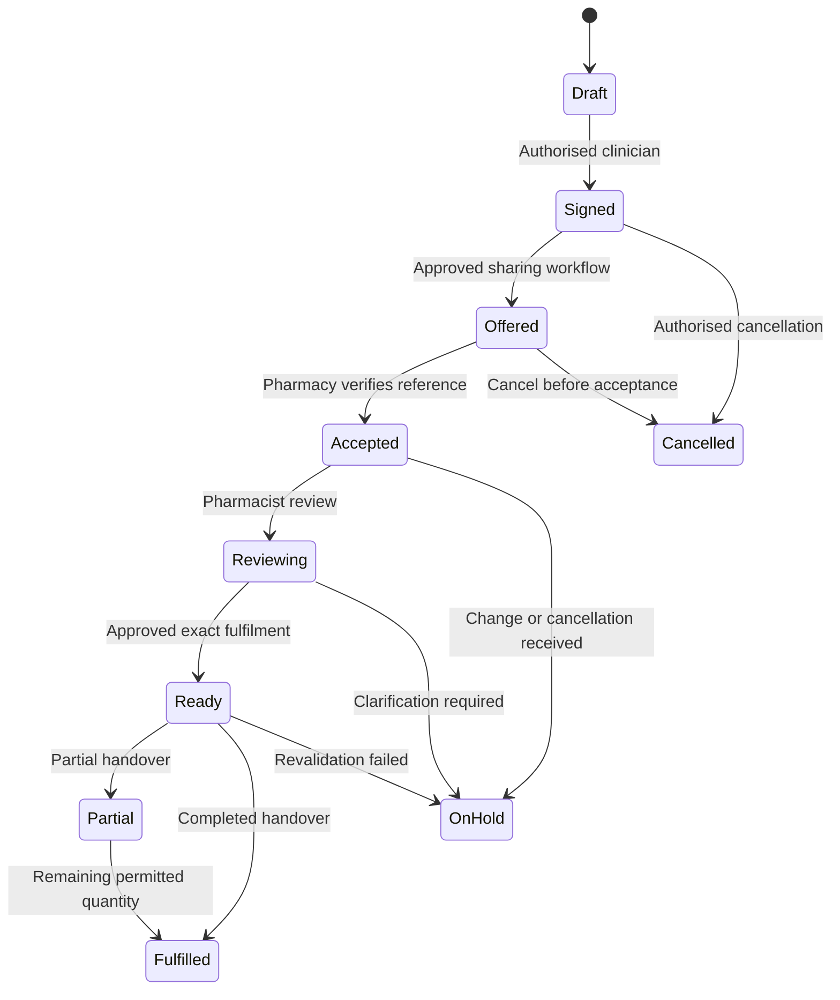
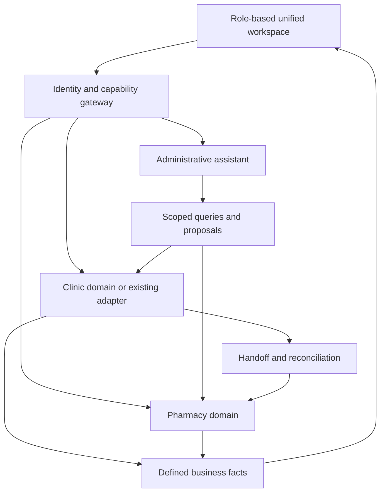
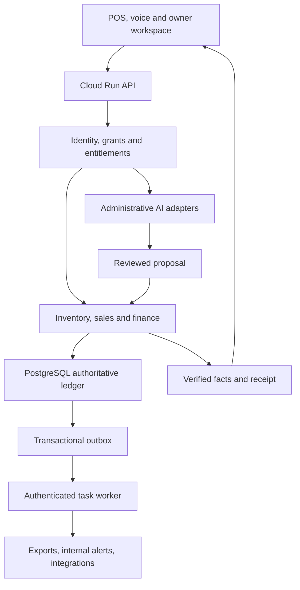

# Clinic + Pharmacy ERP — Unified Product & Engineering Blueprint v1.0

**Prepared:** 2026-11-18 · Asia/Colombo  
**Product:** Modular Clinic + Pharmacy Business Platform  
**Target:** 2026-12-01 gated supervised pilot; not a delivery guarantee  
**Companion:** Clinic_Pharmacy_ERP_Google_AI_Studio_Master_Build_Prompt_v1.md  
**Evidence status:** Documents reviewed. Existing clinical system completion is user-reported; no application repository, deployment, clinical workflow or integration has been independently verified in this task.

## 1. ප්‍රධාන තීරණය: එක platform එකක්, වෙන්ව පාලනය වන modules

සුද්දා, clinic සහ pharmacy එකතු කිරීම ප්‍රයෝජනවත් product direction එකක්. Clientට **Clinic Only**, **Pharmacy Only**, **Clinic + Pharmacy Combo** හෝ පසුව **Multi-branch / Enterprise** තෝරාගත හැකි පරිදි ගොඩනඟමු. Shared login, workspace, task assistant සහ owner reports තිබුණත් clinical records, dispensing authority, stock සහ finance වල ownership/permissions පැහැදිලිව වෙන්ව තිබිය යුතුයි.

“Clinical system එක හදලා ඉවරයි” යන්න ඔයා ලබාදුන් project status එක ලෙස භාරගන්නවා. එය නැවත ලියන්න තීරණය කරන්නේ නැහැ. නමුත් කලින් documents clinical diagnosis engine එකක් සනාථ කරන්නේ නැහැ; ඒවායේ baseline එක clinic administration. සැබෑ code/release එක පරීක්ෂා කර **පවතින verified capabilities රැකගෙන** adapter හරහා integration කිරීම මෙහි මුල් ක්‍රියාවයි.

Maximum value යනු maximum services install කිරීම නොව, එකම patient journey එකේ නැවත data entry අඩුවීම, stock/money වැරදි වැළැක්වීම සහ ownerට නිවැරදි business තොරතුරු ලැබීමයි.

## 2. අලුත් tagline සහ සැබෑ experience contract

> **“ඔබට හුරු භාෂාවෙන් කතා කරලා ඔබේ clinic එකේ appointments, පැමිණීම් සහ ගෙවීම්ත්, pharmacy එකේ විකුණුම්, තොග සහ මිලදී ගැනීම්ත්—එකම platform එකකින් කළමනාකරණය කරන්න. ඔබට අවශ්‍ය modules පමණක් තෝරාගන්න.”**

Client experience: “අද clinic එකයි pharmacy එකයි කොහොමද?” → authorised branch/date/currency context → separate clinic charges/collections and pharmacy sales/collections → correctly consolidated totals → visible breakdown and fresh timestamp → optional exact Sinhala/English speech. No patient note or diagnosis is included merely because the owner requested business performance.

First-time administrative staff get examples, one-question-at-a-time clarification, large controls, scan/type/voice choice and easy repair. Pharmacist/clinician professional work still needs qualifications/training. “All languages/no training/any scale” remains vision until separately validated.

## 3. Source review and migration of requirements

Current attachments: Pharmacy Engineering Report v1(1), 58711 bytes, and Pharmacy AI Studio Prompt v1(1), 26230 bytes; verified byte-identical to previously reviewed originals. Earlier four healthcare files—v2, v3, v4 and healthcare master prompt—were previously read/reviewed in this conversation and compared for the pharmacy redesign. They are background, not evidence of deployed code.

| Source family | Retain | Replace / extend |
|---|---|---|
| Healthcare v2 | Accessible UX, basic clinic modules, feature packaging | Earlier auth ambiguity/financial definitions yield to v3 corrections |
| Healthcare v3 | Current permissions, replay ordering, exact financial corrections, restore quarantine | Extend to stock/professional/patient-sharing boundaries |
| Healthcare v4 | Stack/service selection, voice pipeline, CI/evidence | Bring clinic and pharmacy together with common platform ownership |
| Old healthcare prompt | Complete slices, actual tests/status | Replace clinic-only scope and build order |
| Pharmacy report/prompt | Lot/UOM/FEFO/POS/refund/recall controls | Remove pharmacy-only replacement instruction; add clinic coexistence and integration |

**Authority:** current user instructions → this combined blueprint and its new build prompt → selected inherited controls in Appendix A → older documents where consistent. Do not run competing old prompts as equal instructions. Appendix A carries retained detailed pharmacy implementation rules, not the old pharmacy-only product decision. Where overlap occurs, main-body combo boundaries govern.

## 4. Products and launch boundaries

| Product | Modules | Independent usability |
|---|---|---|
| Clinic Core | Directory, scheduling, queue/attendance, charges, payments, receipts, business reports | No pharmacy dependency |
| Pharmacy Inventory | Catalogue/UOM, suppliers, receiving, lot stock, expiry/recall/quality, stocktake | No clinic or POS dependency |
| Pharmacy Retail | Inventory + POS/tills/returns + required professional release | No clinic dependency |
| Integrated Combo | Clinic Core + Pharmacy Retail + controlled handoff + combined business reports | Each product degrades gracefully if integration unavailable |
| Clinical Workspace | Existing clinician-authored clinical capability, if actually present and validated | No automatic grant of AI clinical processing |
| Chain/Enterprise | Branch governance, transfer/HQ, accounting integrations, contracted isolation/recovery | Capacity/compliance evidence required |

Launch target is one explicitly agreed workflow at one supervised pilot organisation, possibly with clinic and pharmacy under one legal entity. Do not force a full EHR rebuild, laboratory, inpatient, insurance, compounding or national e-prescribing infrastructure into December 1. Existing genuinely verified clinical features can remain available after regression testing; unknown functionality stays unverified rather than silently removed or advertised.

## 5. Departmentwise combined module catalogue

**K = shared foundation; L = launch/core; V = existing capability verification; G = growth; E = enterprise or separately gated.** This is a capability roadmap, not a claim every row is built.

| ID | Department / module | Submodules and key features | Stage |
|---|---|---|---|
| C01 | Organisation | Legal entity, tenant, branch, facility, counter, country packs | K |
| C02 | Identity/access | Staff, roles, branch access, professional grants, recovery, MFA/step-up | K |
| C03 | Shared directory | Scoped person identifiers, contact, verified links, merge review, preferences | K |
| C04 | Consent/access policy | Purpose, sharing scope, legal basis evidence, withdrawal, sensitive access audit | K |
| C05 | Reception | Appointments, service/provider calendars, cancellations, waitlist | L; waitlist G if unbuilt |
| C06 | Patient flow | Arrived/queue/in-service/completed/no-show; token display privacy | L |
| C07 | Clinic services | Duration, price snapshots, practitioner availability, resource blocks | L |
| C08 | Consultation workspace | Encounter, clinician notes, signatures, amendments, provenance | V; new build only if in agreed scope |
| C09 | Clinical records | Allergies, observations, diagnoses, problem/history data | V/E, professional workflow, outside administrative AI |
| C10 | Medication orders | Clinician-authored signed/versioned orders; amendments/cancellation | V/E with local permission review |
| C11 | Clinic finance | Charges, allocations, receipts, refunds, close/reconciliation | L |
| C12 | Referrals/follow-up | Human-directed referrals, follow-up scheduling, status | G |
| C13 | Lab/radiology interfaces | Orders, results, acknowledgement, imaging references | E; no AI interpretation |
| C14 | Pharmacy catalogue | Exact SKU/strength/form/pack/manufacturer/barcode/UOM | L |
| C15 | Pharmacy stock | Lot/expiry/location/balance/movement/reservations | L |
| C16 | Pharmacy safety | Recall, quarantine, damage, disposal, expiry and quality holds | K with inventory |
| C17 | Retail POS | Scan/search/cart, exact lots, price/discount/tax, tender/receipt | L |
| C18 | Pharmacist workflow | Review, exact release scope, partial fulfilment, handover | L baseline / E advanced |
| C19 | Cash office | Tills, float, paid-in/out, close, variance | L |
| C20 | Returns | Original sale linking, refund limits, quarantine disposition | L |
| C21 | Suppliers/receiving | Supplier, GRN, inspection, batch capture, document dedupe | L |
| C22 | Procurement/AP | Requisition, PO, partial receipt, invoice matching, credits, supplier aging | G |
| C23 | Inventory control | Opening balances, stocktake, approved adjustments | L |
| C24 | Transfers/warehouse | Dispatch/in-transit/receive, loss/damage, bins/picking | G/E |
| C25 | Pricing | Versioned policies, allowed discounts, ceiling evidence, branch pricing | L/G |
| C26 | Cold chain/quality | Manual logs, exceptions, hold/release, sensor interfaces | Required if relevant stock; advanced G |
| C27 | Customer accounts | Minimal identity, optional credit/AR/loyalty and opt-in communications | L minimal, G others |
| C28 | Handoff integration | Scoped order/reference transfer, acknowledgement, reconciliation, status | L only approved form; advanced E |
| C29 | Unified finance view | Domain breakdown, consolidated reports, allocations, accounting export | L reports, G deeper integration |
| C30 | Administrative assistant | Voice/text task interpretation, proposals, grounded reports, repair | L validated languages |
| C31 | Routine automation | Internal reminders/digests/reorder drafts, queues, budgets, pause | L bounded |
| C32 | Subscription platform | Module dependencies, feature flags, entitlements, quotas, billing lifecycle | K |
| C33 | Workforce | Staff scheduling/attendance/leave, payroll export | G; distinct from patient attendance |
| C34 | Asset/facility | Equipment inventory, maintenance, room/resource scheduling | G/E |
| C35 | Customer communication | Approved reminders, message consent, delivery audit | G / L if channel ready |
| C36 | Patient portal | Appointments/payments and appropriately scoped records | E; separate age/identity/privacy review |
| C37 | Commerce/delivery | Online pharmacy orders, reservation/fulfilment, proof of delivery | E after permissions/legal review |
| C38 | Enterprise integration | Partner API, webhooks, identity federation, standards mapping | G/E |
| C39 | Audit/security | Sensitive access, configuration history, incident controls, support sessions | K |
| C40 | Data lifecycle/operations | Backup/restore, deletion, export/import, observability, continuity | K |

Modules can be priced individually, but dependency closure and required security/professional controls are inseparable from the relevant workflow.

## 6. Existing clinical system: assess, preserve, integrate

Before changing code, record repo/commit, actual frameworks/runtime, environments, schema, identity, modules, integrations, licence/dependencies, tests and current production use. Build an evidence matrix: user-reported → observed code → run locally → verified staging → verified production. Do not upgrade the status based on a document or screenshot alone.

Inventory existing appointments, clinical records, payments, imports and APIs. Identify data owners and migration hazards. Write regression tests for the five clinic administrative journeys: today's appointments, create, reschedule, payment receipt and daily collections. If clinical signing exists, add signature/amendment/read-access tests under responsible professional review.

**Integration choice:** if the existing system is healthy, preserve it behind a versioned adapter. If same repository/database is suitable, add isolated domain modules and explicit service contracts. If database/stack differs, do not do a rushed wholesale rewrite. Fix actual defects that block safe integration, using incremental releases and rollback.

No schema merge is authorised merely by this report. Production data conversion needs mapped fields, rehearsed scripts, verified backups, sign-off and cutover plan.

## 7. Tenant, legal entity, branch and patient boundaries

Tenant is an isolation boundary; legal entity owns records/receivables; branch is an operational location; department scopes work; professional grant controls specialised actions. Common ownership or same email domain does not automatically authorise sharing all health records.

**Same legal entity:** shared minimal directory may link a person across departments, but clinical content remains purpose/role restricted. **Separate clinic/pharmacy businesses:** separate tenants by default; explicit scoped exchange agreement and person-linking process, no cross-tenant SQL join exposed through owner dashboard. A parent company's administrative account does not grant universal clinical access.

Support lawful anonymous OTC retail without forcing a clinic patient account. Names/phones are nonunique. Cross-system matching uses verified identifiers and human confirmation for ambiguity. Never auto-merge by phone/name. Merge record preserves source IDs, provenance and reversal path; downstream links are reconciled, not silently overwritten.

## 8. Roles and privacy contract

Receptionist manages appointments and authorised payments; clinician manages assigned encounters/orders; pharmacist reviews/release in granted scope; cashier runs authorised POS/till; stock keeper receives/counts; accountant sees financial data needed for role; owner manages business/subscription but does not automatically gain clinical or pharmacist privileges.

Clinical diagnoses/notes are not copied into business analytics. Pharmacy receives only the order/reference and patient identifiers required for authorised fulfilment, plus clinically necessary information provided through approved workflow—not entire encounter history. Administrative AI context excludes notes, diagnoses, prescriptions and patient-specific clinical instructions in this release.

Access decisions include subject, tenant/legal entity, branch, role/grant, resource, purpose, status and time. Consent is recorded where applicable; it is not assumed to be the only lawful basis everywhere. Withdrawal stops future optional sharing; it does not automatically erase required retained financial/clinical history. Country-specific policy owner decides obligations; do not fabricate retention periods.

Break-glass access, if later needed, is restricted, reason-bound, time-limited, audited and reviewed; it never exists as a general AI override. Shared-device lock clears sensitive views/audio/cache. Exports and support sessions have independent authorisation.

## 9. Clinic administrative operations

Appointments have service/provider/resource, UTC instants plus branch timezone, duration/price snapshots, status and version. Capacity-one bookings use exclusion constraints or equivalent proven reservation locks; overlapping bookings cannot succeed concurrently. `[start,end)` boundaries permit adjacent appointments. Reschedule is atomic; failure preserves old slot.

Patient flow distinguishes booked, arrived, in-service, completed, cancelled and no-show according to allowed transitions. Marking arrival does not create a payment; consultation completion does not automatically mark an order dispensed. Clinic resource calendars and staff HR attendance remain distinct.

Charges, payments and allocations are separate immutable records. No unallocated advances in the initial clinic model unless explicitly designed. Wrong patient/payment corrections use authorised reversal/new entry. Refund, charge credit and erroneous-entry void are different events. Old closed-day snapshots remain; restatements get new versions. Receipt printing and speech happen after commit.

## 10. Clinical workspace integration without clinical AI

If present and validated, preserve clinician-authored encounter notes, observations, medication orders and signing/amendment history. Human clinical authoring is a separate protected workflow. This blueprint does not invent diagnosis/dose logic or certify EHR completeness.

Signed records are versioned; edits create amendments, not silent overwrite. Clinician identity, role, signing time, source and supersession are recorded. Signature evidentiary requirements and order validity are local deployment decisions. A typed name is not automatically a legally sufficient electronic signature.

Administrative AI can schedule a clinician-requested follow-up without reading why it was ordered. It cannot translate/summarise a prescription into executable dispensing instructions or recommend substitutions. A “human will review” banner does not exempt clinical model use from provider terms. Google Cloud currently distinguishes clinical restrictions and administrative uses [S1].

## 11. Clinic-to-pharmacy handoff state machine



This is a proposed operational state model, not automatic authorisation to implement electronic prescribing. Initial fallback is approved manual/reference workflow, while professional validation remains required. Electronic order exchange and delivery stay disabled where permissions are unresolved.

A handoff includes source system, tenant/legal entities, patient link, source order ID/version/hash, author identity, intended recipient, scope/expiry, status and audit. Duplicate deliveries create one inbox record. Receiving an order does not create a sale, receive money or deduct stock. Dispense/sale events do not prove administration/consumption. HL7 similarly distinguishes order and dispense concepts [S2–S3]; no FHIR compliance claim is made from using these names.

## 12. Partial fulfilment, amendments and cancellation races

For each approved order line track authorised base quantity, fulfilled quantity, reserved pending fulfilment and remaining eligibility, with version and period rules. The approved source instructions remain unchanged; pharmacist records actual supplied SKU/lot/quantity and relevant human-approved discrepancy. No automatic brand/strength/form substitution.

A changed source order invalidates unfulfilled affected clearance. Cancellation cannot erase a past dispense; create exception/reconciliation record and professional follow-up. For disconnected systems, delayed cancellation messages create a freshness risk. A current source-status/version read is necessary but not sufficient: cancellation can occur immediately after that read. Automated fulfilment requires an atomic source-authority reservation/consume protocol or an equivalent scoped authorisation whose cancellation ordering is explicitly defined. Bind quantity/version/recipient, retain a durable fulfilment ID, and reconcile local sale outcome before releasing the source reservation. If authority is unavailable/stale, hold new fulfilment rather than assuming cached validity.

During legacy coexistence, single-writer authority per order and per inventory ledger is mandatory. Do not enable multiple autonomous dispensing systems against the same remaining quantity without a shared reservation/consumption authority. Source cancellation and fulfilment authorisation use a defined serialisation contract; event delivery alone cannot provide it. If the existing API cannot support this, use supervised manual reconciliation and disable automated clinical handoff for launch.

## 13. Pharmacy core integrity

Appendix A contains the detailed retained specifications for catalogue/UOM, ledger, FEFO/recall, GRN, checkout, refunds, stocktake, hardware, services and tests. Key invariants:

- Exact product/strength/form/pack; no fuzzy auto-selection for a medicine write.
- Versioned base-unit conversion; strength is not stock quantity.
- Lot-level stock and quality status, traceable source and expiry interpretation.
- Eligibility before FEFO; expired/recalled/quarantined stock cannot be sold.
- Shared policy/SKU guard coordinates recall with checkout.
- Last-unit concurrent checkout yields at most one consumption.
- Physical return enters quarantine; refund does not automatically restore sellable stock.
- Supplier invoice is not a second goods receipt.
- Receipt/reprint/TTS failure cannot repeat a committed sale.
- Owner cannot bypass professional release through subscription or admin role.

## 14. Shared finance versus combined screen

A unified owner dashboard does not imply one undifferentiated ledger. Clinic charges and pharmacy sale lines retain source domain, legal entity, tax category, currency, receipt series and correction history. Pharmacy COGS comes from stock cost layers; clinic charges do not acquire fictitious pharmacy COGS.

**MVP default:** separate domain receipts and tender records, consolidated read-only business view. Optional same-entity combined payment is introduced only after explicit allocation/refund tests: one receipt/payment event allocated across clinic charge and pharmacy sale balances, without duplicating collections. Source charge creation is idempotent and source referenced.

**Example, synthetic and tax-free solely for testing:** clinic charge LKR 2,000; pharmacy sale LKR 500; one authorised same-entity payment LKR 2,500 → total collections 2,500, allocations 2,000+500, not 5,000. A LKR 100 pharmacy sale credit/refund adjusts pharmacy net sales/collection and its inventory disposition only; clinic charge remains 2,000. If combined payments are disabled, two separate tenders 2,000 and 500 still total 2,500.

Separate legal entities do not share customer funds/receipt series by default. Cross-entity collections require reviewed settlement, tax and contractual design. Mixed currencies are reported separately; no summed “total” without an explicit FX policy/rate/time/source.

## 15. Data ownership and integration architecture



Recommended new components: modular monolith API plus worker and web. Preserve existing clinical runtime through adapter if necessary. Shared platform services own identity references, entitlements and configuration; domains own their records. Identity provider authenticates; current application membership authorises.

If all new operations genuinely share one database, a transaction can atomically coordinate compatible records. Across existing services/databases, use outbox/inbox, stable IDs, explicit states and reconciliation. Never claim a SQL transaction covers a remote API. No unsafe dual-write to old and new stock/money stores.

## 16. Integration contracts and event processing

Contract event fields: event_id, schema_version, source_system, tenant/legal entity scope, aggregate_id/version, event_type, occurred_at, recorded_at, correlation_id and minimal reference payload. Avoid embedding clinical documents into general queues/logs; authorised consumers retrieve protected content via scoped API when needed.

Event examples: appointment.created, clinic.charge_posted, order.reference_offered, handoff.accepted, dispense.completed, pharmacy.sale_posted, tender.recorded, recall.activated. Do not let a report consumer create a sale in response to a dispense event unless it is the explicit authorised idempotent business command path.

Outbox atomic with source write; consumer inbox uniqueness; aggregate-version ordering; stale/duplicate detection; bounded retries/dead-letter visibility; replay in non-sending mode by default. Out-of-order completion before acceptance is reconciled through current source state, not blindly applied. Failure is visible to staff with next action.

For API partner requests: authenticated service identity, tenant/resource scope, idempotency keys, rate limits, signed webhook verification, replay window and versioned schema. Human actor and delegated purpose survive service-to-service calls. Never expose patient records through a globally privileged integration token.

## 17. Unified database model

Shared: tenants, legal_entities, branches, memberships, professional_grants, directory_persons, external_identifiers, person_links, sharing_policies, audit, capabilities, usage and commands.

Clinic: services, resources, availability, appointments, attendance_events, encounters/clinical_versions if validated, charge_events, allocations and receipt snapshots.

Pharmacy: products, pack_versions, barcodes, lots, cost_layers, locations, balances, movements, reservations, GRNs, carts, professional_releases, sales/lines, sale_lot_allocations, tenders, returns, refunds, recalls/holds, tills and stocktakes.

Bridge: source_order_references, handoffs, line_authorisations, fulfilments, integration_inbox/outbox, mapping_versions and reconciliation_cases. Shared finance if approved: payment records and domain allocations with uniqueness on source reference.

Composite tenant/legal-scope keys prevent cross-links. Parameterised queries, runtime non-owner role, transaction-local trusted scope and RLS defence in depth. Clinical content receives additional object/field/purpose controls; a tenant match alone is insufficient. No broad browser SDK write access to money/stock/clinical signing.

## 18. API, commands and concurrency

Use versioned route families `/api/v1/platform`, `/clinic`, `/pharmacy`, `/handoffs`, `/reports`, `/assistant`, `/commands` with typed request/response contracts. Native domain routes and AI tools call the same services. Model cannot issue arbitrary SQL or cloud administration calls.

Correct command order: authenticate/current access → canonical fingerprint → authorised matching committed replay → conflicting key/in-progress handling → scoped transaction/uniqueness/locks → current policy/grants/version/confirmation checks → domain/audit/outbox/result atomic commit → rendering/speech outside transaction. A consumed confirmation does not block safe retrieval of an already committed result. Lost response retains original command ID.

Appointments lock resources/time; pharmacy locks policy/lot stock; combined allocation locks payer/payment and charge balances. Stable lock order, bounded full-transaction serialization retries and no provider/network/human wait while SQL locks are held. Partial integration failure creates a durable workflow state; it is not repaired with random new-key retries.

## 19. Frontend experience and screens

Workspace modes: Clinic, Pharmacy, Combined, Owner overview. Mode switch changes visible tasks, not underlying permissions. Persistent branch/legal entity and role context; explicit patient context when needed; clear indicator when two people with similar names exist. Do not drag a selected clinic patient into an unrelated pharmacy sale automatically.

Clinic views: appointment board/calendar, queue, directory, encounter handoff, charge/payment/receipt and reports. Existing clinical workspace stays within professional access. Pharmacy views: scan/POS, stock/lot, GRN/supplier, expiry/recall/quality, review queue, returns/till/stocktake. Shared views: assistant, tasks, modules/usage, staff/grants, audit/settings and integration exceptions.

States include loading/empty/stale/offline/permission denied, awaiting source check, awaiting pharmacist, expired/recall hold, insufficient stock, uncertain payment, committed/printer failed and integration degraded. No fake optimistic payment/dispensing success. Every state has accessible text and next action. Keyboard/scanner flow remains fast; voice is optional.

## 20. Voice, language and AI tool scope

Capture → STT → transcript review → allowlisted intent → authorised exact entity resolution → targeted clarification → canonical proposal → confirmation → deterministic command → verified facts → optional template speech. Partial transcripts cannot approve changes. Exact drug SKU/unit/amount/date readback; no automatically inferred clinical instruction.

Tool categories: clinic appointments/attendance/collections; pharmacy stock/expiry/sales/receiving/reorder drafts; authorised combined reports; command status. Tools cannot read clinical notes, generate prescriptions or decide medicine substitution. Staff can open protected clinical screens through normal authorised UI without passing their content to the model.

Launch language manifest independently records UI, understanding, STT, TTS and task validity for Sinhala/English/code-switching. Tamil later after native validation. Approved endpoint/model/region/terms are explicit; missing provider returns a clear unavailable state, never a fabricated voice result. No automatic fallback to an unapproved region/provider.

## 21. Algorithm register

| Problem | Method / invariant |
|---|---|
| Appointment scheduling | Working windows minus blocks/bookings; commit-time overlap protection |
| Person matching | Exact verified identifier then bounded candidate list; human ambiguity resolution |
| Medicine matching | Barcode/exact SKU + strength/form/UOM; fuzzy search only suggestions |
| Stock allocation | Eligibility filter then deterministic FEFO and locked reservations |
| Expiry interpretation | Source label precision + verified country/product policy + local date cutoff |
| Order fulfilment | Current source version/authority, bounded remaining quantity, dedupe and revalidation |
| Refund/credit | Linked immutable events, cumulative limits, separate stock disposition |
| Reports | Versioned parameterised metrics, explicit time/currency/legal entity and watermark |
| Reorder draft | Lead-time demand/safety stock minus inventory position; pack/MOQ/expiry/cash constraints |
| Dialogue repair | Ask highest-impact unresolved field, retain verified fields, invalidate changed proposal |
| Integration repair | Inbox/version checks, current source lookup, bounded retries, human exception queue |
| Quota | Atomic reservation/finalisation/release; idempotent metering |

AI confidence is not authority. No generated decimal arithmetic, hidden patient merge, approval inferred from background speech or autonomous professional act.

## 22. Stack and dependency bill of materials

| Layer | Baseline choice | Existing-system rule |
|---|---|---|
| Web | React/TypeScript/Vite, React Router, Tailwind/accessibility primitives | Preserve working existing frontend behind unified navigation if safer |
| Data/forms/i18n | TanStack Query, React Hook Form, i18next/Intl | One server-state owner; purge on scope/logout |
| API | Supported Node LTS/TypeScript/Fastify, JSON Schema/OpenAPI | Existing Express/Python API can stay behind adapter |
| Data | PostgreSQL/Cloud SQL, Kysely + pg, reviewed migrations | No forced migration of healthy clinical DB before audit |
| Identity | Firebase Auth/required Identity Platform features + current membership | Document subject mapping/account linking, no silent duplicate identities |
| Jobs | SQL outbox/inbox, Tasks/Scheduler, authenticated worker | Cross-service delivery explicitly eventual |
| AI | Server provider adapters, Genkit only if useful | No clinical-content model tools |
| Test | Vitest/Testing Library/Playwright, real PostgreSQL, property tests | Existing regression suite becomes preservation gate |
| Operations | Pino/OpenTelemetry, Cloud monitoring, GitHub Actions OIDC | Redact clinical/personal/payment content |
| Python | Evaluation/import diagnostics, isolated specialist service only if needed | Do not duplicate stock/finance logic |
| Rust | Optional measured device bridge/CPU bottleneck | Not a launch prerequisite |

Pin supported compatible versions after installation/tests; record lockfile/image/action digest, licence, purpose, SBOM/update owner. No invented latest versions or security certification. Appendix A provides detailed pharmacy dependency/service and hardware decisions.

## 23. Firebase/Google Cloud capability decisions

**Baseline:** Auth, Hosting, appropriate App Check, selected private Storage; Cloud Run API/worker, Cloud SQL, Tasks/Scheduler, Secret Manager, IAM, Artifact Registry and logs/metrics. App Check is supplementary, not authorisation. Browser API identity and private worker service IAM are separate contracts.

**Conditional:** Firestore/Realtime Database read projections/presence; no second financial/stock authority. App Hosting only if framework choice warrants it. SQL Connect must not bypass domain commands. Functions for narrow integrations, not duplicate domain logic. Remote Config only UX rollout, not entitlements or safety. FCM generic notifications, never guaranteed safety delivery. Analytics/performance instrumentation minimises data; no health content. Extensions require permission/cost review.

**Later:** native Crashlytics/App Distribution/Test Lab; Pub/Sub fan-out, BigQuery/CDC analytics, Memorystore, enterprise gateway, Document AI invoice assistance, sensor/device bridges. Cloud Healthcare API/FHIR interfaces are separate governed integrations. GKE/Spanner/GPU/AlloyDB only after workload evidence.

**Developer workspace:** Google AI Studio for synthetic prompt/schema iteration; GitHub for code/contracts/tests/releases; Cloud SDK/gcloud/Firebase CLI for reviewed operations; Cloud Shell/Workstations as developer environments, not an always-on production server. Do not inherit unrelated project's region or credentials.

## 24. Real-time, resilience and capacity

Commit response gives read-your-write consistency; bounded active polling initially updates other views, with timestamp/stale banners. Source-order status and stock eligibility are rechecked independently of dashboard freshness. Streams later require reconnect, cursors, authorisation and shared state; Cloud Run process memory is not durable authority [S4].

No offline medicine checkout/clinical handoff autopost in MVP. Unsent drafts are labelled; uncertain submitted commands reconcile before retry. Manual continuity procedures are agreed with professionals. True offline multi-counter stock and cancellation/recall freshness requires separate authority design.

Define measured envelope by active users/counters, checkout TPS, appointments, SKUs/lots, movement history and integration latency. Start one branch/1–2 counters; grow to multi-branch only after workload tests. Shared DB may remain appropriate; dedicated isolation/HA/DR are contracted options, not evidence of universal scale.

Proposed targets: warmed barcode query p95 ≤500 ms; local checkout acknowledgement p95 ≤1.5 s; core voice result p95 ≤6 s after speech end; appointment updates within configured refresh window. All are test targets, not measured results. Bound Cloud Run instances/concurrency/SQL pools including rollout overlap; shed heavy reports/AI before critical operations.

## 25. Security, lifecycle and disaster recovery

Least privilege, verified tokens/current grants, safe rendering/CSP, input limits, scoped APIs, parameterised SQL and audited privileged access. No raw Rx/audio/clinical note in logs, analytics, public storage, prompts or GitHub issues. No card PAN/CVV. Private exports expire and are reauthorised; CSV injection prevented.

Deletion graph covers directory links, files, caches, search, exports, provider traces and backups. Retained clinical/financial events follow reviewed jurisdictional policy; consent withdrawal and deletion are distinct. Do not promise absolute erasure on a generic timer.

Restore both old and new systems into quarantine. Verify coordinated snapshot/stream positions, replay only safe integration state, restore newest revocations/recalls/order cancellations from reconciled durable sources, suppress old external messages, reconcile stock/tenders/allocations and then reopen. A database restore must not resurrect cancelled orders or recalled saleable stock.

## 26. Migration, cutover and rollback plan

1. Read-only audit and mapping; record source-of-truth per entity.
2. Synthetic fixture integration; compatibility/contract tests.
3. Staging import with source IDs, units, timezone/currency and duplicate review.
4. Read-only comparison/shadow reporting; no shadow financial writes.
5. Rehearse cutover with defined freeze/CDC catch-up strategy; reconcile patients/appointments/open balances/stock by lot/active orders.
6. Activate one pilot branch and monitored feature flags; keep legacy read access as appropriate.
7. Stop new writes on failed gate; reconcile any committed events before rollback. Do not run two authoritative ledgers.

Rollback application code is not rollback of money/dispensing. After real new transactions, restore old writer only after reverse mapping/reconciliation, or use forward fix while maintaining history. Document schema compatibility and irreversible transformations. Preserve existing login/account IDs through explicit mapping.

## 27. Module subscriptions and money-making packages

| Bundle | Buyer | Includes |
|---|---|---|
| Clinic Core | Small consultation practice | Scheduling/attendance/collections/admin assistant |
| Pharmacy Inventory | Owner needing stock control | Catalogue/receiving/lots/safety/basic reports |
| Pharmacy Retail | Retail pharmacy | Inventory/POS/till/returns/professional gate |
| Integrated Combo | Same-entity clinic + pharmacy | Both bundles + controlled handoff + unified business reports |
| Growth | Multiple branches | Transfers/HQ/procurement/AP/accounting connectors |
| Enterprise | Groups/complex operations | Agreed identity/isolation/integration/recovery/support capacity |

Bill formula: shared platform base + selected dependency-complete modules + branch/counter limits + transparent AI/message usage + agreed setup/import/integration/support. Avoid charging twice for shared core in combo. Prices need cost/support/pilot validation; this report does not invent approved subscription amounts.

Feature registry maps capability/dependencies/roles/quota/price/version/migrations. Entitlements checked at proposal and execution. Never paywall required expiry/recall/professional/tenant/audit safeguards. Downgrade preserves records/export and needed correction continuity under contract. Exhausted voice quota must not disable paid manual core operations.

## 28. Revenue ladder and promotion

| Level | Sellable increment | Evidence before promotion |
|---|---|---|
| 1 | Verified clinic bundle, pharmacy bundle or limited combo pilot | Real core journey; no P0 defects; exact scope |
| 2 | Deeper purchasing/AP | GRN/invoice/credit reconciliation |
| 3 | Multi-branch/HQ/transfers | Custody and branch isolation/load tests |
| 4 | Improved handoff/partial fulfilment | Current-source and cancellation-race evidence |
| 5 | Finance/export integrations | Accountant-reviewed reconciliation |
| 6 | Quality/cold-chain automation | Exception drill/device evidence |
| 7 | Warehouse/large workload | Measured performance and support capacity |
| 8 | Authorised portal/commerce/delivery | Local/channel permission and privacy review |
| 9 | Enterprise integrations/dedicated operations | Contractual SLO/DR/identity proof |
| 10 | Multi-country/language packs | Native tasks, local rules, endpoint/region acceptance |

Founder-led demo to owners and professionals: appointment → visit → human-approved handoff → reviewed pharmacy sale → accurate separated/combined business report. Use synthetic data. Promote measured time saved, reduced duplicate entry and stock visibility; no diagnostic efficacy or “100% autonomous worldwide” claims. Obtain permission for case studies and outreach.

## 29. December 1 release decision

November 18 to December 1 gives 13 calendar days. Existing clinic readiness is unknown to this review. Protect verified existing product and run integration feasibility before promising a full combo.

Nov 18–19: repo/runtime/clinical scope audit; choose legal entity/pilot/provider/hardware; smoke/regression and speech feasibility. Nov 20–22: platform mapping, inventory/GRN and adapter contract. Nov 23–25: POS/stock/finance gates and clinic regression. Nov 26–27: controlled handoff, reports and voice. Nov 28–29: staging/import/restore/hardware/client rehearsal. Nov 30: freeze/go-no-go. Dec 1: supervised release only for accepted capability set.

If handoff is blocked but standalone bundles pass, sell the validated standalone scope transparently; do not label disconnected screens “fully integrated.” If pharmacy stock/money gates fail, do not expose medicine checkout. If clinical system isn't verified, the statement “already built” does not substitute for acceptance evidence.

## 30. Combined acceptance matrix

| ID | Required test/evidence |
|---|---|
| U01 | Clinic-only works without pharmacy entitlement |
| U02 | Pharmacy-only works without clinic entitlement |
| U03 | Combo shared UI does not broaden clinical access |
| U04 | Separate legal entities/tenants cannot query each other's patient/finance data |
| U05 | Ambiguous person matching does not auto-merge |
| U06 | Existing appointment/payment regressions pass on adapter-integrated build |
| U07 | Two users book same slot: one wins; failed reschedule preserves original |
| U08 | Duplicate handoff event creates one inbox/work item, not sale or tender |
| U09 | Source cancellation/amendment versus fulfilment respects current authority |
| U10 | Partial/retried fulfilment never exceeds authorised remaining quantity |
| U11 | Cashier/owner cannot impersonate clinician/pharmacist |
| U12 | Administrative model context never includes protected clinical fields |
| U13 | Last-unit checkout, recall race and FEFO/expiry tests pass |
| U14 | Same-key replay after consumed/expired confirmation returns one result |
| U15 | Lost response/print/TTS failure does not duplicate domain effects |
| U16 | Combined report counts shared payment once and separates currencies/entities |
| U17 | Pharmacy refund does not alter clinic debt or auto-restock returned medicine |
| U18 | Integration outage holds unsafe handoff while independent modules remain usable |
| U19 | Downgrade/quota preserves mandatory controls and permitted manual operations |
| U20 | Migration/reconciliation and cutover rollback/forward-fix rehearsed |
| U21 | Restore reapplies revocations, recalls and order cancellations without replayed sends |
| U22 | Native-language/device/accessibility/hardware tasks demonstrated |
| U23 | Actual load/connection/cold-start results recorded |
| U24 | Clinical signing/amendment regression verified if clinical workspace enabled |

Retain pharmacy P01–P26 in Appendix A. Automated fixtures, native user tests, professional acceptance and legal review are different evidence classes; one cannot substitute for another. Track PASS/FAIL/NOT RUN/BLOCKED by commit/environment/test command. No production test has been run by authoring this blueprint.

## 31. Repository and deliverables

Recommended new boundaries: apps/web, apps/api, apps/worker; packages/platform, contracts, locales, ai-adapters, clinic-domain, pharmacy-domain, integration-adapters and reporting; database/migrations; infra; tests/{clinic,pharmacy,integration,security}; evals; runbooks; docs/decisions.

If existing repo structure differs, preserve it where workable and add clear interfaces rather than forced folder churn. Deliver OpenAPI, entity ownership, role/professional grants, capability manifest, provider matrix, migrations/import mappings, synthetic fixtures, tests, SBOM/lockfiles, CI, deployment manifests, hardware matrix, incident/restore/cutover runbooks and release evidence.

CI pins actions/images, runs meaningful domain/concurrency/security/browser tests, builds one immutable artifact and promotes tested revisions. OIDC avoids committed deploy secrets. Untrusted PRs do not receive production credentials. Model/prompt/locale/schema versions are release artifacts too.

## 32. Cost and operations model

Measure per tenant/domain successful task costs: compute/SQL/storage, STT/LLM/TTS, notifications, telemetry, backup and support. Compare revenue to gross infrastructure cost plus onboarding/support labour. No free-tier or zero-cost guarantee. Budget alerts need application quotas, provider limits and max-instance controls.

Separate latency/error rates for appointment operations, checkout, reports and voice. Maintain identifiers across request/proposal/command/handoff/task without clinical payloads in logs. Alert on old integration backlog, unreconciled tender, stock mismatch, failed recall propagation, denied privilege attempts and stale provider configuration.

Designate owner, engineer/on-call and responsible professional before paid pilot. Document support hours, outage messaging, manual continuity and escalation. No automation can replace a missing accountable operator for critical exceptions.

## 33. Open decisions that block release, not document completion

Actual clinical repository/commit and deployed capabilities; tenant/legal entity structure; named pilot owner/pharmacist/clinician; existing API/signature/order authority; country-specific e-order/sharing/payment/retention permissions; hardware/network; exact supported language endpoints; region/data-processing choice; opening balances/stock; subscription price/support budget; capacity tests; restore and user acceptance.

Proceed with synthetic local engineering while resolving these. Do not fabricate their answers. A complete document is not a complete system, and the requested senior standard does not imply the author has a personal employment history.

## 34. Verified source notes

- **S1 Google Cloud service-specific terms:** administrative/clinical distinction for generative AI. https://cloud.google.com/terms/service-terms . Retrieved 2026-11-18; actual endpoint/account terms must be reviewed.
- **S2 HL7 FHIR MedicationRequest:** order/request semantics. https://hl7.org/fhir/medicationrequest.html
- **S3 HL7 FHIR MedicationDispense:** supplied/dispensed event semantics. https://www.hl7.org/fhir/medicationdispense.html
- **S4 Cloud Run WebSockets:** connection lifecycle/reconnect design. https://docs.cloud.google.com/run/docs/triggering/websockets

FHIR references explain semantic distinctions, not a commitment to a particular FHIR release/profile or interoperability certification. If implementing exchange later, select partner-supported version/profile/terminology and validate conformance. Appendix A source context retains pharmacy research limitations: NMRA linked guideline PDFs were not fully retrieved, and legal requirements were not certified.

# Appendix A — Retained detailed pharmacy engineering contracts

The following selected pharmacy report sections remain applicable to the pharmacy bounded domain. Original section numbers are prefixed A. Main-body combo boundaries override any inherited product packaging or isolated reporting assumptions. They are included here so developers do not need the old pharmacy-only prompt to implement inventory/POS correctly. These are proposed designs, not implemented capabilities.
## A8. Product identity and pack/unit model

Product identity is not just a brand name. Store SKU, display name, generic/brand metadata, strength with units, dosage form, route where relevant, manufacturer, pack variant, barcode aliases, category, local regulatory classification, storage requirements and source/version of master data. Avoid an AI-created medicine catalogue presented as verified.

Separate `product` from `pack_variant` and `lot`. One brand may have several strengths/forms/packs; they are not substitutable inventory. Barcode identifies a trade item/pack, not necessarily lot or expiry. GS1 structured codes may carry GTIN/lot/expiry/serial [R05]; parse documented delimiters/lengths and validate actual code format. Ordinary EAN/UPC scans do not magically reveal a batch.

Choose a base stock unit per SKU: tablet, capsule, sealed bottle or another verified indivisible unit. Example: 1 box = 10 strips = 100 tablets. Store exact rational/integer conversions with effective version; 2 boxes + 3 strips = 230 tablets. Prohibit fractional tablets where the approved sale unit does not allow them. Liquids default to sealed-bottle stock; do not invent dose-volume dispensing rules.

Snapshot conversion and unit price at receipt/sale. Changing tomorrow's pack definition must not rewrite yesterday's stock. Pack opening requires a traceable conversion record if physical packaging status matters. Strength unit (mg) is not stock quantity (tablets). Duplicate barcode mappings or conflicting lot expiry are review blockers.


## A9. Inventory ledger and lot-status state machine

Use append-only stock movement events plus transactionally maintained balances. Each movement records tenant, branch/location, SKU, lot, base quantity, from/to bucket, reason, source document, actor, command ID and timestamps. No direct “edit stock quantity” route.

Buckets: quarantine, sellable, reserved, in-transit, returned-quarantine, damaged, expired, recalled, disposed. Model reservations as allocations against sellable stock, not duplicate physical stock. Physical total and available quantity are separate measures. Pending purchase orders are neither physical nor sellable.

`available = sellable_on_hand − active_reservations`, evaluated under the same locked scope. Expiry/recall status is checked again even if a cached balance says stock exists. Opening balances are approved import movements with lot/expiry/cost provenance; unknown medicine lot/expiry remains quarantined.

Movement patterns: receive → inspect/release; reserve → release or consume; sell → outbound; return → returned-quarantine; approved restock → sellable; dispatch → in-transit; destination receive → destination stock; disposal → final outbound. Every status transition has role/reason/evidence and reversible correction semantics where physically possible.


## A10. FEFO, expiry and recall algorithm

FEFO = first expiry, first out for otherwise eligible identical stock. **Eligibility precedes sorting:** correct tenant/branch/SKU, released status, allowed storage, non-expired, not recalled/held, sufficient sale window, available quantity. Sort eligible lots by expiry, then receipt time and stable ID. A staff override among eligible lots needs reason and physical confirmation; blocked stock is never selectable.

Expiry is a labelled business date, not an arbitrary UTC timestamp. Store printed representation, parsed precision and approved interpretation. Month-only expiry requires a documented verified policy; do not silently invent a day. Unknown/invalid expiry blocks medicine release. Compute branch-local sale cutoff and any minimum remaining shelf-life policy; do not infer treatment duration from the cart.

Recall entity records affected SKU/manufacturer/lot scope, evidence/reference, effective time, state and approver. Apply a database-enforced release barrier and invalidate reservations/proposals. All checkout writers and recall writers lock a shared SKU/policy guard before lot locks so a newly activated recall cannot race past sale commit. A sale ordered before recall activation is retained and becomes part of recall tracing; no claim that past dispensing can be undone.

Trace lots from receipts through transfers and sales. Anonymous lawful sales may have no customer contact; report traceability limits honestly. Quarantine return by default; financial refund does not automatically make medicine saleable. Responsible authorised review governs any later release under applicable policy.


## A11. Purchasing and goods receipt

Supplier → optional requisition/PO → delivery/GRN → inspection → released stock → supplier invoice/matching → AP/payment. These are distinct documents and events.

MVP GRN: supplier, supplier delivery/invoice reference, branch, date, SKU/UOM, ordered if known, received quantity, bonus quantity, cost, lot, expiry, condition and accepted/quarantine split. Duplicate supplier-document checks are scoped and allow explicit legitimate exceptions. Partial deliveries do not close remaining PO automatically. Over-receipt threshold requires approval.

Posting receipt and stock movements is atomic. Supplier invoice posting must not create stock a second time. Free/bonus units influence actual landed unit cost; provisional costs are labelled. Later invoice/cost corrections use adjustment events and restated valuation policy; never silently rewrite historic margin. Return-to-supplier removes physical stock through custody events; supplier credit/AP settlement remains a distinct financial step.


## A12. POS, tender and dispensing flow

Cart states: draft → awaiting required review → ready → committing → completed; abandoned/voided are distinct. Show exact product, strength/form, UOM, quantity, eligible lot split, expiry, unit price, discount, tax basis and totals. Search confidence never finalises a medication identity.

MVP short-lived reservation begins at final reviewed checkout, not every search/scan. Proposed initial reservation TTL: two minutes, configurable after counter tests. On expiry, revalidate and re-present changed allocation; never silently charge for unavailable stock. Pharmacist clearance binds exact relevant cart/product/quantity/prescription/policy version; critical changes invalidate it.

For in-person cash or externally confirmed card entry, a single authoritative transaction posts sale lines, stock consumption, tender records, receipt snapshot, audit, outbox and command result. Payment method is not a payment-processor action. Cash tendered may exceed total; change is computed separately and net collected equals sale total. This differs from unsupported customer-credit overpayment.

For a future integrated gateway: reserve → external authorisation/capture workflow → reconciled finalisation. Remote processor and SQL are not one atomic transaction. Store gateway intent/reference, verify signatures, dedupe webhooks, reconcile uncertain settlement, release/compensate only after status is known. No blind second charge or immediate stock release when capture outcome is unknown.

Release/handover is recorded separately from receipt printing. If staged sale awaits physical handover and a new recall/expiry blocks it, hold handover and initiate authorised correction. Software cannot prove physical dispensing merely from a printed receipt.


## A13. Exact checkout transaction protocol

1. Verify bearer identity, current tenant/branch membership, capability and counter scope.
2. Canonicalise command fingerprint. Matching authorised committed replay returns prior result **before** consumed/expired approval checks. Same key/different payload conflicts.
3. Begin scoped DB transaction; acquire command uniqueness and proposal locks.
4. Lock policy/SKU guards, affected balance/lot rows and finance rows in stable order. Every competing writer follows the same order.
5. Recheck grants, professional release when required, feature, nonce/expiry, product/price/UOM versions, recall/expiry and reservations.
6. Check quantity and money invariants. Atomically append stock/sale/tender/audit/outbox/receipt/result records; consume approval/reservation.
7. Commit. Generate speech, print and notifications outside transaction.
8. Lost response → same command status/key reconciliation. Never new-key resubmit automatically.

Use bounded full-transaction retries for serialization/deadlock errors, not business-policy conflicts. No LLM, human wait, TTS or external payment request inside the SQL transaction. Unique keys and locks guarantee one domain effect for exact retries; do not advertise exactly-once external delivery.


## A14. Returns, cash and accounting boundaries

Return intake references original sale/line/lot and quantity already returned. Reject cumulative returns above sold eligible quantity and refunds above refundable value. No-receipt exceptions require authorised documented policy. Returned physical units enter quarantine; disposition and refund may complete at different times with reconciled references.

Sale void before fulfilment, erroneous tender-entry correction, customer refund, physical return, disposal and supplier credit are different events. Never “delete sale” to repair a receipt. Refund to customer does not restore sellable stock automatically. Prevent double restock and double refund under retries.

Till: opening float + net cash received + approved paid-in − approved paid-out − cash refunds = expected drawer cash. Card collections do not increase drawer cash. Counted cash and variance recorded with closer/reviewer. Preserve close snapshots and label later corrections.

Recommended MVP costing: receipt cost layers allocated to actual lot consumption, including reasonable exact fractional cost representation. FEFO physical allocation and valuation policy are explicitly documented, not assumed equivalent. Net sales exclude applicable tax according to configured accounting definition; gross margin estimate = net sales − recognised COGS. It is not net profit. Unknown opening cost yields “margin incomplete,” not fictitious zero COGS. Accountant validates rounding/tax/valuation rules before production.


## A15. Stocktakes, transfers and cold chain

**Stocktake:** snapshot cutoff, blind counts in base units, in-flight movement reconciliation, variance review and authorised adjustment events. MVP can temporarily freeze the counted location with visible checkout restriction; unrestricted concurrent counting needs a proven movement-aware algorithm. A stale count cannot overwrite later sales.

**Transfers (growth):** request/reserve at source → dispatch to in-transit → destination receipt; partial receipt and loss/damage remain unresolved custody balances. Do not immediately subtract source and add destination as if transit were instantaneous. Returns from transit have their own event. Same tenant/branch ownership rules; cross-company transfer is a separate sale/purchase integration.

**Cold chain:** approved per-product storage ranges from trusted source, manual readings initially, exception/hold and review evidence. Sensors later need calibration, identity, clock/freshness and offline alarm behaviour. Missing readings are unknown, not proof of safe storage. Do not promise continuous safety monitoring through a browser-only notification.


## A16. AI brain and multilingual experience

AI functions: understand administrative intent, identify missing fields, prepare reviewed drafts and explain verified business facts. Deterministic services calculate, authorise and execute. Scan/type remains faster for many counter tasks; voice is an additional path, not forced friction.

Utterance → STT → transcript preview → normalisation → allowlisted intent → exact authorised entities → clarification → proposal → confirmation → command → fact response → optional TTS. Drug-name/strength/quantity errors have high consequence: require exact SKU/pack readback and scan/manual verification; no fuzzy auto-substitution.

MVP tools: `find_stock`, `get_expiry_report`, `get_daily_sales`, `get_collections`, `draft_goods_receipt`, `draft_reorder`, `prepare_cart_for_known_skus`, `get_command_status`. No dose/interaction/substitute recommendation tools. Prompt injection in supplier files/product names cannot alter tool rights.

Sinhala/English/code-switching assessed separately across UI, STT, interpretation, speech and business task correctness. Tamil can be introduced after native validation. Use exact numbers/currency/units from fact objects in speech templates. “අද profit” asks for gross margin estimate or fuller accounting report; do not generate unsupported reasons for changes.

Audio has explicit start/stop, duration/size limit, microphone teardown on lock/navigation and no raw retention by default. Public-counter privacy mode suppresses patient names aloud. AI outage leaves scan/manual POS and inventory usable; TTS failure after sale is an audio failure, not a failed sale.


## A17. Autonomy policies

| Operation | Allowed automation | Approval |
|---|---|---|
| Read authorised stock/report | Immediate deterministic read | No extra confirmation |
| Near-expiry task/daily digest | Scheduled within configured scope | Owner enables rule |
| Reorder suggestion | Explainable draft with quantity/cost | Buyer approves before sending |
| GRN/cart | Draft and validate | Authorised staff confirms; professional gate where applicable |
| Stock adjustment/refund | Prepare evidence | Explicit privileged approval |
| Recall import | Candidate match/hold under configured trusted process | Confirm source/scope; no autonomous release |
| Dose/substitution/prescription interpretation | Not available | Not enabled by adding a confirmation button |

A reorder baseline uses lead-time demand + approved safety stock − inventory position, rounded to pack/MOQ and capped by cash/expiry constraints. Demand estimates account for stockout days and promotions; sparse data produces “insufficient evidence.” No autonomous supplier purchasing or medical need inference. Each routine has owner, version, permission, budget, pause and run history.


## A18. Frontend screens and device behaviour

Screens: sign-in/recovery; language/setup; owner home; POS; product search/detail; lot balance; goods receipt; supplier; expiry/recall/quarantine; professional review queue; returns; stocktake; till/day-close; reports; staff/grants; modules/billing; audit/settings/help.

POS prioritises scan field, exact product card, cart, lot/quantity/UOM, total and clear review/payment state. Owner home prioritises business summary and exceptions. Role-based navigation hides unavailable work but server always enforces policy. Low-literacy UX uses one question at a time, labels with icons, large targets and spoken guidance; it does not promise no professional training.

Required states: loading, empty, stale, offline, permission denied, stock changed, recalled, expired, awaiting pharmacist, tender uncertain, committed, printer failed, quota exceeded and session locked. Do not show fake optimistic sale completion. A locally saved cart is not posted stock/money.

Hardware matrix: keyboard-wedge barcode scanner first; camera scanning optional tested SDK; supported receipt printer via browser print initially; Sinhala fonts/paper sizes verified; label printing separately validated; cash drawer/scale/USB direct integration deferred unless an authenticated local bridge is implemented and tested. Browser print success is not proof paper emerged. Test Windows desktop and actual Android/iOS browser targets separately.


## A19. System architecture and ownership



Modular monolith initially: web, API, worker; one main transactional database. Domain ownership: catalogue owns identity/UOM; inventory owns quantities/status; retail owns carts/sales; professional workflow owns releases; finance owns tenders/refunds; reporting reads defined facts; SaaS billing owns feature access. No second Firestore source of stock truth.


## A20. Technology and dependency decisions

| Layer | Baseline | Rule |
|---|---|---|
| Web | React + TypeScript + Vite + React Router | Responsive web, no SSR complexity without need |
| UI | Tailwind + accessible primitives; React Hook Form | Keyboard/scan/mic usability and native-language fonts |
| Data UI | TanStack Query | Tenant/branch scoped keys; invalidate after commit; purge on logout |
| Localisation | i18next/react-i18next + Intl | Reviewed templates; domain parsing separate |
| Backend | Supported Node LTS + TypeScript + Fastify | One command implementation for manual and AI |
| Contracts | Trusted JSON Schema + OpenAPI | Generate client types; no untrusted schema compilation |
| DB | PostgreSQL on Cloud SQL; Kysely + pg | Explicit migrations, constraints, locks, exact decimals |
| Queue | Cloud Tasks + Scheduler + SQL outbox | Bounded retries, dedupe, visible failures |
| Identity | Firebase Auth/required Identity Platform features | Bearer validation + current DB grants |
| Hosting | Firebase Hosting; Cloud Run API/worker | Explicit browser API and worker IAM boundaries |
| AI | Server adapters; official SDKs for approved endpoint | Genkit optional; no clinical content/tool access |
| Tests | Vitest, Testing Library, Playwright, real-Postgres integration, fast-check | Behaviour/concurrency/property tests |
| Observability | Pino + OpenTelemetry/Cloud monitoring | Allowlisted attributes; no raw Rx/audio |
| Infrastructure | GitHub Actions OIDC, Artifact Registry, Terraform | Locked images/actions/config and reviewable promotion |
| Python | Offline evaluation/import diagnostics with pytest/pydantic | No duplicate production financial API |
| Rust | Deferred; candidate device bridge/audio bottleneck only after evidence | Adds no value merely by being installed |

Pin exact compatible releases in the build, not fabricated version numbers here. Commit package lockfiles, licence/purpose register, SBOM and owner. Barcode decoder and decimal arithmetic libraries require specific licence/security/format tests before selection. Avoid multiple ORM/router/state/agent frameworks. Google AI Studio uses synthetic records for prompt/schema exploration; accepted prompts/fixtures are versioned in GitHub.


## A21. Firebase service coverage and boundaries

| Family/services | Decision |
|---|---|
| Auth / Identity Platform / App Check | Baseline identity and abuse signal; App Check is not authorisation |
| Hosting | Static staff application; private API responses not cached publicly |
| App Hosting | Alternative for later supported full-stack framework; not duplicate SPA hosting |
| Firestore / Realtime Database | Optional non-authoritative projections/presence only; not stock/payment write path |
| SQL Connect | Alternative evaluation; no bypass around domain locks/approval |
| Cloud Storage | Private validated files/exports; not raw clinical upload to AI |
| Functions | Conditional narrowly scoped triggers; avoid duplicating Cloud Run domain logic |
| Firebase AI Logic / Genkit | Client AI not privileged execution; optional server orchestration/evaluation |
| Remote Config | Nonsecurity UX rollout only; backend owns entitlements and safety policy |
| Cloud Messaging / In-App Messaging | Optional generic notification; server inbox authoritative |
| Performance Monitoring / Analytics / A/B Testing | Conditional minimised telemetry; no experimentation with safety approval |
| Crashlytics / App Distribution / Test Lab | Later native app delivery/testing; web tests still needed |
| Extensions | Review permissions, data flow, cost and maintenance before installation |
| Emulator Suite / Rules tooling | Development tests for enabled products; does not prove cloud IAM/production parity |
| Phone verification | Conditional onboarding need; not compulsory identity for retail shoppers |

This maps relevant families [R06], not every Firebase SKU or a commitment to install them all. Disable unused APIs and rules. No project region is inherited from an unrelated earlier RavanaTec project; pharmacy processing locations require an explicit decision.


## A22. Google Cloud capability map

| Services | Baseline / trigger |
|---|---|
| Cloud Run services/jobs | API, worker, controlled migrations/imports; bounded requests/scaling |
| Cloud SQL/PostgreSQL | Ledger, locks, backup/PITR; isolated restore tests |
| Storage / Secret Manager / IAM | Private artifacts, runtime secrets, separate service identities |
| Tasks / Scheduler | Outbox dispatch and bounded scheduled tasks |
| Logging / Monitoring / Trace / Error Reporting | Redacted request/command/task evidence |
| Artifact Registry / GitHub Actions or Cloud Build | One primary reproducible build path; immutable promotion |
| VPC / SQL connectivity / DNS / TLS | Reviewed region/network/egress design |
| Load balancer / Cloud Armor | Conditional API edge requirements and threat/load evidence |
| KMS / organisation policy / security posture tooling | Key/permission governance; additional tiers by requirement |
| Speech-to-Text / Text-to-Speech / approved generative endpoint | Validated language/terms/region; server-side only |
| Translation | Reviewed interface/help content; no generated medicine instructions |
| Sensitive Data Protection | Conditional discovery; not proof data is anonymous |
| Pub/Sub / Eventarc / Workflows | Later multi-consumer orchestration; not initial domain truth |
| BigQuery / Datastream / Dataflow | Later warehouse/CDC with watermark and access controls |
| Memorystore | Later shared-cache/rate limit requirement; never sole stock truth |
| AlloyDB / Spanner / GKE / Compute / GPUs | Only measured workload/contract need; no speculative migration |
| Document AI / Vision | Later invoice extraction with human verification; prescription clinical extraction excluded |
| API Gateway / Apigee | Later partner APIs and enterprise governance |
| Cloud Healthcare API | Future separately scoped interoperability, not POS prerequisite |
| Cloud Shell / SDK gcloud / Cloud Workstations | Developer/admin environment; not always-on production server |
| Billing budgets / quotas | Alerts plus application caps; budget alerts alone do not cap spending |

Service/region/contract availability changes; provisioning evidence records actual chosen endpoint, location, data types, retention, IAM, estimated spend and rollback. No “free unlimited production” assumption.


## A23. Database schema and API contracts

Core entities: tenant, branch, counter, user_membership, professional_grant, product, pack_variant, barcode_alias, supplier, lot, storage_location, inventory_balance, stock_movement, reservation, goods_receipt/line, purchase_order/line (growth), supplier_invoice (growth), cart/line, professional_release, sale/line, sale_lot_allocation, tender, refund, return_intake/line, disposition, till_shift, cash_event, recall, quality_hold, stocktake, proposal, command_result, audit, outbox, entitlement and usage.

Every tenant-owned relation has scoped keys/FKs. Lot identity includes product/manufacturer/batch context, not batch string alone. Keep physical lot and receipt-cost layers separate where one lot arrives at different costs. Inventory balances are updated with append-only movements in the same transaction; periodic reconciliation raises discrepancies without silently rewriting history.

API families `/api/v1`: session/context, catalogue, stock/query, lots, goods-receipts, carts, professional-releases, proposals, commands, commands/{id}, sales, receipts, returns, refunds, tills, reports/{metric}, recalls, stocktakes, capabilities, usage, exports and audit. Writes require canonical validated schemas; model receives narrow domain tools rather than arbitrary REST/SQL access.

Errors include `STOCK_CHANGED`, `LOT_BLOCKED`, `EXPIRED`, `PROFESSIONAL_RELEASE_REQUIRED`, `PROPOSAL_STALE`, `IDEMPOTENCY_CONFLICT`, `TENDER_UNCERTAIN`, `FEATURE_DISABLED`, `PERMISSION_DENIED`. Human-readable Sinhala/English messages explain the next step. Query existence leaks must not expose another tenant's records.


## A24. Example sale proposal and precise numerics

Synthetic example; API quantity/money strings below avoid unsafe numeric coercion. Implement a validated bounded representation consistently across client/server.

```json
{
  "schema_version": "1",
  "intent": "checkout_sale",
  "proposal_id": "prop_demo",
  "version": 3,
  "branch_id": "branch_demo",
  "cart_id": "cart_demo",
  "lines": [{
    "sku_id": "sku_demo",
    "pack_version": 2,
    "base_unit": "tablet",
    "quantity_base": "12",
    "lot_allocations": [{"lot_id": "lot_demo", "quantity_base": "12"}],
    "line_total_minor": "12000"
  }],
  "currency": "LKR",
  "total_minor": "12000",
  "tender": {"method": "cash", "received_minor": "20000", "change_minor": "8000"},
  "professional_release_id": "release_demo",
  "expires_at": "2026-11-18T12:02:00Z"
}
```

This payload is not an authority assertion: server reloads trusted branch membership, current prices, grants, lot eligibility and release scope. `professional_release_id` is required only per configured product/workflow policy, never an arbitrary boolean supplied by the model. Hash/nonce and resource versions form the approval envelope stored server-side.


## A25. Reports and algorithms

| Metric / algorithm | Definition/control |
|---|---|
| Net sales | Posted sales less approved sale returns/credits under explicit tax/time policy |
| Recorded collections | Recorded tenders less applicable void corrections/refunds; settlement status separately visible |
| Expected till cash | Cash-only movement equation from Appendix A14 |
| Gross margin estimate | Defined net sales minus allocated recognised cost; incomplete costs flagged |
| Available stock | Eligible released stock minus active reservations, by SKU/lot/location |
| Near expiry | Lots with expiry in chosen local-date interval and status/quantity filters |
| Stock value | Approved cost basis × remaining quantity; quarantine/write-down treatment explicit |
| Reorder suggestion | Lead-time demand + safety stock − inventory position; pack/MOQ/expiry/cash constraints |
| Dead stock | No relevant demand for configured period; distinguish new SKU/stockout |
| Return rate | Matched sale/return basis and interval; zero denominator handled |
| FEFO | Eligible identical lots sorted by expiry with deterministic tie-break |
| Fuzzy search | Candidate ranking only; exact SKU/strength/form verification before action |

Report fact objects carry metric/version, branch, currency, period, timezone, recorded/effective basis, data watermark, generated time and permitted drill-down. AI explains these exact facts. Export, screen and speech must agree. No invented SQL or unsupported “sales fell because…” causal narratives.


## A26. Real-time, offline and performance

MVP: own writes refresh immediately after server commit; other sessions use bounded active polling initially (proposed 5–10 seconds depending screen/load). Show freshness. All sellability checks are transactional, independent of polling. Recall screen refresh is not the enforcement barrier.

Cloud Run streams require reconnect/lifecycle design [R07]. Later SSE/WebSocket uses external shared state, authorised event IDs/cursors and snapshot repair. No bearer tokens in URLs and no reliance on one process's memory.

**Offline MVP:** read previously allowed non-sensitive UI shell and unsent cart only; no automatic offline checkout/payment queue. Provide a pharmacist-approved business-continuity procedure outside the app and controlled later reconciliation. True offline multi-counter sales need local authority/device quotas/conflict/recall-age rules and are a separate product increment, not a service-worker toggle.

Proposed targets under measured pilot load: barcode lookup p95 ≤ 500 ms on warmed API/network profile; cash checkout commit p95 ≤ 1.5 s; voice read result ≤ 6 s after speech end; recovery objectives RPO ≤ 15 min/RTO ≤ 4 h only if configured and demonstrated. These are goals, not provider promises. Record actual end-to-end percentiles, error rates and test conditions.


## A27. Scale and tenancy strategy

| Profile | Initial design envelope to test, not claimed capacity | Additional engineering |
|---|---|---|
| Small | 1 branch, 1–2 counters, up to 20k SKU records | Shared tenant-isolated database, limited instance/pool budget |
| Medium | 2–10 branches, up to 30 active counters | Transfers, HQ controls, larger load tests, reporting projections |
| Large | 10+ branches or demanding throughput/integrations | Measured partition/index strategy, warehouse analytics, possible dedicated deployment/HA/DR contract |

Branch count alone does not define scale: measure checkout TPS, concurrent users, SKU/lot/movement volume, report fan-out, integration load and acceptable downtime. Do not shard early. Shared DB may suffice beyond these profiles; dedicated tenancy is a contractual/operational option, not a universal requirement.

Cloud Run max instances and per-instance pools must fit approved SQL connection capacity, including rollout overlap/worker/jobs/reserve. Shed heavy reports/AI before blocking essential POS. Read replicas/warehouse cannot decide whether the last item may be sold. All authoritative inventory decrements go to the transactional writer.


## A28. Security, privacy and incident recovery

Bearer token verification plus current membership; least-privilege runtime DB role; transaction-local tenant context/RLS; composite FKs; step-up privileged operations; professional grant checks; parameterised SQL; safe rendering/CSP; strict input/audio limits; redacted observability.

Separate runtime, worker, deployer, migration and support identities. Google Cloud worker IAM token and Firebase user token serve different purposes. Browser-facing API still enforces application identity; do not confuse public network reachability with anonymous data access. OIDC-based CI avoids long-lived deploy keys.

Anonymous retail where lawful should not require unnecessary patient profiling. Prescription references/files receive stricter access/retention than generic SKU stock data. No Rx scans, names or card data in prompts/analytics/GitHub. No PAN/CVV storage. Exports are scoped, audited, expiry-limited and CSV-injection-safe.

Restore quarantine: restore isolated; verify ledger balances; reapply revocations/deletions and newest recall/hold records from durable reconciled sources; prevent old outbox messages; verify tender reconciliation; then release. Backups containing old sellable states must not resurrect recalled stock. Runbooks cover provider outage, unknown sale, printer failure, SQL saturation, recall incident, suspicious access and reconciliation mismatch.


## A29. Modular pricing and billing logic

Client chooses a capability bundle, but dependency closure and mandatory safeguards remain enforced. Example tiers are packaging proposals, not market-validated prices.

| Bundle | Buyer | Included |
|---|---|---|
| Inventory Start | Small owner needing stock visibility | Catalogue, receiving, lots/expiry/recall, basic reports, audit, bounded assistant |
| Retail Core | Single-shop counter operations | Inventory + POS/till/receipts/returns + required professional workflow |
| Procurement Plus | Purchasing team | Requisitions/POs, supplier AP and purchasing reports |
| Branch Growth | Multi-shop owner | Transfers, HQ visibility, branch policy, consolidated reports |
| Enterprise Contract | Chain/warehouse | Agreed isolation, integrations, support/recovery/capacity evidence |

Monthly bill = base platform + chosen dependency-complete modules + branch/counter allowance extensions + disclosed AI/message usage + agreed integration/support. Implementation/import/training fees may be separate. No invented LKR price table presented as approved. Offer a fixed paid pilot scope after measuring hosting, support and migration effort.

Entitlement manifest includes key, dependencies, roles, quota, SKU and migration prerequisites. Check both proposal and commit. Downgrades preserve records/read/export and necessary corrections under contract; expiry/recall/security protections cannot be disabled. Shortfall in voice allowance leaves paid manual POS functioning. Meter usage idempotently with reservation/finalisation/release; price/version history preserved.


## A32. Test catalogue and release evidence

| ID | Behaviour required |
|---|---|
| P01 | Cross-tenant/branch reads, writes, exports and task execution denied |
| P02 | Same brand different strength/form/pack never auto-selected as equivalent |
| P03 | Pack conversion/versioning produces exact base units; historical snapshot stable |
| P04 | Two counters buy last unit: one successful, no negative stock |
| P05 | FEFO excludes expired/recalled/quarantined/reserved/unreleased stock |
| P06 | Recall activation racing with checkout honours shared locking order |
| P07 | Same command repeated concurrently creates one sale/stock/tender/receipt effect |
| P08 | Committed replay works after confirmation consumed/expired; changed payload rejected |
| P09 | Lost response and printer failure do not duplicate sale/charge |
| P10 | Owner without professional grant cannot release required dispensing |
| P11 | Critical cart change/revoked grant invalidates professional release |
| P12 | GRN posting retry and supplier invoice never duplicate inventory |
| P13 | Excess return/refund blocked; returned medicine quarantined, not automatically resold |
| P14 | Cash change/split tender if enabled/close/refund calculations reconcile exactly |
| P15 | Stocktake cannot overwrite intervening movements |
| P16 | Expiry month/day boundary and unknown expiry handled by verified policy |
| P17 | Reports/speech/export share exact totals and incomplete-cost labels |
| P18 | Voice ambiguity/noise/mic denial/model outage preserves manual operation |
| P19 | Malicious names/docs cannot execute instructions or expose records |
| P20 | Quota/downgrade never disables mandatory safety controls |
| P21 | Transfer partial receipt/loss preserves custody balance (growth gate) |
| P22 | Restore reapplies revocations, deletion and recalls; old events suppressed |
| P23 | Hardware/keyboard/screen reader/mobile and Sinhala print tests recorded |
| P24 | External payment uncertainty/webhook duplication reconciled (gateway gate) |
| P25 | Reconciled opening stock per SKU/lot/UOM/cost signed off |
| P26 | Load test includes real PostgreSQL locks and connection budget, not mock-only APIs |

Tests may be local automated, staging or manual professional validation. Maintain exact command/run/environment/commit/fixture and result. “Not run” stays not run. Zero observed errors in test fixtures is not proof of universal safety. No code, performance, user study or recovery test has been run by preparing this document.


## A33. Deterministic synthetic acceptance fixture

SKU DEMO-A, base unit tablet; 1 box=100 tablets. Lot EARLY released 20 tablets, later lot LATE released 30, lot HOLD quarantined 10. All sample dates are injected relative to a fixed test clock, not real medicine recommendations.

- Available = 50, physical held included = 60.
- Sale 25 tablets at LKR 10 each: consume EARLY 20 + LATE 5; remaining available 25. Price total 25000 minor units; customer hands 30000; change 5000; recorded net cash 25000. Assume no tax/discount solely for this fixture.
- Original unit cost LKR 6: COGS 15000 minor units, gross margin estimate 10000.
- Return 5 tablets/refund LKR 50: returned-quarantine +5, available remains 25, net cash falls to 20000. Restock only after separate authorised release; valuation of the returned asset follows explicit disposition policy.
- Activate recall for LATE: remaining 25 becomes unavailable; cached stock screen must not permit checkout. HOLD remains unavailable.
- Repeat original sale command: return original committed result with current access check; no additional stock/tender movement.

Tests should independently assert these facts, not calculate expected values using the same production function under test.


## A34. Repository, CI and handover

Repository: `apps/web`, `apps/api`, `apps/worker`; `packages/domain/{catalogue,inventory,retail,professional,finance,reporting,billing}`; `packages/contracts`, `packages/locales`, `packages/ai-adapters`; `database/migrations`, `infra`, `tests`, `evals`, `runbooks`, `docs/decisions`.

CI: types/lint → domain/property tests → real PostgreSQL constraints/concurrency/RLS → browser critical flows → dependency/secret checks → synthetic AI evaluation where affected → immutable image → staging smoke/restore evidence → production promotion. No production secrets for untrusted PRs. Record versions/models/prompts/schema, image digest and rollback limitations.

Deliver OpenAPI, migrations, seed fixtures, role matrix, capability manifest, provider/language matrix, service inventory, dependency lock/SBOM, hardware matrix, import/export schemas, runbooks, test evidence and implementation status. Existing clinic code, if any, must be inspected rather than assumed to match previous prose.


## A36. Sources and research limitations

Checked 2026-11-18. These references support selected facts; proposed implementation rules/algorithms are this report's design. Current prices, provider terms, local law and service availability must be checked at deployment.

- **R01 NMRA Pharmacy page:** current gateway to pharmacy licensing/guideline material. https://www.nmra.gov.lk/pages/pharmacy . Linked GPP/GSP PDFs could not be retrieved; no full clause audit claimed.
- **R02 WHO TRS 1025 Annex 7:** general good storage/distribution guidance and FEFO terminology. https://www.who.int/docs/default-source/medicines/norms-and-standards/guidelines/distribution/trs1025-annex7-(1).pdf
- **R03 Google Cloud service-specific terms:** generative AI healthcare restrictions; administrative distinction. https://cloud.google.com/terms/service-terms
- **R04 Sri Lanka Gazette 2145/1 (2019):** retrieved official regulatory text; current applicability/amendments require verification before affected feature launch. https://www.documents.gov.lk/view/egz/2019/10/2145-01_E.pdf
- **R05 GS1 Application Identifiers:** GTIN, lot and expiry encoding definitions. https://ref.gs1.org/ai/?lang=en
- **R06 Firebase Build catalogue:** relevant service families. https://firebase.google.com/products-build
- **R07 Cloud Run WebSockets:** bounded connection/reconnect architecture. https://docs.cloud.google.com/run/docs/triggering/websockets

**Founder decision:** sell a useful, tested pharmacy workflow early; preserve one consistent inventory/money truth as modules and customers grow.
